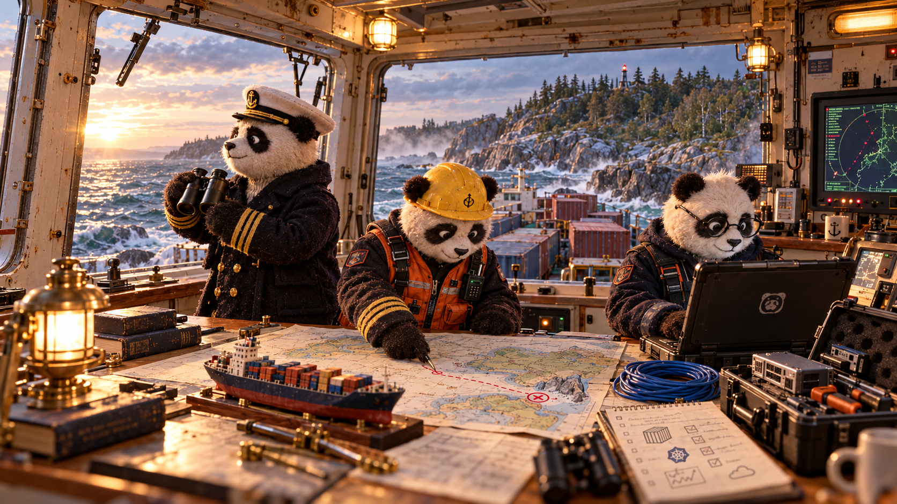

# КуберПанды

Лабораторные работы по контейнеризации и оркестрации (магистратура ИТМО).

## Лабораторные работы

| Работа | Материалы |
| --- | --- |
| 1 — Свой Docker | [lab1-containerization](lab1-containerization/README.md) |
| 2 — Observability | [lab2-observability](lab2-observability/README-lab.md) |
| 3 — Control Plane | [lab3-control-plane](lab3-control-plane/README.md)|
| 4 — Scheduling resources | [lab4-scheduling-resources](lab4-scheduling-resources/README-lab.md) |
| 5 — Zero-trust сеть | [lab5-networking](lab5-networking/README.md) |
| 6 — Service Mesh | 🐸
| 7(8) — AI | [lab8-ai](lab8-ai/panda-release-brief/README.md) |

## Команда

| Участник | Группа |
| --- | --- |
| Ложкин Владислав Сергеевич | K4113c |
| Добрецков Дмитрий Александрович | K4111c |
| Круглов Егор Ильич | K4110c |
