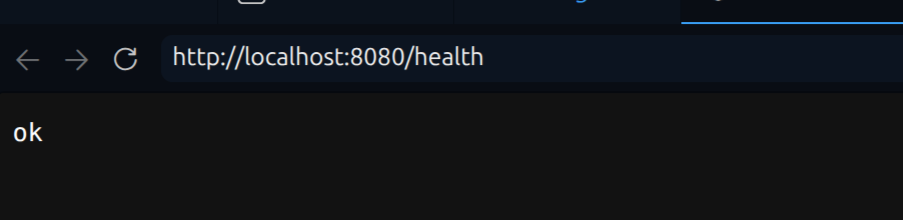

# Лаба 1 — Свой Docker

Команда: **КуберПанды**.

Цель работы — поэтапно собрать собственный механизм запуска изолированного процесса с помощью namespaces, cgroups и ограничения прав, затем сравнить его с Docker.

Структура отчёта:

- **Часть 0** — подопытный сервис PandaRecovery;
- **Часть 1** — запуск без изоляции;
- **Часть 2** — namespaces;
- **Часть 3** — cgroups: память, CPU и количество задач;
- **Часть 4** — capabilities и seccomp;
- **Часть 5** — свой Docker и сравнение с `docker run`;
- **Часть 6** — образы, слои и тома;
- **Часть 7** — дополнительная изоляция с gVisor;
- **Часть 8** — мониторинг и выбор метрик для алертов.

## Часть 0 — Сервис PandaRecovery

Язык сервиса: **Go**, только стандартная библиотека.

По сюжету это первый диагностический сервис на корабельном Linux-сервере.
Пока он предоставляет тестовые маршруты для экспериментов с ресурсами;
взаимодействие с датчиками и контроллерами ещё не реализовано.

| Маршрут | Поведение |
| --- | --- |
| `GET /health` | Возвращает `ok`. |
| `GET /eat?mb=N` | Выделяет и заполняет N МиБ памяти, удерживает её до завершения процесса. Повторные запросы добавляют память. |
| `GET /burn` | Запускает один фоновый CPU worker с бесконечным циклом. Повторные запросы не создают дополнительные worker. |

Сборка из корня репозитория:

```bash
cd lab1-containerization/api
go build -o api .
```

Запуск и проверка:

```bash
./api
```

В другом терминале:

```bash
curl http://localhost:8080/health
```

Адрес по умолчанию — `:8080`; его можно изменить переменной `API_ADDR`.
Нагрузка `/burn` и выделенная через `/eat` память сохраняются до остановки
процесса (`Ctrl+C`). Эти маршруты нужны для последующих проверок лимитов.

## Часть 1 — Запуск без изоляции

Сервис запущен командой `./api`, без добавления собственной изоляции.
На хосте выполнена команда:

```bash
ps -C api -o pid,ppid,user,uid,%cpu,rss,args
```

Полученный результат:

```text
    PID    PPID USER       UID %CPU   RSS COMMAND
  66474   29205 vladisl+  1000  0.0  7872 ./api
```

В этом запуске PID сервиса на хосте — `66474`, родительский PID — `29205`.
Процесс работает с UID `1000` пользователя `vladislav`; поле `USER`
сокращено до `vladisl+` из-за ширины столбца. RSS в момент проверки —
7872 КиБ (около 7,7 МиБ), средняя загрузка CPU — 0,0%.
После перезапуска PID может измениться.

В браузере открыт `http://localhost:8080/health`, получен ответ `ok`.



## Часть 2 — Изоляция через namespaces

Из корня репозитория, без `sudo`, выполнен запуск:

```bash
unshare --user --map-root-user \
  --pid --fork \
  --mount --mount-proc \
  --net --uts --ipc \
  sh -c 'hostname pandarecovery && exec ./lab1-containerization/api/api'
```

| Namespace | Что изолирует |
| --- | --- |
| PID | Нумерацию и видимость процессов. Первый процесс внутри получает PID 1. |
| Mount | Таблицу точек монтирования. `--mount-proc` монтирует `/proc` для нового PID namespace. Сам по себе mount namespace не скрывает файлы хоста. |
| Network | Сетевые интерфейсы, маршруты и сетевой стек, включая порты. |
| UTS | Имя хоста и NIS domain name. |
| IPC | System V IPC и очереди сообщений POSIX. |
| User | Отображение UID/GID и область действия capabilities. Внутренний UID 0 отображён в пользователя, запустившего `unshare`. |

При предварительной проверке в интерактивном `sh` наблюдались:

```text
PID оболочки: 1
uid=0(root) gid=0(root)
hostname: pandarecovery

    PID    PPID USER     COMMAND
      1       0 root     sh
      5       1 root     ps -eo pid,ppid,user,args

1: lo: <LOOPBACK> mtu 65536 qdisc noop state DOWN mode DEFAULT group default qlen 1000
    link/loopback 00:00:00:00:00:00 brd 00:00:00:00:00:00
```

Оболочка видела только процессы своего PID namespace. В новой сети
был только выключенный loopback-интерфейс; интерфейсов хоста не было.
При `exec` интерактивная оболочка завершилась с ошибкой
`Cannot set tty process group (No such process)`. Повторный запуск через
неинтерактивный `sh -c`, приведённый выше, прошёл успешно.

Стартовое сообщение API при успешном запуске:

```text
2026/10/07 00:56:06 PandaRecovery lab API: pid=1 address=:8080
```

Проверка в другом терминале на хосте:

```bash
ps -C api -o pid,ppid,user,uid,args
hostname
```

```text
    PID    PPID USER       UID COMMAND
  26189   26188 vladisl+  1000 ./lab-1/api/api
laptop
```

Таким образом, один процесс имеет PID 1 внутри и PID 26189 на хосте.
Root внутри user namespace не стал root на хосте: снаружи UID равен 1000.
Изменение имени хоста внутри UTS namespace не изменило имя `laptop` снаружи.
Для проверки сервиса из его сети на хосте выполнено:

```bash
sudo nsenter --target 26189 --user --net \
  sh -c 'ip link set lo up && curl --noproxy "*" http://127.0.0.1:8080/health'
```

Получен ответ `ok`. Команда вошла в user и network namespaces API,
включила внутренний loopback и выполнила запрос внутри изолированной сети.
Сеть хоста с этой сетью не соединялась; UID самого API на хосте остался 1000.

## Часть 3 — Ограничение ресурсов через cgroups

### Память и OOM

На хосте обнаружена файловая система `cgroup2fs`. Доступны контроллеры
`cpuset cpu io memory hugetlb pids rdma misc dmem`; в корневом
`cgroup.subtree_control` включены `cpu memory pids`.
До переноса API находился в группе VS Code:

```text
0::/user.slice/user-1000.slice/user@1000.service/app.slice/app-com.microsoft.VSCode-8516.scope
```

Для API создана отдельная группа с лимитом памяти 32 МиБ и запретом swap:

```bash
sudo mkdir /sys/fs/cgroup/pandarecovery-lab1
sudo sh -c '
  echo 33554432 > /sys/fs/cgroup/pandarecovery-lab1/memory.max
  echo 0 > /sys/fs/cgroup/pandarecovery-lab1/memory.swap.max
  echo 26189 > /sys/fs/cgroup/pandarecovery-lab1/cgroup.procs
'
```

После переноса `/proc/26189/cgroup` показал `0::/pandarecovery-lab1`,
а `memory.max` — `33554432`. Исходные счётчики `memory.events` были нулевыми.

Из network namespace сервиса запрошено выделение 64 МиБ:

```bash
sudo nsenter --target 26189 --user --net \
  curl --noproxy "*" --max-time 10 'http://127.0.0.1:8080/eat?mb=64'
```

Запрос завершился ошибкой `curl: (52) Empty reply from server`.
После запроса `memory.events` содержал:

```text
low 0
high 0
max 49
oom 1
oom_kill 1
oom_group_kill 0
sock_throttled 0
```

`cgroup.procs` оказался пустым, а `ps -C api -o pid,uid,args`
вывел только заголовок и завершился с кодом 1: процессов API не осталось.
Рост `oom` и `oom_kill` с 0 до 1 подтверждает OOM и завершение процесса
ядром при невозможности выделить память в пределах лимита.
`max 49` — число событий на границе лимита, а не размер памяти и не число
завершённых процессов. `oom_group_kill 0` означает, что отдельного события
группового OOM-завершения не было.

### CPU и throttling

Для той же группы задана CPU-квота 50 мс на период 100 мс:

```bash
sudo sh -c 'echo "50000 100000" > /sys/fs/cgroup/pandarecovery-lab1/cpu.max'
```

Это бюджет процессорного времени, соответствующий половине одного
логического CPU при постоянной нагрузке, а не привязка к определённому ядру.

После предыдущего OOM API запущен заново из корня репозитория:

```bash
unshare --user --map-root-user \
  --pid --fork \
  --mount --mount-proc \
  --net --uts --ipc \
  sh -c 'hostname pandarecovery && ip link set lo up && exec ./lab1-containerization/api/api'
```

Внутри сервис сообщил PID 1, на хосте получил PID 43347 и UID 1000.
Новый процесс перенесён в группу отдельно:

```bash
sudo sh -c 'echo 43347 > /sys/fs/cgroup/pandarecovery-lab1/cgroup.procs'
```

`/proc/43347/cgroup` подтвердил `0::/pandarecovery-lab1`.
До запуска нагрузки `cpu.stat` содержал:

```text
usage_usec 52299
user_usec 27155
system_usec 25143
nice_usec 0
core_sched.force_idle_usec 0
nr_periods 2
nr_throttled 0
throttled_usec 0
nr_bursts 0
burst_usec 0
```

Нагрузка запущена из сети сервиса:

```bash
sudo nsenter --target 43347 --user --net \
  curl --noproxy "*" http://127.0.0.1:8080/burn
```

Ответ: `one CPU worker running until process exit`.
После запуска нагрузки `cpu.stat` показал:

```text
usage_usec 6102220
user_usec 6054289
system_usec 47931
nice_usec 0
core_sched.force_idle_usec 0
nr_periods 123
nr_throttled 121
throttled_usec 6419813
nr_bursts 0
burst_usec 0
```

Рост `nr_throttled` с 0 до 121 и `throttled_usec` с 0 до 6419813
(около 6,42 с) подтверждает ограничение выполнения после исчерпания квоты.
CPU-время группы выросло примерно на 6,05 с.
В отличие от проверки памяти, исчерпание CPU-квоты приостанавливает
выполнение до пополнения бюджета, а не завершает процесс.

### Количество задач

Для проверки установлен `stress-ng` версии 0.20.01.
До настройки лимита группа содержала 6 задач API, `pids.max` был `max`,
а `pids.events` показывал `max 0`.
Контроллер pids учитывает как процессы, так и потоки.

Для эксперимента лимит памяти увеличен с 32 до 128 МиБ, чтобы проверить
именно ограничение количества задач, без нового OOM. CPU-квота сохранена.
Установлен общий лимит 32 задачи:

```bash
sudo sh -eu -c '
  echo 134217728 > /sys/fs/cgroup/pandarecovery-lab1/memory.max
  echo 32 > /sys/fs/cgroup/pandarecovery-lab1/pids.max
'
```

Проведён ограниченный по времени fork-тест внутри той же cgroup:

```bash
sudo sh -eu -c '
  echo $$ > /sys/fs/cgroup/pandarecovery-lab1/cgroup.procs
  exec runuser -u vladislav -- stress-ng \
    --fork 1 --fork-max 64 \
    --timeout 10s --metrics-brief --no-oom-adjust
'
```

Оболочка перенесла себя в группу, а её потомки унаследовали членство.
`runuser` запустил тест от пользователя `vladislav`. Один fork-worker
пытался создавать до 64 дочерних процессов за итерацию.
`stress-ng` сообщил 2645 bogo ops, `passed: 1: fork (1)`, `failed: 0`
и завершился за 10,00 с. Bogo ops не являются числом одновременно
существующих процессов; сообщение `passed` само по себе не доказывает
срабатывание лимита.

После теста:

```text
pids.current:
6

pids.events:
max 4714

memory.events:
low 0
high 0
max 49
oom 1
oom_kill 1
oom_group_kill 0
sock_throttled 0
```

Рост `max` в `pids.events` с 0 до 4714 подтверждает отказы создания задач
из-за лимита pids. После завершения теста осталось 6 задач API.
Счётчики памяти не изменились: нового OOM не было.
Достижение `pids.max` запрещает создание новых задач, но само по себе
не завершает уже существующие процессы.

## Часть 4 — Ограничение прав

### Проверка capabilities

Исходные capabilities основного потока API (PID 43347 на хосте)
прочитаны через `sudo grep '^Cap' /proc/43347/status`:

```text
CapInh: 0000000000000000
CapPrm: 000001ffffffffff
CapEff: 000001ffffffffff
CapBnd: 000001ffffffffff
CapAmb: 0000000000000000
```

Внутри user и network namespaces API проверена операция,
требующая `CAP_NET_ADMIN`: изменение MTU loopback-интерфейса.
С capability операция прошла успешно; исходный MTU затем восстановлен:

```bash
sudo nsenter --target 43347 --user --net sh -eu -c '
  ip link set lo mtu 60000
  ip link show lo
  ip link set lo mtu 65536
'
```

В выводе наблюдался `lo` со значением `mtu 60000`.
В отдельной проверочной оболочке capability исключена из bounding set
перед запуском новой программы:

```bash
sudo nsenter --target 43347 --user --net \
  capsh --drop=cap_net_admin -- -c '
    id
    capsh --print
    ip link set lo mtu 60000
  '
```

Результат:

```text
uid=0(root) gid=0(root) groups=0(root)
Current: =ep cap_net_admin-ep
Current IAB: !cap_net_admin
RTNETLINK answers: Operation not permitted
```

Команда завершилась с кодом 2. UID 0 сохранился, но операция запрещена:
для управления сетевыми настройками требуется соответствующая capability.
Проверка ограничила новую оболочку; capabilities работающего API
этими командами не изменялись.

### Запуск API без capabilities

Предыдущий API остановлен командой `kill -TERM 43347`.
Новый запуск выполнен из корня репозитория:

```bash
unshare --user --map-root-user \
  --pid --fork \
  --mount --mount-proc \
  --net --uts --ipc \
  sh -eu -c '
    hostname pandarecovery
    ip link set lo up
    exec capsh --drop=all -- -c "exec ./lab1-containerization/api/api"
  '
```

Окружение настроено до сброса capabilities. После исключения всех
capabilities из bounding set через `capsh --drop=all` и запуска следующей
программы API работает без capabilities. На хосте новый PID — 68024,
UID — 1000. Проверка `sudo grep '^Cap' /proc/68024/status` показала:

```text
CapInh: 0000000000000000
CapPrm: 0000000000000000
CapEff: 0000000000000000
CapBnd: 0000000000000000
CapAmb: 0000000000000000
```

Новый процесс отдельно перенесён в существующую cgroup:

```bash
sudo sh -c 'echo 68024 > /sys/fs/cgroup/pandarecovery-lab1/cgroup.procs'
cat /proc/68024/cgroup
```

Получено `0::/pandarecovery-lab1`.
Запрос из сети API:

```bash
sudo nsenter --target 68024 --user --net \
  curl --noproxy "*" --max-time 5 http://127.0.0.1:8080/health
```

Ответ — `ok`: для текущей функциональности API capabilities не требуются.
Проверочный процесс `nsenter` не изменяет наборы capabilities API.

### Seccomp

Установлен пакет `libseccomp-dev`; `pkg-config --modversion libseccomp`
показал версию 2.6.0.

Добавлен launcher `seccomp-run.c` и учебный профиль `seccomp-deny.txt`.
Формат профиля — имена запрещённых системных вызовов, разделённые пробелами
или переводами строк, без комментариев. Сейчас в нём только `uname`.
Это формат нашего launcher, а не JSON-профиль Docker.

Сборка из корня репозитория:

```bash
gcc -Wall -Wextra -Werror -O2 lab1-containerization/seccomp-run.c -o lab1-containerization/seccomp-run -lseccomp
```

Launcher разрешает остальные вызовы (`SCMP_ACT_ALLOW`), а для перечисленных
возвращает `EPERM`. Он устанавливает `no_new_privs`, загружает фильтр в ядро
и заменяется указанной программой через `execvp`.
Фильтр и `no_new_privs` сохраняются при `exec` и наследуются потомками.
Запрет `uname` выбран для наблюдаемого эксперимента; этот профиль не является
полным набором ограничений для защиты сервиса.

После сборки выполнено сравнение одного и того же вызова без фильтра
и под фильтром:

```bash
python3 -c 'import os; print(os.uname())'
./lab1-containerization/seccomp-run lab1-containerization/seccomp-deny.txt \
  python3 -c 'import os; print(os.uname())'
```

Обычный запуск вернул сведения о системе:

```text
posix.uname_result(sysname='Linux', nodename='laptop', release='7.0.0-34-generic', version='#34-UbuntuSMP PREEMPT_DYNAMIC Wed Sep  2 14:29:37 UTC 2026', machine='x86_64')
```

Запуск под фильтром завершился с кодом 1 и ошибкой:

```text
PermissionError: [Errno 1] Operation not permitted
```

Это подтверждает отказ системного вызова `uname` под установленным фильтром.
API перезапущен из корня репозитория с тем же профилем и без capabilities:

```bash
unshare --user --map-root-user \
  --pid --fork \
  --mount --mount-proc \
  --net --uts --ipc \
  sh -eu -c '
    hostname pandarecovery
    ip link set lo up
    exec capsh --drop=all -- -c "
      exec ./lab1-containerization/seccomp-run ./lab1-containerization/seccomp-deny.txt ./lab1-containerization/api/api
    "
  '
```

На хосте API получил PID 79622 и UID 1000.
Проверка `sudo grep -E '^(Cap|NoNewPrivs|Seccomp)' /proc/79622/status`
показала:

```text
CapInh: 0000000000000000
CapPrm: 0000000000000000
CapEff: 0000000000000000
CapBnd: 0000000000000000
CapAmb: 0000000000000000
NoNewPrivs:     1
Seccomp:        2
Seccomp_filters:        1
```

Все наборы capabilities пусты, установлен `no_new_privs`, активен режим
seccomp-фильтрации с одним фильтром. Сами поля `Seccomp` не описывают
правила фильтра: запрет `uname` отдельно проверен сравнением выше.

Новый процесс перенесён в cgroup, затем выполнен запрос из его сети:

```bash
sudo sh -c 'echo 79622 > /sys/fs/cgroup/pandarecovery-lab1/cgroup.procs'
cat /proc/79622/cgroup
sudo nsenter --target 79622 --user --net \
  curl --noproxy "*" --max-time 5 http://127.0.0.1:8080/health
```

Получены `0::/pandarecovery-lab1` и ответ `ok`. Таким образом, текущая
функциональность сервиса работает одновременно с namespaces, cgroup-лимитами,
нулевыми capabilities и seccomp-фильтром.

## Часть 5 — Свой Docker

### Единый запуск через mydocker.sh

В `mydocker.sh` собраны проверенные команды из частей 2–4.
Скрипт запускается обычным пользователем; `sudo` используется только
для создания cgroup, настройки лимитов и переноса процесса запуска.
Это сохраняет отображение внутреннего root в непривилегированного
пользователя хоста.

Подготовка бинарных файлов из корня репозитория, если они ещё не собраны:

```bash
(cd lab1-containerization/api && go build -o api .)
gcc -Wall -Wextra -Werror -O2 lab1-containerization/seccomp-run.c -o lab1-containerization/seccomp-run -lseccomp
```

Запуск из корня репозитория:

```bash
./lab1-containerization/mydocker.sh
```

Порядок действий:

1. Создаётся новая cgroup `/sys/fs/cgroup/pandarecovery-<PID скрипта>`.
2. Устанавливаются лимиты: 128 МиБ памяти, запрет swap, 50 мс CPU
   на период 100 мс, 32 задачи.
3. Процесс скрипта переносится в группу. Запускаемые затем процессы
   наследуют её; API получает ограничения с начала выполнения.
4. Создаются шесть namespaces, задаётся hostname, включается loopback.
5. Сбрасываются все capabilities, устанавливаются `no_new_privs`
   и seccomp-фильтр, запускается API с PID 1 внутри.

API и ожидающий его процесс `unshare` входят в общий бюджет cgroup.
`--kill-child` завершает дочерний процесс при завершении `unshare`.
Для остановки запуска используется `Ctrl+C`.
В этой учебной версии пустая cgroup остаётся после остановки.
Удалить её можно командой `sudo rmdir` с точным путём, напечатанным
скриптом, после завершения всех процессов группы.

Проверка синтаксиса скрипта выполнена. При запуске 22 октября получено:

```text
Cgroup: /sys/fs/cgroup/pandarecovery-73877
Лимиты: 128 МиБ RAM, без swap, 0.5 CPU, 32 задачи.
2026/10/22 03:33:06 PandaRecovery lab API: pid=1 address=:8080
```

На хосте API получил PID 73928, PPID 73877 и UID 1000.
Проверки выполнены командами:

```bash
cat /proc/73928/cgroup
sudo grep -E '^(Cap|NoNewPrivs|Seccomp)' /proc/73928/status
cat /sys/fs/cgroup/pandarecovery-73877/memory.max
cat /sys/fs/cgroup/pandarecovery-73877/memory.swap.max
cat /sys/fs/cgroup/pandarecovery-73877/cpu.max
cat /sys/fs/cgroup/pandarecovery-73877/pids.max
```

Результат:

```text
0::/pandarecovery-73877
CapInh: 0000000000000000
CapPrm: 0000000000000000
CapEff: 0000000000000000
CapBnd: 0000000000000000
CapAmb: 0000000000000000
NoNewPrivs:     1
Seccomp:        2
Seccomp_filters:        1
134217728
0
50000 100000
32
```

Запрос `/health` из сети API:

```bash
sudo nsenter --target 73928 --user --net \
  curl --noproxy "*" --max-time 5 http://127.0.0.1:8080/health
```

Получен ответ `ok`. Единый запуск применяет ожидаемые лимиты и ограничения
прав; API работает в созданном окружении.
Результаты сравнения с Docker приведены ниже.

### Сравнение с Docker

По выводу `docker version` клиент Docker имеет версию 29.8.1,
сервер Engine — 29.9.2, Docker Desktop — 4.96.1. Используется контекст
`desktop-linux`. В `SecurityOptions` указаны встроенный seccomp-профиль
и cgroup namespace; режим rootless в списке не указан.

Docker Desktop на Linux запускает Engine и контейнеры в отдельной VM
([документация](https://docs.docker.com/desktop/setup/install/linux/)).
Наш `mydocker.sh` работает непосредственно на Linux-хосте, поэтому PID
контейнера, возвращаемый Docker Engine, относится к VM, а не к пространству
процессов ноутбука. Это различие окружений нужно учитывать при сравнении.

В `api/Dockerfile` добавлен простой одноэтапный образ на базе
`golang:1.27.3-bookworm`. Внутри копируются исходники и собирается API;
компилятор и исходники пока остаются в конечном образе.
При переходе к части 6 этот вариант сохранён как `api/Dockerfile.baseline`,
а основной `api/Dockerfile` заменён multi-stage-вариантом.
`CGO_ENABLED=0` отключает cgo при сборке.
`EXPOSE 8080` описывает порт сервиса, но не публикует его на хосте.
`CMD` запускает бинарный файл напрямую, без промежуточной оболочки.
Файл `.dockerignore` исключает локальный бинарный файл из контекста сборки.

Воспроизведение сборки базового варианта из корня репозитория:

```bash
docker build -f lab1-containerization/api/Dockerfile.baseline -t pandarecovery:baseline lab1-containerization/api
```

Сборка успешно завершена. Базовый образ разрешён в digest
`sha256:972b4110ba0f47539a975c31e52c64765e1ff19f2d74469ae4a595c6676e80a5`.

Контейнер запущен с сопоставимыми лимитами:

```bash
docker run -d \
  --name pandarecovery-docker \
  --hostname pandarecovery \
  --memory 128m \
  --memory-swap 128m \
  --cpus 0.5 \
  --pids-limit 32 \
  --cap-drop ALL \
  --security-opt no-new-privileges=true \
  -p 127.0.0.1:8081:8080 \
  pandarecovery:baseline
```

Создан контейнер `ab70f29a34a3aa18cc31425c5354619a79d8fb9dd3c67376664a52957d22f399`.
Параметр `--memory-swap` задаёт общий бюджет RAM и swap; равенство
с `--memory` запрещает swap. Порт опубликован только на loopback хоста.

```bash
docker logs pandarecovery-docker
curl --noproxy "*" --max-time 5 http://127.0.0.1:8081/health
```

Лог API содержит `pid=1 address=:8080`, HTTP-запрос вернул `ok`.
Права API и лимиты проверены внутри контейнера:

```bash
docker exec pandarecovery-docker sh -c '
  id
  hostname
  grep -E "^(Name|Pid|Uid|Cap|NoNewPrivs|Seccomp)" /proc/1/status
  for name in memory.max memory.swap.max cpu.max pids.max; do
    printf "%s: " "$name"
    cat "/sys/fs/cgroup/$name"
  done
  uname -s
'
```

Результат:

```text
uid=0(root) gid=0(root) groups=0(root)
pandarecovery
Name:   api
Pid:    1
Uid:    0       0       0       0
CapInh: 0000000000000000
CapPrm: 0000000000000000
CapEff: 0000000000000000
CapBnd: 0000000000000000
CapAmb: 0000000000000000
NoNewPrivs:     1
Seccomp:        2
Seccomp_filters:        1
memory.max: 134217728
memory.swap.max: 0
cpu.max: 50000 100000
pids.max: 32
Linux
```

Поля `/proc/1/status` относятся к API, а `id` и `uname` выполнены отдельным
процессом `docker exec`. Команда `uname` проходит под конфигурацией Docker;
наш учебный профиль этот вызов запрещает. Одинаковые поля `Seccomp: 2`
и `Seccomp_filters: 1` говорят о режиме и количестве фильтров, а не о
совпадении правил.

| Свойство | `mydocker.sh` | Проверенный запуск Docker |
| --- | --- | --- |
| Где работает процесс | Linux-хост ноутбука | VM Docker Desktop |
| API внутри PID namespace | PID 1 | PID 1 |
| Hostname | `pandarecovery` | `pandarecovery` |
| Память и swap | 128 МиБ, swap запрещён | Те же значения в cgroup |
| CPU | Квота 50000 мкс на период 100000 мкс | Та же квота |
| Количество задач | 32; бюджет включает `unshare` и API | Лимит 32 внутри контейнера |
| Capabilities API | Все наборы пусты | Все наборы пусты благодаря `--cap-drop ALL` |
| `no_new_privs` | 1, выставлен launcher | 1, задан параметром запуска |
| Seccomp | Наш профиль запрещает `uname`, остальные вызовы разрешены | Встроенный профиль Docker; проверочный `uname` проходит |
| Сеть | Только внутренний loopback, проверка через `nsenter` | Сеть Docker и публикация `127.0.0.1:8081` |
| Корневая файловая система | Наследуется файловая система хоста; отдельный mount namespace не создаёт новый корень | Корневая файловая система из образа и записываемый слой контейнера |
| Пользователь | UID 0 внутри отображён в UID 1000 хоста | Внутри UID 0; аналогичное отображение в UID 1000 параметрами запуска не задавалось |
| Жизненный цикл и вывод | Терминал, `Ctrl+C`; пустая cgroup удаляется вручную | Фоновый запуск, `docker logs`, `docker stop`, `docker rm` |

Внешний UID процесса Docker нельзя установить по внутреннему UID 0:
Docker Desktop использует VM и собственные механизмы изоляции.
Показанные данные не означают, что процесс является root непосредственно
на ноутбуке.

Скрипт воспроизводит основные механизмы ограничения процесса. Docker
дополнительно управляет образами и слоями файловой системы, сетями,
публикацией портов, метаданными и жизненным циклом контейнеров.
Наш скрипт пока использует файловую систему и утилиты хоста и требует
ручного удаления пустой cgroup. Лимиты и политики прав в Docker не
предполагаются равными нашим автоматически: для сравнения они заданы
параметрами запуска, а seccomp-профили намеренно различаются.

## Часть 6 — Образы и хранение данных

### Multi-stage-сборка

Для сравнения сохранены два Dockerfile:

- `api/Dockerfile.baseline` — исходная одноэтапная сборка с Go и исходниками.
- `api/Dockerfile` — multi-stage-сборка с конечной базой `scratch`.

Первый этап `build` собирает API так же, как базовый вариант.
Второй `FROM` начинает новую стадию с пустой файловой системой `scratch`.
`COPY --from=build /app/api ./api` переносит только готовый бинарный файл.
Компилятор, исходники и кэш сборки остаются на первом этапе и не входят
в конечный образ. Сборка с `CGO_ENABLED=0` позволяет запустить этот API
без динамических библиотек C. В конечный образ не добавляются оболочка
и диагностические утилиты.

Сборка из корня репозитория:

```bash
docker build -t pandarecovery:small lab1-containerization/api
```

Первая сборка multi-stage-варианта завершилась за 4,6 с. Этапы `WORKDIR`,
`COPY go.mod main.go ./` и `RUN CGO_ENABLED=0 go build -o api .` стадии
`build` уже использовали кэш предшествующей базовой сборки. Поэтому разницу
во времени с первой базовой сборкой нельзя приписывать только multi-stage:
базовые слои уже были скачаны, а компиляция не выполнялась повторно.

Минимальный образ запущен с теми же ресурсными лимитами и ограничениями прав:

```bash
docker run -d \
  --name pandarecovery-small \
  --memory 128m --memory-swap 128m \
  --cpus 0.5 --pids-limit 32 \
  --cap-drop ALL \
  --security-opt no-new-privileges=true \
  -p 127.0.0.1:8082:8080 \
  pandarecovery:small

docker logs pandarecovery-small
curl --noproxy "*" --max-time 5 http://127.0.0.1:8082/health
```

Создан контейнер `2c593354a53ed778cd239744658ce184519a290bd7a0710266751f7c76bc979f`.
API сообщил `pid=1 address=:8080`, запрос вернул `ok`.

Сравнение образов:

```bash
docker image inspect pandarecovery:baseline pandarecovery:small \
  --format '{{json .RepoTags}} size={{.Size}} bytes layers={{len .RootFS.Layers}}'
```

| Образ | Размер, байт (`Size`) | Размер, МиБ | Файловые слои |
| --- | --- | --- | --- |
| `pandarecovery:baseline` | 1369168698 | 1305,74 | 10 |
| `pandarecovery:small` | 13552948 | 12,93 | 2 |

Размер минимального образа примерно в 101,02 раза меньше (снижение на
99,01%). Это сравнение поля `Size` образов, а не фактически освобождённого
места на диске: хранение может использовать общие слои и сжатие.
Слои первого этапа multi-stage-сборки не входят в конечный образ `small`.
Число файловых слоёв не равно числу инструкций Dockerfile: `CMD` и `EXPOSE`
меняют конфигурацию образа, не добавляя файлового содержимого.

Повторная сборка без изменений:

```bash
docker build --progress=plain -t pandarecovery:small lab1-containerization/api
```

В логе помечены `CACHED`:

- `WORKDIR /app` стадии `build`;
- `COPY go.mod main.go ./`;
- `RUN CGO_ENABLED=0 go build -o api .`;
- `COPY --from=build /app/api ./api` конечной стадии.

Второй этап `WORKDIR /app` отмечен `DONE 0.0s`, а не `CACHED`.
Базовый образ разрешён без повторной загрузки слоёв; проверка его метаданных
заняла 1,7 с. Экспорт слоёв завершился без их повторного создания.
Манифест и конфигурация конечного образа сохранили свои digest;
attestation и manifest list получили новые digest. Это не означает,
что компиляция выполнялась повторно.

### Записываемый слой и том

Для файлового эксперимента использован образ `pandarecovery:baseline`,
где доступны оболочка, `cat` и `ls`. В образе `small` на базе `scratch`
этих утилит нет. Механизмы записываемого слоя и томов применимы к обоим.

Сначала создан отдельный контейнер без тома, в него записан файл:

```bash
docker run -d --name panda-file-test --network none pandarecovery:baseline
docker exec panda-file-test sh -c \
  'printf "plan-v1\n" > /app/plan.txt && cat /app/plan.txt'
```

Первое чтение вернуло `plan-v1`. Затем контейнер остановлен, удалён
и создан заново из того же образа:

```bash
docker stop panda-file-test
docker rm panda-file-test
docker run -d --name panda-file-test --network none pandarecovery:baseline
docker exec panda-file-test ls -l /app/plan.txt
```

Получен результат:

```text
ls: cannot access '/app/plan.txt': No such file or directory
```

Последняя команда завершилась с кодом 2. Старый контейнер имел ID
`389941db7ef96baa2a991031a6bd051fbc55c2189fa5e782188b61d5ab700d75`,
новый — `d401ee7a461fb8ca6dc4c9a79b0d5cbc6fa0621628f3a834776dda6f74e68091`.
Файл находился в записываемом слое старого контейнера, который удалён
вместе с ним. Образ от записи файла не изменился. Обычная остановка
и последующий запуск того же контейнера сохраняют его записываемый слой.

Затем опыт повторён с именованным томом:

```bash
docker volume create panda-plan-data
docker run -d --name panda-volume-test --network none \
  --mount type=volume,src=panda-plan-data,dst=/data \
  pandarecovery:baseline
docker exec panda-volume-test sh -c \
  'printf "plan-v1\n" > /data/plan.txt && cat /data/plan.txt'
```

Первое чтение вернуло `plan-v1`. Контейнер пересоздан с тем же томом:

```bash
docker stop panda-volume-test
docker rm panda-volume-test
docker run -d --name panda-volume-test --network none \
  --mount type=volume,src=panda-plan-data,dst=/data \
  pandarecovery:baseline
docker exec panda-volume-test cat /data/plan.txt
```

Результат — `plan-v1`. ID контейнера изменился с
`87d9e4d7d1978e5073019bec9edc4e3def7a5f7b32011333b06e7be1f87ec353`
на `05f09317d774989ece2be49274c9d40bd16d4d4b4e8a5f78af49965b6c0da2b2`.
Файл сохранился, поскольку лежал в томе `panda-plan-data`, а не в
записываемом слое удалённого контейнера.

| Место хранения файла | После пересоздания контейнера |
| --- | --- |
| Записываемый слой (`/app/plan.txt`) | Файла нет |
| Тот же именованный том (`/data/plan.txt`) | Файл сохранился |

В Docker Desktop том управляется Docker Engine внутри VM. В эксперименте
том не удалялся; повторный контейнер явно подключил тот же именованный том.

`docker volume create panda-plan-data` создаёт именованный объект хранения,
управляемый Docker. При используемом локальном драйвере данные размещаются
в каталоге на машине Docker Engine — здесь внутри VM Docker Desktop.
Это не обязательный отдельный диск и не каталог внутри образа.
Параметр `--mount type=volume,src=panda-plan-data,dst=/data` подключает
содержимое тома в `/data` контейнера. Запись в `/data/plan.txt` идёт в том,
а не в записываемый слой контейнера. При пересоздании подключается то же
хранилище, без необходимости копировать файл заново.

Именованный том также может автоматически создаваться при `docker run`,
если указанное имя ещё не существует. В эксперименте он создан явно,
чтобы отделить создание хранилища от его подключения.
Сведения о нём можно посмотреть через `docker volume inspect panda-plan-data`.
Подробнее: [тома Docker](https://docs.docker.com/engine/storage/volumes/).

## Часть 7 — Дополнительная изоляция с gVisor

### Подготовка Docker Engine на хосте

В Docker Desktop обнаружены только runtime `io.containerd.runc.v2` и `runc`.
На Linux-хосте исходно отсутствовали `dockerd`, `runsc`, служба Docker
и сокет `/var/run/docker.sock`. Для эксперимента с gVisor установлен
отдельный Docker Engine из официального apt-репозитория для Ubuntu 26.04
(`resolute`). Ранее установленный CLI был из пакета для `noble`,
а соответствующий старый репозиторий был отключён.

После установки и запуска службы выполнено:

```bash
sudo systemctl start docker
sudo docker --context default version
```

Проверены версии: клиент и сервер Docker Engine 29.9.2, API 1.56,
containerd v2.4.2, runc 1.5.2, docker-init 0.19.0; платформа `linux/amd64`.
Для дальнейшего опыта используется явно указанный контекст `default`.
Он обращается к Engine на хосте; контекст `desktop-linux` относится
к отдельному Engine внутри Docker Desktop. Их образы, контейнеры и тома
хранятся независимо.

Из официального apt-репозитория gVisor установлен пакет `runsc`
версии 20261019.0. Команда `runsc --version` показала:

```text
runsc version release-20261019.0
spec: 1.2.1
```

После установки пакета runtime автоматически не появился в конфигурации
локального Engine. Выполнена явная регистрация и перезапуск службы:

```bash
sudo runsc install
sudo systemctl restart docker
sudo docker --context default info \
  --format '{{range $name, $runtime := .Runtimes}}{{println $name}}{{end}}'
```

Команда установки сообщила `Runtime runsc not found: adding`
и `Successfully updated config.`. После перезапуска в списке доступны:

```text
io.containerd.runc.v2
runc
runsc
```

### Запуск API под gVisor

Тот же минимальный образ перенесён из Docker Desktop в Engine хоста:

```bash
docker --context desktop-linux image save pandarecovery:small |
  sudo docker --context default image load
```

Получено `Loaded image: pandarecovery:small`. Перенос выполнен без
пересборки, поэтому сравнивается та же программа и файловая система образа.

```bash
sudo docker --context default run -d \
  --runtime=runsc \
  --name pandarecovery-gvisor \
  --cap-drop ALL \
  --security-opt no-new-privileges=true \
  -p 127.0.0.1:8083:8080 \
  pandarecovery:small
```

Создан контейнер `3458fe4c3907d94282e7e17e1bfe2e392a66da7b05339c0304795799ce6131fa`.
Для первого запуска проверяется совместимость приложения с runtime;
ресурсные лимиты в этой команде отдельно не заданы.

```bash
sudo docker --context default logs pandarecovery-gvisor
curl --noproxy "*" --max-time 5 http://127.0.0.1:8083/health
sudo docker --context default inspect pandarecovery-gvisor \
  --format 'runtime={{.HostConfig.Runtime}} running={{.State.Running}}'
```

API сообщил `pid=1 address=:8080`, HTTP-запрос вернул `ok`,
Docker подтвердил `runtime=runsc running=true`.
Сервис успешно запускается под gVisor. Проверка запуска сама по себе
не измеряет степень защищённости или производительность.

### Сравнение gVisor, runc и своего запуска

Для сравнения на том же Engine хоста запущен тот же минимальный образ
через обычный `runc`, с такими же параметрами прав и без отдельных
ресурсных лимитов, как в проверочном запуске gVisor:

```bash
sudo docker --context default run -d \
  --runtime=runc \
  --name pandarecovery-runc \
  --cap-drop ALL \
  --security-opt no-new-privileges=true \
  -p 127.0.0.1:8084:8080 \
  pandarecovery:small
curl --noproxy "*" --max-time 5 http://127.0.0.1:8084/health
```

Ответ — `ok`. Для обоих контейнеров прочитаны runtime и PID:

```bash
sudo docker --context default inspect \
  pandarecovery-runc pandarecovery-gvisor \
  --format '{{.Name}} runtime={{.HostConfig.Runtime}} host_pid={{.State.Pid}}'
```

```text
/pandarecovery-runc runtime=runc host_pid=71446
/pandarecovery-gvisor runtime=runsc host_pid=68949
```

Проверка процессов на хосте:

```bash
sudo ps -p 71446,68949 -o pid,ppid,user,comm
sudo readlink /proc/71446/exe
sudo readlink /proc/68949/exe
```

```text
    PID    PPID USER     COMMAND
  68949   68918 root     gvisor_sentry
  71446   71421 root     api

/app/api
/usr/bin/gvisor-bin/gvisor_sentry
```

У обычного контейнера Docker показывает непосредственно процесс API.
У gVisor основной PID на стороне хоста принадлежит Sentry — пользовательскому
ядру, реализующему Linux-интерфейс для приложения. Оба контейнера работают
на одном Linux-хосте, поэтому это сравнение не смешивает Docker Desktop VM
и непосредственный запуск на ноутбуке.

| Свойство | `mydocker.sh` | Docker с `runc` на хосте | Docker с `runsc` на хосте |
| --- | --- | --- | --- |
| Обработка системных вызовов API | Ядро Linux хоста, с нашим seccomp-фильтром | Ядро Linux хоста, со встроенной политикой Docker | Пользовательское ядро Sentry; оно взаимодействует с Linux через ограниченный интерфейс |
| Основной наблюдаемый процесс | API | API (`/app/api`) | Sentry (`gvisor_sentry`) |
| Файловая система приложения | Файлы хоста, отдельный mount namespace | Корень из образа `small` | Тот же образ `small`, доступ к ресурсам через механизмы gVisor |
| Ограничения окружения | Namespaces, cgroups, capabilities, seccomp настроены скриптом | Настройка окружения и жизненного цикла через Docker | Docker управляет контейнером; runsc добавляет границу пользовательского ядра |
| Проверенный HTTP-ответ | `ok` | `ok` на порту 8084 | `ok` на порту 8083 |

У обычного контейнера с хостом остаётся общим ядро Linux. Namespaces
ограничивают видимость ресурсов, cgroups — их потребление, capabilities
и seccomp — разрешённые действия и вызовы. Однако разрешённые системные
вызовы всё равно обрабатывает общее ядро. Уязвимость в доступном интерфейсе
этого ядра потенциально позволяет преодолеть границу контейнера.
Отдельный образ не содержит отдельного работающего ядра ОС.

gVisor реализует системный интерфейс приложения в Sentry. Вызовы приложения
обрабатываются этим пользовательским ядром; они не перенаправляются
один к одному как произвольные вызовы Linux хоста. Для собственной работы
Sentry использует ограниченный набор интерфейсов хоста и дополнительные
механизмы изоляции. Это уменьшает прямую поверхность атаки на ядро хоста
и создаёт дополнительную границу, которую нужно преодолеть для выхода
из окружения. gVisor при этом продолжает зависеть от Linux-хоста;
его изоляция не означает отсутствие любых возможных уязвимостей.

Дополнительная обработка вызовов может создавать накладные расходы,
а поддержка Linux-интерфейсов имеет ограничения совместимости.
В этой работе подтверждён запуск нашего API; измерение производительности
и испытания других приложений не выполнялись.
Архитектурные выводы опираются на [описание устройства gVisor](https://gvisor.dev/docs/architecture_guide/intro/)
и [его модель безопасности](https://gvisor.dev/docs/architecture_guide/security/).

## Часть 8 — Мониторинг

### Стек мониторинга и дашборд

По договорённости стек мониторинга опирается на
[lab2-observability](https://github.com/Owl876/containerization-and-orchestration-labs/tree/main/lab2-observability).
При изучении использована версия ветки `main` с commit
`836f9ed42c41dcca836b55ce7d8009ddc79fe24e`.

Изучены `README-lab.md`, настройки `observability/kube-prometheus-stack-values.yaml`,
шаблоны `ServiceMonitor`, `PrometheusRule`, ConfigMap дашборда
и параметры Helm-чарта `panda-api`.
В лабораторной 2 используются minikube и Helm-релиз `kube-prometheus-stack`
в namespace `monitoring`: Prometheus, Grafana и Alertmanager.
Дашборды подхватываются через ConfigMap с лейблом `grafana_dashboard: "1"`;
в values включён поиск по всем namespace и сняты фильтры по Helm release
для ServiceMonitor/PodMonitor и правил.

Существующий дашборд lab2 показывает RED-метрики Python-сервиса `panda-api`.
В части 8 первой лабы нужны ресурсные метрики нашего Go API: память, CPU
и throttling. Поэтому переиспользуется подход и стек, а панели и правила
должны быть адаптированы к ресурсным метрикам.

API первой лабы работает вне Kubernetes, на Engine Linux-хоста или
через `mydocker.sh`. Метрики pod-ов minikube сами по себе не являются
метриками этого процесса. Источник cgroup-метрик должен наблюдать именно
Linux-хост с нашим API; затем Prometheus должен получать данные этого
источника. Возможный источник — cAdvisor на хосте.

Настройки уведомлений Telegram, прокси, Loki и Jaeger в исходной lab2
относятся к её окружению; для ресурсного мониторинга первой лабы
не требуется переносить их целиком. Уведомления внешним получателям
в рамках подготовки этой части не настраивались.
Существующий стек lab2 работает на другом ноутбуке команды. Для этой
работы выбран отдельный локальный стенд с тем же подходом к развёртыванию:
minikube с Docker driver и Helm-релиз `kube-prometheus-stack`.
Кластер запущен на Engine Linux-хоста (контекст `default`), чтобы сбор
ресурсных метрик относился к той же машине, где работает API.
При первоначальной проверке была найдена команда `kubectl` из Snap;
`minikube` и `helm` отсутствовали.

Установлен Minikube v1.39.0, commit
`7a9f6a841470a207de8cf4bafcccee0969d8ba10`.
После добавления пользователя в группу `docker` и открытия оболочки
через `newgrp docker` проверка локального Engine без `sudo` вернула
`Server=29.9.2`.

Кластер создан командой:

```bash
DOCKER_CONTEXT=default minikube start \
  -p panda-monitoring \
  --driver=docker \
  --container-runtime=containerd \
  --cpus=4 \
  --memory=6144 \
  --disk-size=20g
```

Подготовлены Kubernetes v1.37.0 и containerd 2.3.4.
Включены `storage-provisioner` и `default-storageclass`.
Сначала нода была `NotReady` во время инициализации; последующая проверка
готовности прошла успешно:

```bash
DOCKER_CONTEXT=default minikube -p panda-monitoring status
DOCKER_CONTEXT=default minikube -p panda-monitoring kubectl -- \
  wait --for=condition=Ready node/panda-monitoring --timeout=120s
DOCKER_CONTEXT=default minikube -p panda-monitoring kubectl -- get nodes
```

`host`, `kubelet` и `apiserver` получили статус `Running`, kubeconfig —
`Configured`; нода `panda-monitoring` — `Ready`.
Snap-клиент kubectl имеет версию 1.35.9, поэтому используется совместимый
клиент v1.37.0, который Minikube скачал с проверкой контрольной суммы.

Для команд Minikube требуется явно выбирать Engine хоста: без переменной
окружения проверка обратилась к Docker Desktop и не нашла контейнер ноды.
С `DOCKER_CONTEXT=default` проверки работали, но Minikube предупреждал
об отсутствии `meta.json` контекста. Создан явный именованный контекст:

```bash
docker context create panda-host \
  --docker host=unix:///var/run/docker.sock
DOCKER_CONTEXT=panda-host minikube -p panda-monitoring status
```

Проверка через `panda-host` прошла без предупреждения, компоненты остались
`Running`. Этот Docker-контекст указывает на тот же локальный Engine;
Kubernetes-контекст кластера называется `panda-monitoring`.

Из официального архива установлен Helm v4.3.1+gc0d08d0.
SHA256 скачанного Linux amd64 архива
`0403a88ae20913d11b10a2467b50087721fea7581736da6b9d3992f5357fe54b`
совпал с опубликованным в релизе; проверка вернула `OK`.

Для стека подготовлен файл
`monitoring/kube-prometheus-stack-values.yaml`, адаптированный из lab2.
Сохранены настройки выбора мониторов и правил, поиск дашбордов по всем
namespace и отключение недоступных в minikube control-plane targets.
Prometheus собирает данные каждые 15 с; задано хранение до 24 часов
с ограничением размера TSDB 1GB. Для основных компонентов заданы
requests/limits под локальный кластер. Alertmanager использует только
receiver `null`; внешние уведомления не настроены.
Grafana получает сгенерированный чартом пароль в Secret.

Закреплена версия Helm-чарта `kube-prometheus-stack` 92.11.0.
До установки выполнены `helm lint` и локальный `helm template` с
`--kube-version 1.37.0`; обе проверки прошли. В отрендерованных ресурсах
дополнительно проверены селекторы мониторов/правил, интервал сбора,
настройки хранения, receiver Alertmanager и сервисы трёх UI.
Стек установлен в Kubernetes-контекст `panda-monitoring`, namespace
`monitoring`; Helm сообщил `STATUS: deployed`, revision 1.
В первом списке подов Grafana, Alertmanager, Operator, kube-state-metrics
и node-exporter находились в `Running` со всеми контейнерами `Ready`.
Prometheus сначала находился в `Running` с готовностью `1/2`.
Последующая проверка `kubectl wait --for=condition=Ready` для его пода
вернула `condition met`; готовность подтверждена. Доступ к UI Prometheus
подтверждён скриншотами ниже; UI Grafana и свой дашборд проверены
скриншотом 25 после устранения первоначального OOM.
Сбор памяти, CPU и throttling API с хоста подтверждён ниже.
Настройки CPU/RAM и установившееся потребление CPU подтверждены ниже.
Выбор трёх метрик для алертов и обоснование приведены в конце этой части.

На Engine хоста (`panda-host`) запущен cAdvisor 0.60.6 из официального
образа `ghcr.io/google/cadvisor:0.60.6` с `--cgroupns=host`,
`--privileged` и bind mounts системных каталогов. Имя контейнера —
`panda-cadvisor`, порт хоста — 8085; включены метрики `cpu,memory`,
интервал сбора cAdvisor — 5 с. Digest образа:
`sha256:b8e7d1093144fd088f425ff003d75a4aa405de075db78dae3bc563730b1bd07a`.
Счётчики ресурсов поступают из cgroup ядра; Docker API позволяет
сопоставить их с контейнерами. Изменять Go API для этого не требуется.
Запрос `http://127.0.0.1:8085/metrics` с хоста прошёл успешно.
Для `name="pandarecovery-runc"` найдены
`container_cpu_usage_seconds_total` (0.079659 с накопленного CPU-времени)
и `container_memory_working_set_bytes` (2027520 байт, около 1.93 МиБ).
В первоначальном выбранном выводе счётчик throttling отсутствовал.
Позднее он появился при проверке под нагрузкой, описанной ниже.
В предыдущем сравнении
runtime контейнер запускался без явных ресурсных лимитов.
В оболочке студента `rg` отсутствует, поэтому для проверки вывода
используется `grep -E` и `grep -F`.
На ноде Minikube имя `host.minikube.internal` разрешается в
`192.168.49.1`. Образ Prometheus не содержит `sh`, поэтому проверка
через `kubectl exec ... sh` не выполнилась. Для диагностики запущен
временный под `panda-cadvisor-check` с образом `busybox:1.37.0`
в namespace `monitoring`. Получение `/metrics` через `wget` прошло
успешно и по имени, и по IP. Диагностический под удалён после проверки.

В values добавлен `prometheus.prometheusSpec.additionalScrapeConfigs`
с job `panda-host-cadvisor` и target `host.minikube.internal:8085`.
Опрос наследует общий интервал 15 с. После применения настроек в UI
Prometheus выполнен запрос `up{job="panda-host-cadvisor"}`.
Получена одна серия с `instance="host.minikube.internal:8085"` и значением
`1`: успешный опрос экспортёра подтверждён скриншотом 20.
Затем запрос
`container_memory_working_set_bytes{job="panda-host-cadvisor",name="pandarecovery-runc"}`
вернул одну серию со значением 2027520 байт (около 1.93 МиБ).
Получение метрики памяти именно контейнера API в Prometheus подтверждено
скриншотом 21. `up` экспортёра сам по себе не проверяет `/health` приложения.
Источник параметров запуска: [официальная инструкция cAdvisor](https://github.com/google/cadvisor/blob/v0.60.6/README.md#quick-start-running-cadvisor-in-a-docker-container).

Для проверки под нагрузкой предложены `docker update` с лимитами
128 МиБ RAM, без swap, 0.5 CPU и 32 задачи, затем по одному запросу
`/eat?mb=32` и `/burn`. Первая попытка обновления из нового терминала
завершилась отказом доступа к Docker socket; предложено активировать
группу через `newgrp docker`. Последующая проверка `docker inspect`
вернула `NanoCpus=500000000 Memory=134217728`, подтвердив настройки
0.5 CPU и 128 МиБ RAM. Swap и pids этой командой не проверялись.
На последующих скриншотах получены:

- рабочий набор памяти: 34.94921875 МиБ (скриншот 22);
- `rate(container_cpu_usage_seconds_total{job="panda-host-cadvisor",name="pandarecovery-runc",cpu="total"}[2m])`:
  около 0.2898 ядра (скриншот 23);
- `increase(container_cpu_cfs_throttled_periods_total{job="panda-host-cadvisor",name="pandarecovery-runc"}[2m])`:
  около 882.92 периодов (скриншот 24).

Метрика памяти выросла примерно на 33 МиБ относительно исходных 1.93 МиБ;
рабочий набор включает дополнительные расходы приложения.
Throttling за выбранное окно подтверждён. Дробный результат `increase`
обусловлен экстраполяцией на полное окно запроса, а не дробными событиями.
CPU на первом снимке ниже предложенного потолка 0.5; один снимок
не устанавливает причину. Настройки CPU и RAM подтверждены через inspect;
последующий график Grafana (скриншот 25) показывает выход CPU на плато
0.500 ядра после начального роста двухминутной средней.

Подготовлен `monitoring/panda-resources-dashboard.yaml`: ConfigMap
с лейблом `grafana_dashboard: "1"` и JSON дашборда
`PandaRecovery — ресурсы API` (uid `panda-lab1-resources`).
Sidecar Grafana должен подхватить его так же, как дашборды во второй лабе.
Используется существующий datasource с uid `prometheus`, наличие которого
проверено в сгенерированной конфигурации Helm-чарта. Три панели показывают
рабочий набор памяти, `rate` CPU за 2 минуты и `increase` числа периодов
с throttling за 2 минуты. Выбраны последние 30 минут, обновление каждые
15 с. Скриншот 25 подтверждает, что дашборд подхвачен Grafana и все три
панели отображают данные `pandarecovery-runc`. На снимке последние значения:
память 35.41 МиБ, CPU 0.500 ядра, throttling около 1.2 тыс. периодов
за скользящее окно 2 минуты. На графиках виден переход от простоя к нагрузке.

Во время открытия Grafana `port-forward` завершился с
`connection reset by peer` и `lost connection to pod`.
Диагностика показала, что контейнер `grafana` версии 13.2.4-distroless
был завершён с `Reason: OOMKilled`, exit code 137, и перезапущен
один раз. Лимит составлял 256 МиБ, request — 128 МиБ;
оба sidecar-контейнера продолжали работать без перезапусков.
Для исправления в values повышен лимит Grafana до 1 ГиБ,
request — до 256 МиБ. После предложенного обновления Helm и повторного
port-forward дашборд успешно открыт (скриншот 25). Длительная работа
без новых OOM этим единственным снимком не проверялась.

### Выбор метрик для алертов

Для нашего API выбраны три ресурсные метрики. Они позволяют предупредить
о нехватке памяти, загрузке доступного CPU и фактическом ограничении
выполнения CPU-квотой. По каждой важны устойчивое состояние и контекст
нагрузки; единичный высокий показатель сам по себе не доказывает отказ API.

| Метрика и способ наблюдения | Что обнаруживает | Чем грозит API |
| --- | --- | --- |
| `container_memory_working_set_bytes`: рабочий набор памяти относительно заданного лимита 128 МиБ | Рост памяти и приближение рабочего набора к пределу контейнера. `/eat` удерживает выделенные блоки до завершения процесса. | Дальнейшие выделения могут привести к исчерпанию бюджета памяти и OOM kill. Процесс завершится, запросы оборвутся, сервис станет недоступен до запуска нового процесса. |
| `container_cpu_usage_seconds_total`: среднее потребление через `rate(...[2m])` относительно квоты 0.5 CPU | Длительное использование почти всего разрешённого CPU-времени: запаса для дополнительной вычислительной работы мало. | При увеличении числа запросов они дольше ждут обработки; растут время ответа и риск таймаутов. В нашем тесте `/burn` намеренно создаёт такую нагрузку. |
| `container_cpu_cfs_throttled_periods_total`: прирост через `increase(...[2m])` | Частое исчерпание CPU-квоты, после которого ядро приостанавливает выполнение задач cgroup до следующего периода. Это возможно и при одном процессе на свободном хосте. | Процесс готов работать, но временно не получает CPU из-за лимита; обработка запросов задерживается. Длительный throttling — повод оценить квоту и вычислительную нагрузку. |

CPU-счётчик хранит накопленное время, поэтому для текущего потребления
используется скорость его роста. Память — значение в момент измерения,
её можно показывать непосредственно. В `rate(...[2m])` две минуты —
скользящее окно расчёта каждой точки, а выбранные на дашборде 30 минут —
отрезок отображаемой истории.

Загрузка CPU и throttling связаны, но показывают разные стороны проблемы:
первая — сколько CPU фактически использовано, второй — что ограничитель
уже задерживал выполнение. Конкуренция с другими процессами не является
обязательным условием throttling.

Рабочий набор не совпадает со всем объёмом памяти, учитываемым
`memory.max`, поэтому его близость к лимиту — предупредительный сигнал,
а не точное предсказание момента OOM. Аналогично, положительный throttling
не доказывает нарушение времени ответа: для рабочего сервиса его следует
сопоставлять с задержками и ошибками запросов.

В рамках задания выбраны и обоснованы метрики; правила с конкретными
порогами и внешние уведомления не настраивались. Для реальных алертов
порог и длительность условия следует выбирать под ожидаемую нагрузку;
число периодов throttling также зависит от CPU-периода и окна наблюдения.
