# Лаба 1 — Свой Docker

<table>
<tr><td align="center">

 

*После шторма контейнеровоз сел на мель. Часть груза сместилась, а балластная система начала сбоить. Чтобы выровнять судно, нужно понять, какие контейнеры переместить и в каком порядке. Три панды решают разработать PandaRecovery — систему, которая поможет рассчитать такой план по данным о грузе и состоянии корабля.*

*У команды остался рабочий Linux-сервер, но на нём уже работают другие корабельные системы. Прежде чем запускать расчёты, нужно убедиться, что новый сервис не займёт всю память и не помешает остальным. Для проверки панды начнут с небольшого тестового API, который нагружает процессор и память.*

</td></tr>
</table>

Структура:

- [0. Тестовый сервис](#часть-0--сервис-pandarecovery)
- [1. Запуск без изоляции](#часть-1--запуск-без-изоляции)
- [2. Namespaces](#часть-2--namespaces)
- [3. Cgroups: память, CPU и задачи](#часть-3--cgroups)
- [4. Capabilities и seccomp](#часть-4--capabilities-и-seccomp)
- [5. Свой Docker](#часть-5--свой-docker)
- [6. Образы и данные](#часть-6--образы-и-данные)
- [7. gVisor](#часть-7--gvisor)
- [8. Мониторинг](#часть-8--мониторинг)

## Часть 0 — Сервис PandaRecovery

Для опытов сделали небольшой API на Go (код в [api/main.go](api/main.go)). До расчётов груза он пока не дорос, зато умеет специально нагружать сервер. Этого достаточно, чтобы проверить изоляцию и лимиты.

| Запрос | Что делает |
| --- | --- |
| `GET /health` | Возвращает `ok`. |
| `GET /eat?mb=N` | Выделяет и заполняет N MiB памяти, а потом удерживает её. Повторный запрос добавляет ещё память. |
| `GET /burn` | Запускает одну фоновую задачу для нагрузки CPU. Повторные запросы ничего не меняют. |

Сначала собрали и запустили API как обычную программу на `:8080`. Нагрузка и выделенная память сохраняются до остановки процесса, поэтому между опытами сервис нужно перезапускать.

~~~bash
cd lab1-containerization/api
go build -o api .
./api
~~~

## Часть 1 — Запуск без изоляции

<table>
<tr><td align="center">

 

*Расчёт перемещения контейнеров может занять много CPU и памяти. Проверим на тестовом API, как ограничить такую нагрузку. Начнём с обычного запуска — он нужен для сравнения.*

</td></tr>
</table>

В браузере открыли `http://localhost:8080/health` и получили `ok`.

В другом терминале посмотрели процесс:

~~~bash
ps -C api -o pid,ppid,user,uid,%cpu,rss,args
~~~

В нашем запуске API получил PID 66474 и работал от пользователя с UID 1000. В колонке RSS видим 7872 KiB, то есть около 7,7 MiB оперативной памяти. Пока это обычный процесс без нашей дополнительной изоляции.

Процесс на хосте

<a href="report/screenshots/03-api-process.png">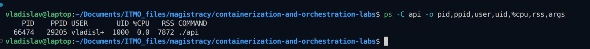</a>

## Часть 2 — Namespaces

Следующим шагом отделили окружение API от остальной системы с помощью namespaces. Это позволяет дать ему свой список процессов, сетевые настройки и имя хоста. Например, смена hostname внутри не изменит имя самого сервера.

Через `unshare` создали шесть namespaces: `--user`, `--pid`, `--mount`, `--net`, `--uts` и `--ipc`. Для запуска API использовали такую команду:

~~~bash
unshare --user --map-root-user \
  --pid --fork \
  --mount --mount-proc \
  --net --uts --ipc \
  sh -c 'hostname pandarecovery && exec ./lab1-containerization/api/api'
~~~

Остальные флаги помогают настроить запуск. `--map-root-user` отображает текущего пользователя в root внутри, `--fork` запускает дочерний процесс в новом PID namespace, а `--mount-proc` монтирует `/proc` для него. Дополнительных namespaces они не создают.

Команду запускали без sudo. Внутри мы получили root, но на хосте остались обычным пользователем.

Сначала с этими флагами запустили оболочку и посмотрели, что ей видно. Она получила PID 1, а из сетевых интерфейсов остался только выключенный `lo`.

Проверка процессов, hostname, UID и сети внутри

<a href="report/screenshots/04-namespaces-check.png">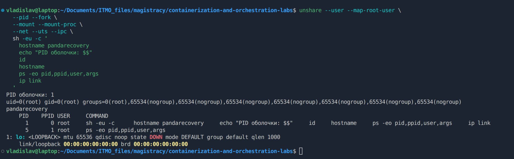</a>

Затем запустили API и получили `pid=1` уже у него. Вверху скриншота осталась ошибка оболочки от предыдущей попытки. Ниже виден успешный запуск сервиса на `:8080`.

<a href="report/screenshots/05-namespaces-api.png">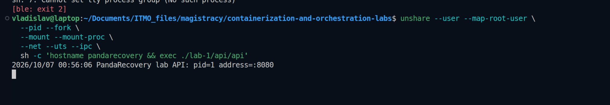</a>

Снаружи это тот же процесс, но с PID 26189 и UID 1000. Имя хоста тоже не поменялось, осталось `laptop`.

<a href="report/screenshots/06-namespaces-host.png">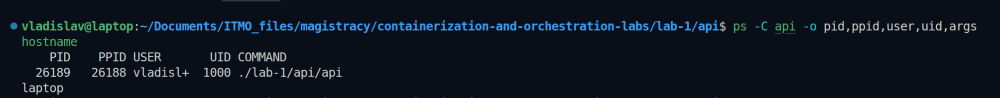</a>

Проверить HTTP как раньше уже не получится. У API теперь своя сеть, и `localhost` хоста к нему не ведёт. Поэтому вошли в network namespace через `nsenter`, включили loopback и выполнили запрос оттуда:

~~~bash
sudo nsenter --target 26189 --user --net \
  sh -c 'ip link set lo up && curl --noproxy "*" http://127.0.0.1:8080/health'
~~~

Получили `ok`. Для проверки зашли в сеть API, сам сервис перезапускать не пришлось.

Окружение отделили, но файлы хоста пока доступны в пределах прав процесса. Лимитов памяти и CPU тоже нет. С ними разобрались дальше.

## Часть 3 — Cgroups

Для ограничения ресурсов использовали cgroups. На стенде уже работает cgroup v2 с контроллерами `cpu`, `memory` и `pids`.

### Ограничение памяти и CPU

Создали группу `pandarecovery-lab1`, задали ей 32 MiB памяти без swap и добавили туда API с PID 26189:

~~~bash
sudo mkdir /sys/fs/cgroup/pandarecovery-lab1
sudo sh -c '
  echo 33554432 > /sys/fs/cgroup/pandarecovery-lab1/memory.max
  echo 0 > /sys/fs/cgroup/pandarecovery-lab1/memory.swap.max
  echo 26189 > /sys/fs/cgroup/pandarecovery-lab1/cgroup.procs
'
~~~

Затем через сеть API запросили `/eat?mb=64` (больше лимита всей группы). Запрос оборвался с `Empty reply from server`, API исчез из списка процессов. В `memory.events` счётчики `oom` и `oom_kill` выросли с 0 до 1.

<a href="report/screenshots/08-memory-oom.png">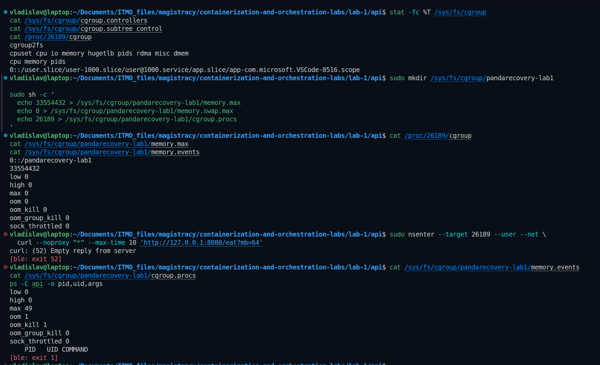</a>

Памяти в пределах лимита не хватило, и ядро завершило процесс. По одной ошибке curl причину не понять, поэтому проверили `memory.events`. В Kubernetes такое завершение контейнера обычно видно как `OOMKilled`.

После OOM пришлось перезапустить API. У него появился новый PID 43347, который снова записали в `cgroup.procs`. Затем задали 50 мс CPU-времени на каждые 100 мс:

~~~bash
sudo sh -c 'echo "50000 100000" > /sys/fs/cgroup/pandarecovery-lab1/cpu.max'
~~~

Это примерно половина одного CPU при постоянной нагрузке. После запроса `/burn` сравнили `cpu.stat`:

| Счётчик | До нагрузки | После |
| --- | ---: | ---: |
| `nr_periods` | 2 | 123 |
| `nr_throttled` | 0 | 121 |
| `throttled_usec` | 0 | 6 419 813 |

API продолжил работать, но теперь получал только половину процессорного времени одного ядра. Когда квота заканчивалась, ему приходилось ждать. Так мы ограничили нагрузку на сервер, но выполнение задач стало занимать больше времени.

Нагрузка /burn и статистика throttling

<a href="report/screenshots/09-cpu-limit.png">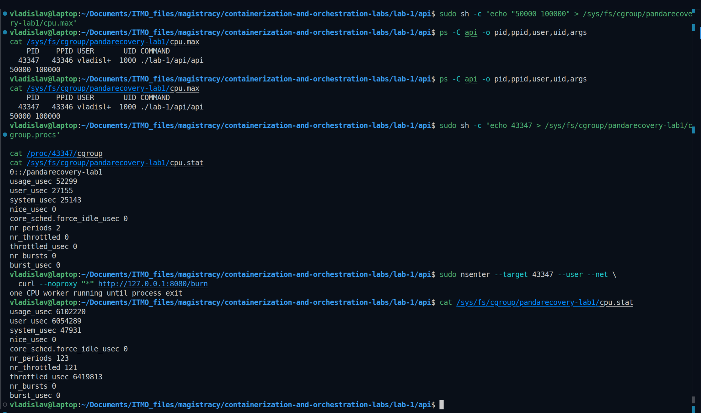</a>

### Ограничение числа процессов и потоков

Ограничили группу до 32 процессов и потоков суммарно (`pids.max=32`). Затем на 10 секунд запустили `stress-ng`, который пытался создавать новые процессы.

Когда группа заполнялась, ядро отказывало в создании новых процессов. Лимит сработал 4714 раз, а API продолжил работать. То есть программа не смогла наплодить процессы сверх ограничения, но уже запущенные процессы никто не убивал.

Команда и результат проверки

Память подняли до 128 MiB, чтобы не получить OOM раньше проверки числа процессов. Оболочку добавили в ту же cgroup, что и API. Запущенный из неё `stress-ng` наследует эту группу.

~~~bash
sudo sh -eu -c '
  echo $$ > /sys/fs/cgroup/pandarecovery-lab1/cgroup.procs
  exec runuser -u vladislav -- stress-ng \
    --fork 1 --fork-max 64 \
    --timeout 10s --metrics-brief --no-oom-adjust
'
~~~

В `pids.events` счётчик `max` вырос с 0 до 4714. После теста осталось 6 задач API, счётчики OOM не изменились.

<a href="report/screenshots/10-pids-limit.png">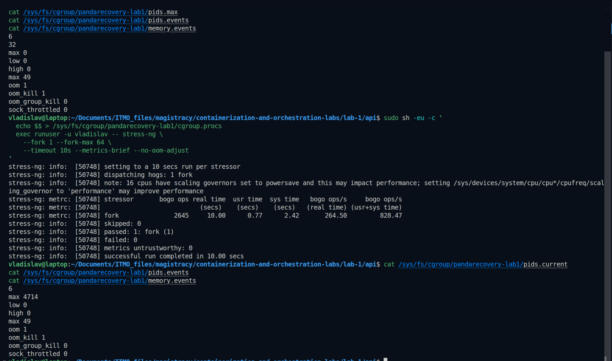</a>

В этих опытах получили три разных результата. Памяти не хватило и API завершился. При лимите CPU он продолжал работать, но с паузами. А лимит задач просто не давал создавать новые процессы.

## Часть 4 — Capabilities и seccomp

С ресурсами разобрались. Но лимиты сами по себе не запрещают процессу менять настройки системы. Поэтому дальше проверили, как убрать лишние права и запретить отдельные системные вызовы.

### Проверка capabilities

Для проверки попробовали изменить MTU у `lo`, то есть максимальный размер пакета. С `CAP_NET_ADMIN` всё работало. Затем убрали это разрешение через `capsh` и повторили команду:

~~~bash
sudo nsenter --target 43347 --user --net \
  capsh --drop=cap_net_admin -- -c 'ip link set lo mtu 60000'
~~~

Получили `RTNETLINK answers: Operation not permitted`, хотя UID внутри остался 0. Оказалось, быть root недостаточно. Для этой операции нужна `CAP_NET_ADMIN`.

Эта проверка ограничивала только новую оболочку. Затем отдельно перезапустили сам API через `capsh --drop=all`. Hostname и loopback настроили до сброса прав. Все пять полей `Cap*` у API стали нулевыми, а `/health` продолжил возвращать `ok`.

<a href="report/screenshots/11-capabilities.png">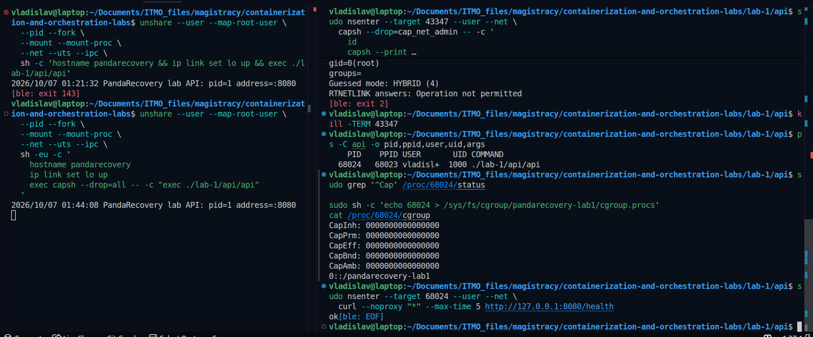</a>

### Запрет системного вызова через seccomp

Для seccomp написали небольшую [обёртку](seccomp-run.c). Она читает список запрещённых вызовов из [seccomp-deny.txt](seccomp-deny.txt), включает фильтр и запускает программу с ним.

Для опыта запретили только `uname`, который возвращает сведения о системе. Проверили его через Python сначала без фильтра, потом с ним. Остальные вызовы оставили разрешёнными, чтобы было проще увидеть результат.

Сборка обёртки и проверка запрета

Нужны GCC и библиотека разработки libseccomp.

~~~bash
gcc -Wall -Wextra -Werror -O2 \
  lab1-containerization/seccomp-run.c \
  -o lab1-containerization/seccomp-run -lseccomp

python3 -c 'import os; print(os.uname())'
./lab1-containerization/seccomp-run lab1-containerization/seccomp-deny.txt \
  python3 -c 'import os; print(os.uname())'
~~~

С фильтром получили `Operation not permitted`. Так и должно быть: seccomp запретил вызов `uname`, поэтому Python не смог получить сведения о системе.

<a href="report/screenshots/12-seccomp-denied.png">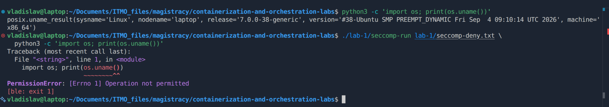</a>

Потом запустили под тем же фильтром API. Он продолжил отвечать `ok`. В `/proc` проверили, что capabilities обнулены, а seccomp включён (`Seccomp: 2`). Обёртка также выставляет `no_new_privs`, чтобы запуск другой программы через `exec` не позволил повысить привилегии.

Проверка API с фильтром

<a href="report/screenshots/13-seccomp-api.png">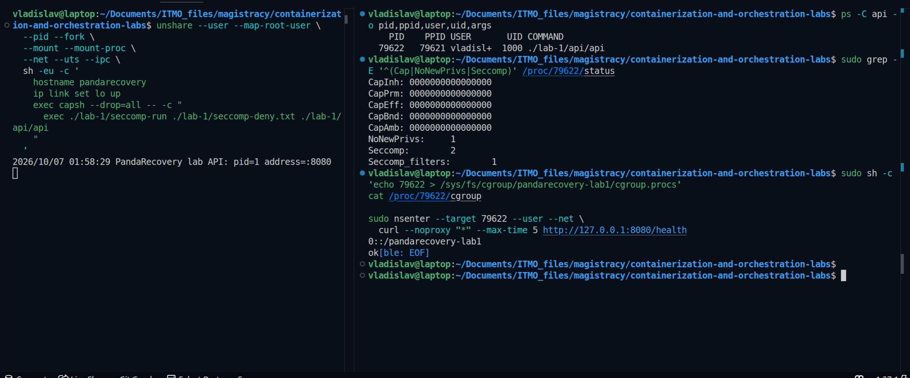</a>

## Часть 5 — Свой Docker

К этому моменту команд уже накопилось много. После перезапуска нужно было снова находить PID, добавлять процесс в cgroup и настраивать окружение. Надо было что-то с этим делать... Собрали всё в один скрипт, чтобы не повторять вручную.

Получился [mydocker.sh](mydocker.sh). При запуске он:

1. Создаёт cgroup с лимитами 128 MiB RAM, без swap, 0.5 CPU и 32 задачи.
2. Добавляет себя в группу, чтобы дочерние процессы тоже получили эти лимиты.
3. Создаёт namespaces, задаёт hostname и включает loopback.
4. Убирает capabilities, подключает seccomp-фильтр и запускает API.

После сборки API и seccomp-обёртки достаточно одной команды:

~~~bash
./lab1-containerization/mydocker.sh
~~~

Сам скрипт запускали без sudo. Он запрашивает права только для настройки cgroup, а API на хосте остаётся обычным пользователем.

После запуска проверили всё вместе. Внутри у API PID 1, на хосте PID 73928 и UID 1000. Лимиты на месте, capabilities обнулены, seccomp включён. И главное, `/health` всё ещё отвечает `ok`.

<a href="report/screenshots/15-mydocker-check.png">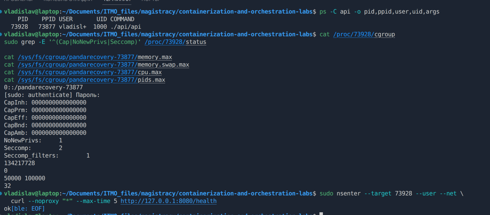</a>

Но до полноценного Docker тут ещё далеко. Лимиты cgroup делят API и ожидающий его `unshare`, в сети есть только loopback, отдельного rootfs нет. Запуск останавливаем через `Ctrl+C`, а пустую cgroup удаляем вручную. Её путь скрипт выводит в терминал.

### Сравнение с Docker

В этом опыте использовали Docker Desktop. Он запускает контейнеры в виртуальной машине, а наш скрипт работает прямо на хосте. Поэтому PID контейнера относится к виртуальной машине, и root внутри контейнера — не то же самое, что root на хосте.

Собрали исходный образ по [Dockerfile.baseline](api/Dockerfile.baseline) и запустили его с сопоставимыми ограничениями.

Сборка и docker run

~~~bash
docker build -f lab1-containerization/api/Dockerfile.baseline \
  -t pandarecovery:baseline lab1-containerization/api

docker run -d \
  --name pandarecovery-docker \
  --hostname pandarecovery \
  --memory 128m --memory-swap 128m \
  --cpus 0.5 --pids-limit 32 \
  --cap-drop ALL \
  --security-opt no-new-privileges=true \
  -p 127.0.0.1:8081:8080 \
  pandarecovery:baseline
~~~

`--memory-swap` задаёт суммарный бюджет RAM и swap. Здесь он равен `--memory`, поэтому swap запрещён. Порт доступен только через loopback хоста.

API внутри Docker тоже получил PID 1 и вернул `ok`. Проверка cgroup и `/proc/1/status` подтвердила заданные ограничения.

| Что сравниваем | `mydocker.sh` | Наш запуск Docker |
| --- | --- | --- |
| PID и hostname | PID 1, `pandarecovery` | То же |
| Ресурсы | 128 MiB, без swap, 0.5 CPU, 32 задачи | Те же лимиты, заданы явно |
| Capabilities и `no_new_privs` | Capabilities пусты, `no_new_privs=1` | То же, благодаря параметрам запуска |
| Seccomp | Запрещён `uname`, остальное разрешено | Встроенный профиль Docker; `uname` проходит |
| Сеть | Только loopback; запрос через `nsenter` | Сеть Docker и публикация порта |
| Файловая система | Используем файлы хоста | Корень из образа и записываемый слой |
| Пользователь | UID 0 внутри → UID 1000 хоста | Внутри UID 0; такое же отображение мы не задавали |
| Управление | Терминал и ручная очистка cgroup | Фоновый запуск, логи, остановка и удаление контейнера |

По ресурсам и правам получили похожий результат. Но Docker ещё берёт на себя образы, отдельную файловую систему, сеть и управление контейнером. В нашем скрипте этого пока нет.

## Часть 6 — Образы и данные

### Уменьшение размера образа

После запуска в Docker занялись размером образа. В базовом варианте остались Go, исходники и инструменты сборки, хотя для работы API нужен только готовый бинарный файл.

В основном [Dockerfile](api/Dockerfile) разделили сборку и запуск. На первой стадии собрали API с `CGO_ENABLED=0`, на второй скопировали готовый файл в `scratch`. Библиотеки C нашему сервису не нужны, поэтому этого хватило.

Образ получился совсем пустым, кроме самого API. Даже привычный `docker exec ... sh` здесь не сработает, потому что оболочки нет.

~~~bash
docker build -t pandarecovery:small lab1-containerization/api
docker image inspect pandarecovery:baseline pandarecovery:small \
  --format '{{json .RepoTags}} size={{.Size}} bytes layers={{len .RootFS.Layers}}'
~~~

| Образ | Размер по `inspect` | Файловые слои |
| --- | ---: | ---: |
| `pandarecovery:baseline` | 1305,74 MiB | 10 |
| `pandarecovery:small` | 12,93 MiB | 2 |

<a href="report/screenshots/16-image-sizes.png">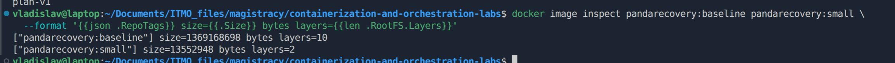</a>

Образ стал примерно в 101 раз меньше, API по-прежнему отвечает `ok`.

При повторной сборке Docker использовал кэш (`CACHED`), заново компилировать API не пришлось.

### Где хранить данные

Дальше проверили, останутся ли данные после пересоздания контейнера. Не хочется потерять план перемещения груза при обновлении PandaRecovery. Пока вместо плана записали обычный `plan.txt`. Для опыта взяли `baseline`, потому что там есть `sh`, `cat` и `ls`. В нашем образе на `scratch` их нет.

Сначала записали файл в `/app/plan.txt`, удалили контейнер и создали новый. Получили `No such file or directory`. Файл был в записываемом слое контейнера и удалился вместе с ним. Если просто остановить и запустить тот же контейнер, файл останется.

Повторили опыт с томом `panda-plan-data`, подключённым к `/data`. После пересоздания контейнера `/data/plan.txt` сохранился и по-прежнему содержал `plan-v1`. Теперь файл лежал в отдельном хранилище, которое мы подключили заново.

Как подключили том и проверили сохранность файла

Сначала пересоздали контейнер без тома — файл пропал:

<a href="report/screenshots/17-file-without-volume.png">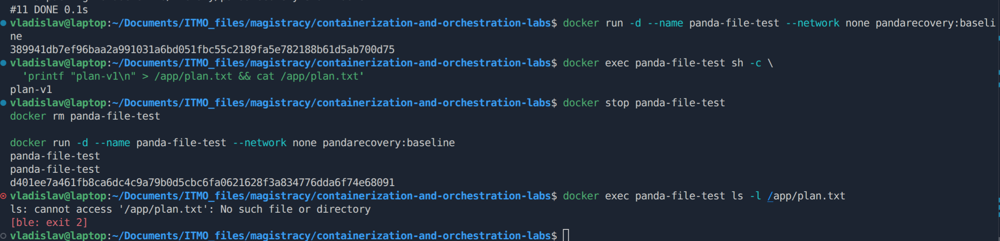</a>

Затем создали том, подключили его к контейнеру и записали файл:

~~~bash
docker volume create panda-plan-data
docker run -d --name panda-volume-test --network none \
  --mount type=volume,src=panda-plan-data,dst=/data \
  pandarecovery:baseline
docker exec panda-volume-test sh -c \
  'printf "plan-v1\n" > /data/plan.txt && cat /data/plan.txt'
~~~

После `docker stop` и `docker rm` повторили запуск с тем же `--mount` и прочитали файл.

Содержимое файла сохранилось:

<a href="report/screenshots/18-file-with-volume.png">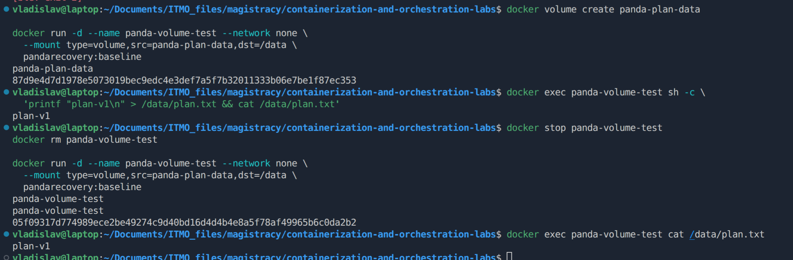</a>

Для плана спасения подойдёт том. Но бэкап всё равно нужен, ведь приложение может само удалить или испортить файл.

## Часть 7 — gVisor

До этого мы меняли окружение и права процесса, но системные вызовы приложения по-прежнему обрабатывало общее ядро Linux. Решили посмотреть, что изменится при запуске того же API под gVisor.

В gVisor системные вызовы приложения обрабатывает Sentry. Это пользовательское ядро, которое само обращается к Linux через ограниченный набор вызовов.

### Что проверили

Для этого установили Docker Engine прямо на Linux-хост и добавили `runsc`, среду запуска gVisor. Переключились с Docker Desktop на контекст `default`. Готовый образ `pandarecovery:small` перенесли через `docker save/load`, собирать его заново не пришлось.

Запустили один и тот же образ двумя способами, через обычный `runc` и через `runsc`. Оба API вернули `ok`. Здесь проверяли только запуск и процессы на хосте, поэтому отдельные лимиты ресурсов не задавали.

Регистрация runtime и запуск под gVisor

После установки пакета `runsc` зарегистрировали runtime:

~~~bash
sudo runsc install
sudo systemctl restart docker

docker --context desktop-linux image save pandarecovery:small |
  sudo docker --context default image load

sudo docker --context default run -d \
  --runtime=runsc \
  --name pandarecovery-gvisor \
  --cap-drop ALL \
  --security-opt no-new-privileges=true \
  -p 127.0.0.1:8083:8080 \
  pandarecovery:small
~~~

Для обычного запуска использовали `--runtime=runc`, имя `pandarecovery-runc` и порт 8084. Проверенный `runsc` — версии `20261019.0`.

В `ps` разница уже видна. У обычного контейнера на хосте виден `api`, а у варианта с gVisor на его месте `gvisor_sentry`.

<a href="report/screenshots/19-gvisor-compare.png">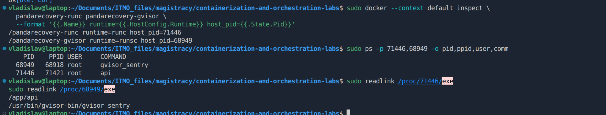</a>

Нашему API хватило возможностей gVisor. Для других приложений совместимость придётся проверять отдельно. Скорость работы здесь не сравнивали.

## Часть 8 — Мониторинг

Ограничения мы уже проверили через файлы cgroup и отдельные запросы. Теперь собрали дашборд, чтобы следить за ресурсами на графиках. Так проще увидеть, как растёт нагрузка и когда сервис упирается в лимиты.

<table>
<tr><td align="center">

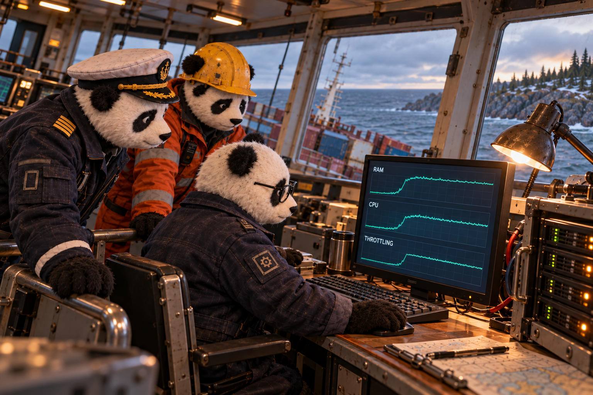

 

*Панды снова нагружают сервис. Теперь рядом с терминалом открыты графики, и можно посмотреть, куда уходит память и хватает ли CPU.*

</td></tr>
</table>

Для мониторинга взяли знакомую по [второй лабе](../lab2-observability/README-lab.md) связку Prometheus и Grafana. Установили её через `kube-prometheus-stack` в minikube на том же компьютере.

Но API у нас работает в Docker вне Kubernetes. По метрикам pod-ов minikube его не увидишь. Поэтому рядом запустили контейнер cAdvisor, который читает счётчики cgroups на хосте и отдаёт их Prometheus:

```mermaid
flowchart LR
    subgraph host["Linux-хост"]
        direction LR
        subgraph containers["API и cAdvisor в Docker"]
            subgraph isolation["Контейнер API · runc"]
                API("PandaRecovery API<br/>Свои namespaces<br/>Ограниченные права")
            end
            CG["cgroup API на хосте<br/>Память, CPU и throttling"]
            CA("Контейнер cAdvisor<br/>Читает метрики хоста")
            API -.->|Расход ресурсов| CG
            CG -->|Счётчики| CA
        end
        subgraph monitoring["minikube · Kubernetes"]
            PR[("Prometheus<br/>История метрик")]
            GR("Grafana<br/>Дашборд API")
            PR -->|Данные| GR
        end
        CA -->|Метрики · каждые 15 с| PR
    end

    classDef service fill:#e0f2fe,stroke:#0284c7,color:#0c4a6e,stroke-width:2px
    classDef counters fill:#f1f5f9,stroke:#94a3b8,color:#334155,stroke-dasharray:4 4
    classDef metrics fill:#ccfbf1,stroke:#0d9488,color:#134e4a,stroke-width:2px
    classDef dashboard fill:#ffedd5,stroke:#ea580c,color:#7c2d12,stroke-width:2px
    class API service
    class CG counters
    class CA,PR metrics
    class GR dashboard
    style host fill:transparent,stroke:#94a3b8,color:#64748b
    style containers fill:#f8fafc,stroke:#cbd5e1,color:#334155
    style isolation fill:#eff6ff,stroke:#0284c7,color:#0c4a6e,stroke-width:2px,stroke-dasharray:6 4
    style monitoring fill:#f0fdfa,stroke:#99f6e4,color:#134e4a
```

У API отдельное окружение и лимиты ресурсов, но ядро Linux общее с хостом. cAdvisor работает в другом контейнере и читает счётчики cgroup с хоста. Код Go-сервиса для этого менять не пришлось.

### Что настроили

- cAdvisor отдаёт метрики на порту 8085; Prometheus опрашивает `host.minikube.internal:8085` каждые 15 секунд.
- В запросах выбираем `job="panda-host-cadvisor", name="pandarecovery-runc"`, чтобы смотреть именно наш API.
- [Настройки стека](monitoring/kube-prometheus-stack-values.yaml) и [дашборд](monitoring/panda-resources-dashboard.yaml) сохранены в репозитории.
- Grafana подхватывает дашборд из ConfigMap с лейблом `grafana_dashboard: "1"`.

Как проверили сбор метрик

Minikube запустили через Docker и выделили ему 4 CPU и 6 GiB памяти.

cAdvisor настроили по официальной инструкции. Дали ему доступ к Docker и нужным каталогам хоста, чтобы он мог читать метрики контейнеров.

В Prometheus выполнили `up{job="panda-host-cadvisor"}` и получили `1`. Значит, Prometheus успешно забирает метрики у cAdvisor.

<a href="report/screenshots/20-cadvisor-up.png">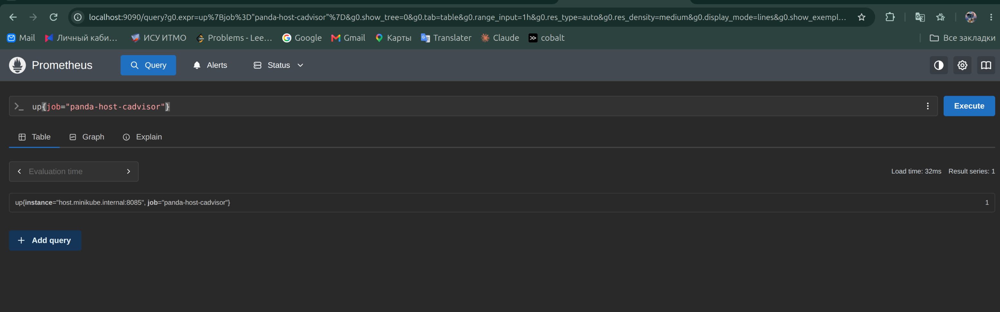</a>

Это проверка связи с cAdvisor. Дальше нашли метрики самого API по имени контейнера `pandarecovery-runc`.

Во время настройки сама Grafana получила `OOMKilled` при лимите 256 MiB. Стали смотреть, хватает ли памяти API, а памяти не хватило мониторингу.

Подняли лимит Grafana до 1 GiB, а request до 256 MiB. После этого дашборд открылся. Заодно проверили OOM ещё раз, хотя в этот раз не планировали.

### Что видно под нагрузкой

Для API подтвердили лимиты 128 MiB RAM и 0.5 CPU, затем вызвали `/eat?mb=32` и `/burn`.

<a href="report/screenshots/25-grafana-dashboard.png">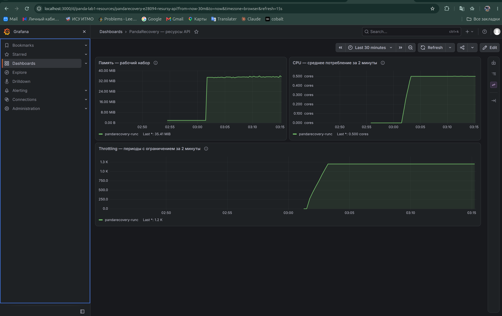</a>

На графиках виден переход от простоя к нагрузке:

- память выросла примерно с 1,93 до 35,41 MiB после запроса на 32 MiB;
- CPU дошёл до лимита 0.5 ядра и держался на нём;
- ограничение CPU срабатывало примерно в 1200 периодах за две минуты.

Первый запрос Prometheus показал около 0.29 ядра вместо ожидаемых 0.5. Позже среднее за две минуты дошло до 0.5 и держалось на этом уровне. На дашборде это видно, просто по первой точке делать вывод было рано.

Запросы панелей

Память — текущее значение:

~~~promql
container_memory_working_set_bytes{
  job="panda-host-cadvisor", name="pandarecovery-runc"
}
~~~

Среднее потребление CPU за две минуты:

~~~promql
rate(container_cpu_usage_seconds_total{
  job="panda-host-cadvisor", name="pandarecovery-runc", cpu="total"
}[2m])
~~~

Как часто срабатывало ограничение CPU за две минуты:

~~~promql
increase(container_cpu_cfs_throttled_periods_total{
  job="panda-host-cadvisor", name="pandarecovery-runc"
}[2m])
~~~

Каждая точка показывает, сколько раз сработало ограничение CPU за предыдущие две минуты (`[2m]`). На графике видна история за 30 минут. Prometheus оценивает прирост счётчика по собранным значениям, поэтому число может получиться дробным.

### Три метрики для алертов

Для будущих алертов выбрали те же три метрики с дашборда:

- Память приближается к лимиту. Если рост продолжится, API может получить OOM.
- CPU долго держится у своей квоты. Запаса на дополнительную нагрузку почти нет.
- Throttling срабатывает часто. Процессу приходится ждать, поэтому стоит проверить, не выросло ли время ответа.

График памяти помогает заметить рост, но точный момент OOM по нему не определить. cgroup учитывает больше памяти, чем показано в этой метрике.

Сами алерты и уведомления здесь не настраивали. Пока выбрали, за чем следить, а пороги нужно будет подобрать под реальную нагрузку.

## Что получилось по итогу

Начали с обычного API на хосте, а в итоге собрали свой скрипт запуска с изоляцией, лимитами и ограниченными правами. Сравнили его с Docker, уменьшили образ примерно в сто раз и проверили, как сохранить данные при замене контейнера. Потом попробовали gVisor и собрали дашборд ресурсов. Теперь видно не только то, что API отвечает, но и как он ведёт себя под нагрузкой.

<table>
<tr><td align="center">

 

*Первый сервис запущен, ограничения проверены, метрики видны. Панды записывают результаты и возвращаются к плану работ. Корабль пока на мели — контейнеризация сама его не спасёт. Но теперь у команды есть проверенный способ запускать сервисы PandaRecovery на общем сервере.*

</td></tr>
</table>
