# Лаба 2 — Observability: метрики, логи, трейсы, алерты

## Стенд

- Инструмент кластера: _TODO (minikube, driver, версия)_
- Версия Kubernetes: _TODO_
- Характеристики хоста: _TODO (CPU/RAM/диск)_
- Способ деплоя: Helm

## Часть 0 — Сервис `api`

Описание сервиса и эндпоинтов — см. [api/README.md](api/README.md).

- _TODO: как собирали образ, как загружали в кластер_

<details>
<summary>Установка инструментов (Docker, kubectl, minikube, Helm) — чисто подготовка стенда</summary>

### Docker
Итак, при подготовке стенда не помешало бы установить докер (ну а вдруг пригодится)

```bash
  sudo apt-get update
  sudo apt-get install -y ca-certificates curl
  sudo install -m 0755 -d /etc/apt/keyrings
  sudo curl -fsSL https://download.docker.com/linux/ubuntu/gpg -o /etc/apt/keyrings/docker.asc
  sudo chmod a+r /etc/apt/keyrings/docker.asc
  echo \
    "deb [arch=$(dpkg --print-architecture) signed-by=/etc/apt/keyrings/docker.asc] https://download.docker.com/linux/ubuntu \
    $(. /etc/os-release && echo "$VERSION_CODENAME") stable" | \
    sudo tee /etc/apt/sources.list.d/docker.list > /dev/null
  sudo apt-get update
  sudo apt-get install -y docker-ce docker-ce-cli containerd.io docker-buildx-plugin docker-compose-plugin
  sudo usermod -aG docker $USER
```
Команды запуска честно спёрта у нейронки, но позже проверена в официальной доке. Кроме блока `echo` с настройкой под конкретную локальную машину и демона, чтобы дергать докер без `sudo`, все совпадает с официальной документацией.

ВАЖНО! `usermod -aG docker $USER` группа применяется только к новым сессиям, так что после этой команды нужно перелогиниться (`newgrp docker` или просто выйти и зайти заново), иначе `docker` команды продолжат требовать `sudo`.

### kubectl

Скачиваем через:
```bash
  curl -LO "https://dl.k8s.io/release/$(curl -L -s https://dl.k8s.io/release/stable.txt)/bin/linux/amd64/kubectl"
  sudo install -o root -g root -m 0755 kubectl /usr/local/bin/kubectl
  rm kubectl
  kubectl version --client
```
Так же немного вольная интерпретация команды установки от нейронки, но по сути похоже на правду.

### minikube

Ставим через:
```bash
  curl -LO https://storage.googleapis.com/minikube/releases/latest/minikube-linux-amd64
  sudo install minikube-linux-amd64 /usr/local/bin/minikube
  rm minikube-linux-amd64
  minikube version
```

### Helm

Ставим через:
```bash
  curl -fsSL https://raw.githubusercontent.com/helm/helm/main/scripts/get-helm-3 | bash
  helm version
```

### Поднятие кластера

Дальше запускаем сам Kubernetes: `minikube` берёт готовый образ ноды и поднимает его как отдельный Docker-контейнер

```bash
  minikube start --driver=docker --cpus=6 --memory=12g --disk-size=30g
  kubectl get nodes
```

Цифры по ресурсам подобраны под мой комп (не зря ж я тут игровой сетапчик собирал) — отдаём кластеру половину ядер и памяти с запасом, чтобы хватило и на будущий Prometheus/Loki/Jaeger/Grafana/Alertmanager/Karma.

Полезное (ибо у меня дуалбут) — `minikube stop` / `minikube start` для перезагрузки хоста без потери состояния.

### Сборка образа `api`

У `minikube` свой изолированный Docker-демон внутри контейнера-ноды — образ, собранный обычным `docker build` на хосте, туда просто не виден. Собираем сразу внутри:

```bash
  cd api
  minikube image build -t panda-api:local .
  minikube image ls | grep panda-api
```

Тег `local` — чтобы явно отличать от образов из публичных registry, это пригодится в Helm-чарте (`imagePullPolicy: Never`, чтобы kubelet даже не пытался его откуда-то тянуть).

### Деплой через Helm

Сервис завёрнут в свой маленький Helm-чарт (`charts/panda-api`) — два реплика-пода, `Service` с ClusterIP, `SELF_URL` смотрит на DNS-имя сервиса (`http://panda-api:8000`), а не на `localhost`, чтобы `/load` реально раскидывал запросы между репликами, а не бил сам в себя:

```bash
  helm install panda-api charts/panda-api
  kubectl get pods -l app=panda-api -w
```

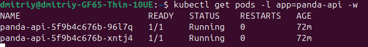

### Проверка работоспособности

Если оба пода поднялись (`1/1 Running`), дёргаем сервис снаружи кластера через `port-forward` (в соседнем терминале, иначе команда блокирует сессию):

```bash
  kubectl port-forward svc/panda-api 8000:8000
```

И в другом окне:

```bash
  curl localhost:8000/health
  curl localhost:8000/slow
  curl localhost:8000/fail
  curl localhost:8000/metrics | head -30
```

- `/health` → `ok`
- `/slow` → `{"slept_seconds": ..., "panda_energy_level": ...}`
- `/fail` → `simulated failure` (это и есть ожидаемые 500 для будущих алертов)
- `/metrics` → обычный prometheus-текст (`python_gc_*`, `process_*` и наши RED+panda метрики)

Если в конце видно `curl: Failed writing body` — не баг: это `head -30` закрывает пайп раньше, чем curl допишет весь буфер метрик, curl получает SIGPIPE и жалуется. Контент до этого момента валидный.

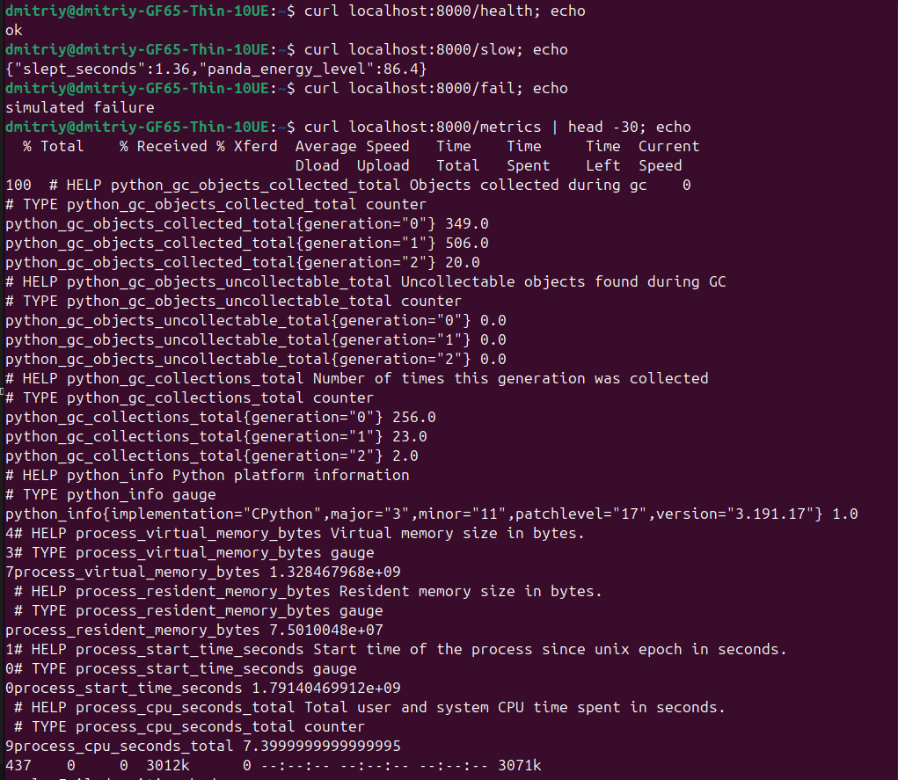

---

Если лень копировать команды руками — в `setup/` лежат те же шаги тремя скриптами, запускать по порядку (каждый следующий рассчитывает, что предыдущий уже отработал):

```bash
  bash setup/01-install-toolchain.sh   # Docker, kubectl, minikube, Helm + не забыть перелогиниться
  bash setup/02-start-cluster.sh       # поднять сам кластер
  bash setup/03-build-image.sh         # собрать образ api внутри кластера
```

После этого — `helm install panda-api charts/panda-api` и сервис уже внутри кластера.

</details>

## Часть 1 — Метрики (Prometheus + Grafana)

Для установки prometheus используем это:

```bash
helm repo add prometheus-community https://prometheus-community.github.io/helm-charts
helm install kube-prometheus-stack prometheus-community/kube-prometheus-stack \
  -n monitoring --create-namespace \
  -f observability/kube-prometheus-stack-values.yaml   # сам стек: Prometheus, Grafana, Alertmanager и далее по списку
helm upgrade panda-api charts/panda-api                 # накатить ServiceMonitor, чтобы Prometheus увидел api
```

После установки открываем http://localhost:3000/ и пытаемся понять, что тут происходит. 5 минут отрицания и попыток самостоятельно разобраться, и вот я уже на ютубе, смотрю гайд какого-то школьника. Путем n-ого количества экспериментов и тыканья во все подряд, получился такой вот вариант дашборда:

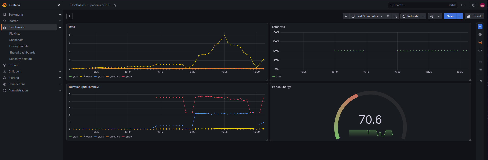

Вообще, раз уж я делал панда-апи, то было принято стратегическое решение добавить сюда какую-нибудь метрику панд. Panda Energy лежит в диапазоне 0-100 и тратится, когда панда "работает" (`/slow`, `/load`), а затем восстанавливается сам по себе со временем.

Так же скачал JSON дашборда и завел в чарт `panda-api` как ConfigMap с лейблом `grafana_dashboard: "1"`. Сайдкар Grafana из `kube-prometheus-stack` сам подхватывает такие ConfigMap'ы и накатывает дашборд.

## Часть 2 — Логи (Loki + Grafana)

Так как Loki сам логи не читает и является просто хранилищем, за сбором нужен отдельный агент на каждой ноде. Взял `grafana/loki-stack`:

```bash
helm repo add grafana https://grafana.github.io/helm-charts
helm install loki grafana/loki-stack -n logging --create-namespace --set grafana.enabled=false
```
(`grafana.enabled=false` — Grafana уже установлена из kube-prometheus-stack)

Loki подключили к Grafana через `additionalDataSources` в values `kube-prometheus-stack`.

Код пишет логи через обычный `logging.StreamHandler()`, а это по умолчанию stderr, но Kubernetes всё равно собирает оба потока в один лог-файл пода, так что Promtail их видит одинаково.

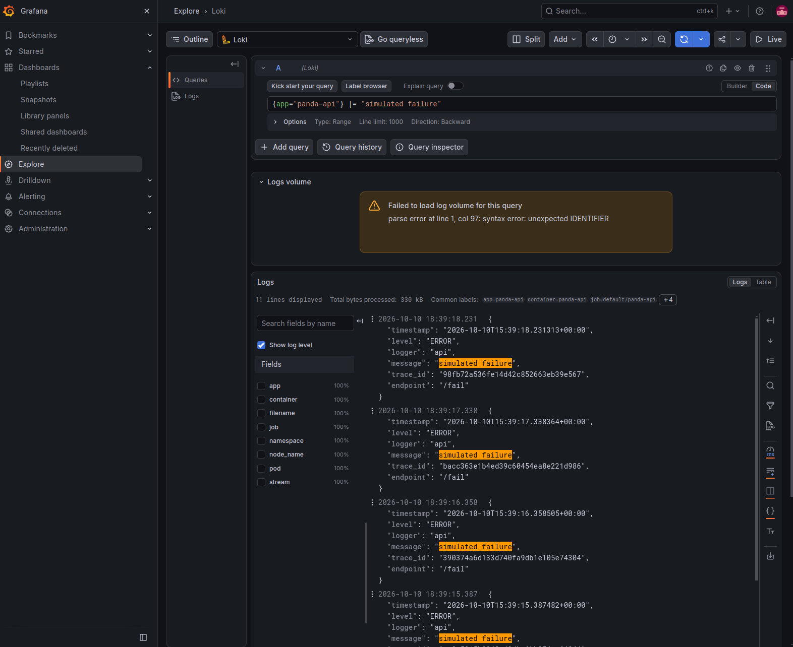

Для проверки использовал этот запрос:
```logql
{app="panda-api"} |= "simulated failure"
```

Ну и раз уж логи теперь в Grafana, то имеет смысл добавить панель логов прямо на дашборд, чтобы они были в одном окне:

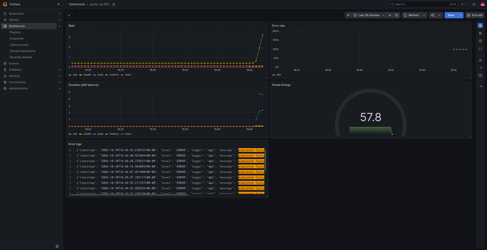

## Часть 3 — Трейсы (OpenTelemetry + Jaeger)

Jaeger ставим в all-in-one варианте — коллектор, UI и хранилище в одном поде:

```bash
helm repo add jaegertracing https://jaegertracing.github.io/helm-charts
helm install jaeger jaegertracing/jaeger \
  -n tracing --create-namespace \
  --set provisionDataStore.cassandra=false \
  --set allInOne.enabled=true \
  --set storage.type=memory \
  --set agent.enabled=false \
  --set collector.enabled=false \
  --set query.enabled=false
```

Дальше сервису достаточно знать один адрес — `OTEL_EXPORTER_OTLP_ENDPOINT=http://jaeger.tracing.svc.cluster.local:4317`. Отдельный OTel Collector не понадобился: all-in-one сам умеет принимать OTLP напрямую.

`/slow` рисует вложенный спан `nap-time` на всю длину сна, `/fail` же рисует спан с красным статусом ERROR и записанным исключением. Работает ок, но смотреть на один спан внутри одного пода скучновато, поэтому мучаю `/load`.

`/load` ходит через `Service panda-api`, поэтому запросы раскидываются между обеими репликами. В итоге получился один трейс на 254 спана глубиной 4, и в нём видно, что часть работы выполнил один под, а часть — другой:

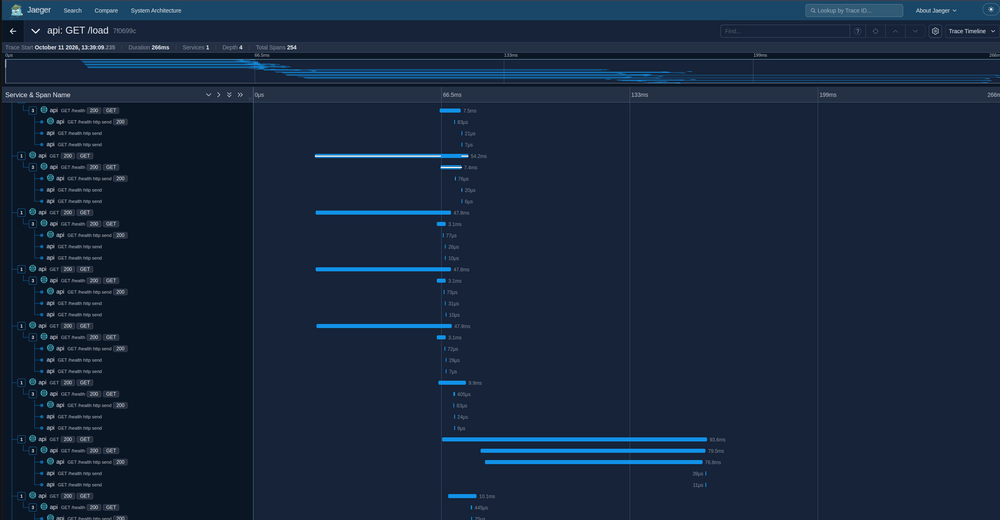

Так же сразу имеет смысл прикрутить Jaeger ещё и как datasource в Grafana, а на Loki настроить `derivedFields`. Эта регулярка вытаскивает `trace_id` из JSON-тела лога и превращает его в кликабельную кнопку, которая сразу открывает нужный трейс:

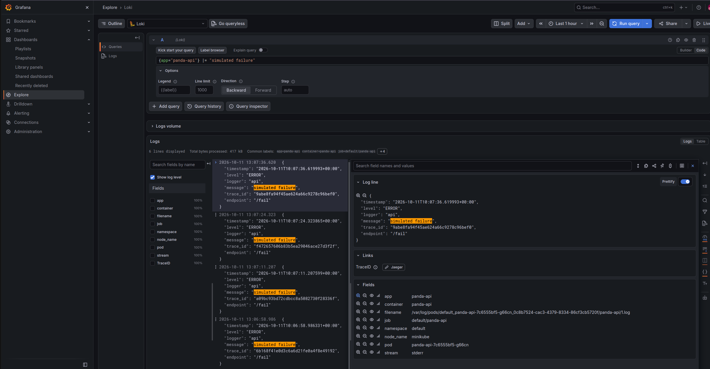

## Часть 4 — Алерты (Alertmanager + Karma)

Правила алертов завел прямо в чарте `panda-api`, чтобы всё версионировалось вместе с сервисом:

```bash
helm upgrade panda-api charts/panda-api
```

Karma — это просто более приятный UI поверх Alertmanager (сам Alertmanager хоть и рабочий, но выглядит как аскетичный список). Ставится отдельным чартом и указывается на уже существующий Alertmanager из `kube-prometheus-stack`, без своего:

```bash
helm repo add karma https://zekker6.github.io/helm-charts/
helm install karma karma/karma -n monitoring \
  --set env.ALERTMANAGER_URI="http://kube-prometheus-stack-alertmanager.monitoring.svc.cluster.local:9093"
```

| Алерт | Что ловит (PromQL) | Почему важно | Что делать дежурному |
|---|---|---|---|
| `PandaHighErrorRate` | `sum(rate(http_errors_total[5m])) / sum(rate(http_requests_total[5m])) > 0.1` | больше 10% ответов — 5xx, сервис реально деградирует | смотреть логи в Loki по `ERROR`, по `trace_id` из лога провалиться в Jaeger и найти, где всё падает |
| `PandaSlowRequests` | `histogram_quantile(0.95, rate(http_request_duration_seconds_bucket[5m])) > 2` | p95 латенси выше 2с — сервис подтормаживает ещё до явных ошибок | проверить RED-дашборд на аномальную нагрузку (не кто-то ли долбит `/load`), посмотреть долгие спаны в Jaeger |
| `PandaEnergyExhausted` | `min(panda_energy_level) < 15` | наша собственная бизнес-метрика: хотя бы одна реплика-панда почти без сил | обычно само пройдёт (регенерация 1/сек), если не восстанавливается — смотреть `panda_state.py` на баг |

Погоняли нагрузку (`/fail` и `/slow` залпом) и получили все три алерта живьём:

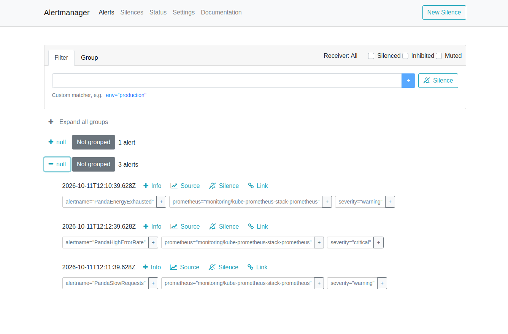

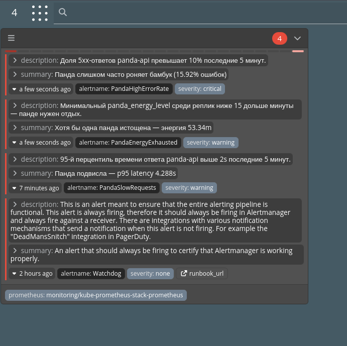

Мелкая забавная деталь: в шаблоне `PandaEnergyExhausted` значение энергии подставляется через `{{ $value | humanize }}`, и для чисел меньше единицы `humanize` вместо процентов выдаёт SI-приставки — получили сообщение "энергия 53.34m" (то есть 0.05334), что выглядит как опечатка, а на самом деле просто функция делает то, для чего не предназначена.

### Telegram-бот для алертов

Для отправки алертов в тг можно использовать встроенный `telegram_configs` у Alertmanager, но мне захотелось, чтобы на бизнес-метрику `PandaEnergyExhausted` бот слал анимированный стикер уставшей панды. Проблема в том, что весь встроенный телеграм-ресивер Alertmanager умеет слать только текстовые сообщения, а `sendSticker`, поэтому пришлось маршрутизировать алерты на два разных ресивера:

```yaml
route:
  routes:
    - match:
        alertname: PandaEnergyExhausted
      receiver: telegram-sticker-bridge   # свой вебхук, шлёт стикер + текст
    - match_re:
        alertname: PandaHighErrorRate|PandaSlowRequests
      receiver: telegram-text             # встроенный telegram_configs, просто текст
```

`telegram-sticker-bridge` - это чарт и FastAPI, который слушает вебхук от Alertmanager и на каждый `firing`-алерт дёргает `sendSticker` + `sendMessage` через `httpx`.

На этом этапе надо было как-то отправить стикер без хостинга картинок. Bot API для `sendSticker` просит постоянную ссылку на файл внутри самого Telegram. Чтобы его достать нужно отправить желаемый стикер самому боту в личку, а потом вытащить его `file_id` из `getUpdates`:

```bash
curl -s "https://api.telegram.org/bot<TOKEN>/getUpdates" | jq '.result[].message.sticker.file_id'
```

Токен бота, chat_id и file_id стикера лежат в Kubernetes Secret:

```bash
kubectl create secret generic telegram-bridge-secrets -n monitoring \
  --from-literal=bot-token=<TOKEN> \
  --from-literal=chat-id=<CHAT_ID> \
  --from-literal=sticker-file-id=<FILE_ID>
```

В итоге получился такой чат с ботом:

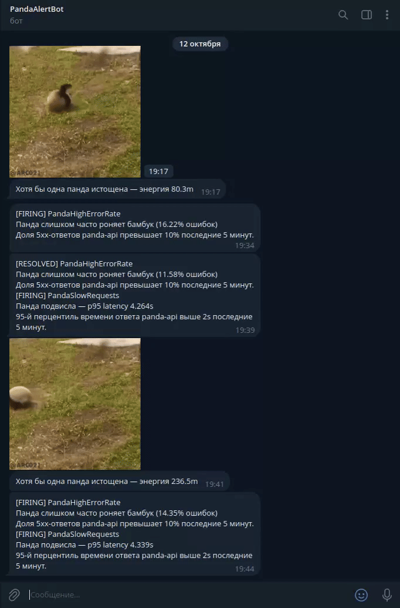

И так же обновленная маршрутизация алертов в Alertmanager и Karma

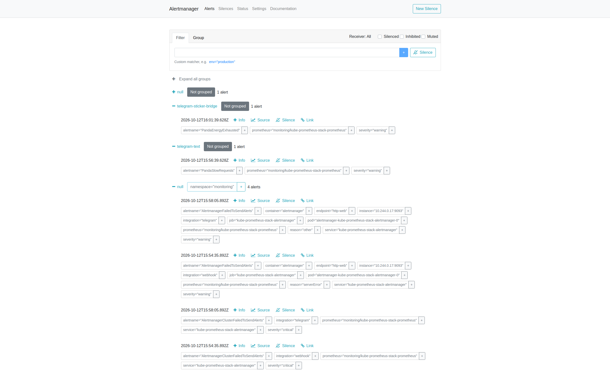
*Маршрутизация алертов видна в Alertmanager по receiver'ам*

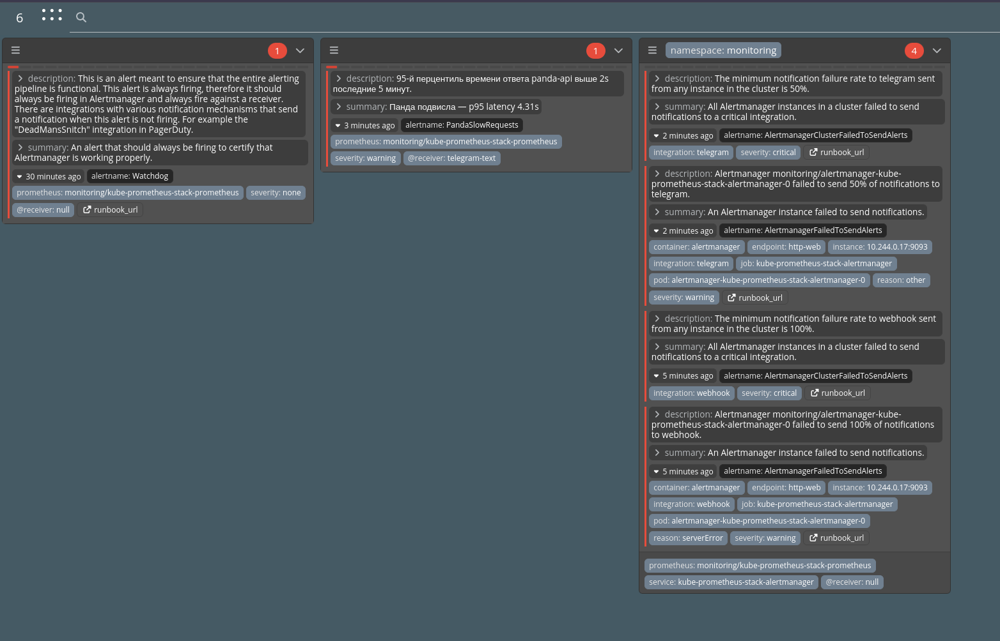

## Грабли

- При добавлении Jaeger как datasource заодно явно прописали `uid: loki` для уже существующего Loki — Grafana не умеет на лету переименовывать uid у того, что уже есть, и зациклилась с ошибкой `"data source not found"` на каждой попытке реконсиляции. Лечится просто: не трогать uid у того, что уже заведено, задавать его только для новых источников.
- Jaeger из этого чарта — на самом деле уже v2 (под капотом OTel Collector), и REST API у него новый — `/api/v3/*`, а не классические `/api/services` / `/api/traces`. Старые curl-рецепты из интернета на нём дружно 404-ят.
- Первая версия `PandaEnergyExhausted` считала `avg(panda_energy_level)` по обеим репликам. При тестировании через `kubectl port-forward` весь трафик уходит в один конкретный под (а не раскидывается, как через настоящий Service), так что уставала только одна "панда" из двух — и `avg` размазывал её просевшую энергию пополам со второй, здоровой. Порог так и не пробивался. Поменяли на `min()` — по смыслу так даже правильнее: алерт должен срабатывать, если устала хотя бы одна реплика, а не когда они обе разом падают.
- Helm и Prometheus оба используют `{{ }}` для своих шаблонов, и когда `PrometheusRule` рендерится через Helm, он пытается подставить `$value` как свою переменную и падает с `undefined variable "$value"` — хотя это вообще не Helm-переменная, а штука из шаблонизатора самого Prometheus, которая должна доехать до него нетронутой. Лечится заворачиванием в raw-строку Go-шаблонов: `` {{`{{ $value | humanizePercentage }}`}} ``.
- Дефолтный шаблон сообщений у `telegram_configs` рендерит HTML-теги (`<b>...</b>`), а я по привычке поставил `parse_mode: Markdown` — и Telegram стабильно отвечал 400 `can't parse entities`, потому что видел `<b>` там, где ждал Markdown-разметку. Вместо того чтобы подружить два разных синтаксиса — выключил парсинг форматирования вообще (`parse_mode: ""`) и написал свой шаблон голым текстом.
- Самое весёлое — ни под, ни сам хост не достучались до `api.telegram.org` напрямую (обычный интернет при этом работал). Спасибо блокировкам Telegram у провайдера. На хосте для таких случаев уже стоял VPN-клиент с локальным SOCKS5-прокси на `127.0.0.1:10808`, просто не торчащим дальше localhost. Докинул `socat` (`TCP-LISTEN:18080 → 127.0.0.1:10808`), и под внутри кластера дотянулся до прокси через `host.minikube.internal:18080`. И встроенный `telegram_configs` (`http_config.proxy_url`), и свой `telegram-bridge` (`httpx` с `proxy=`) настроены ходить именно через этот прокси.

## Итоги

- _TODO_
