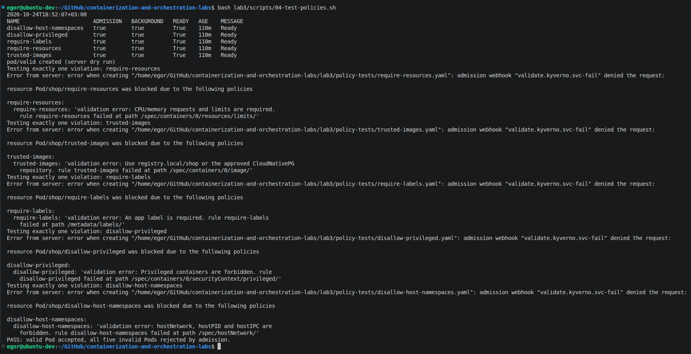
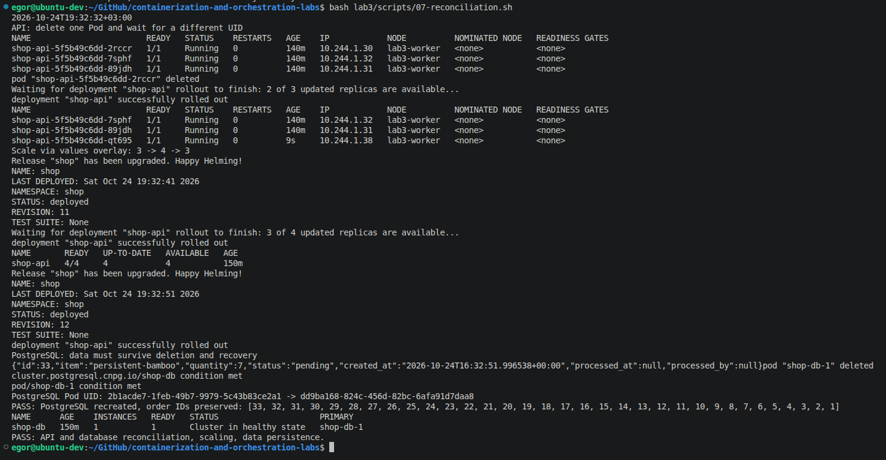
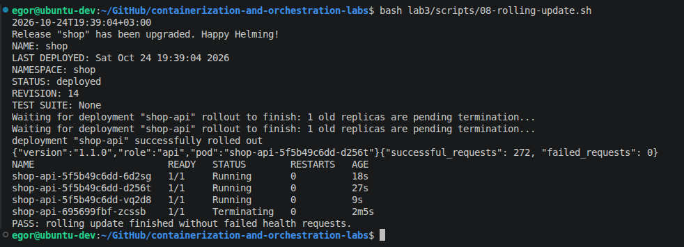
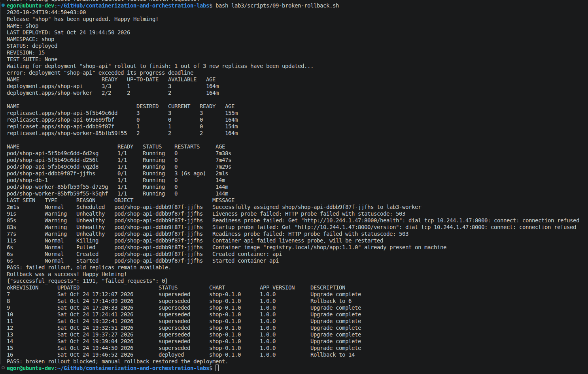
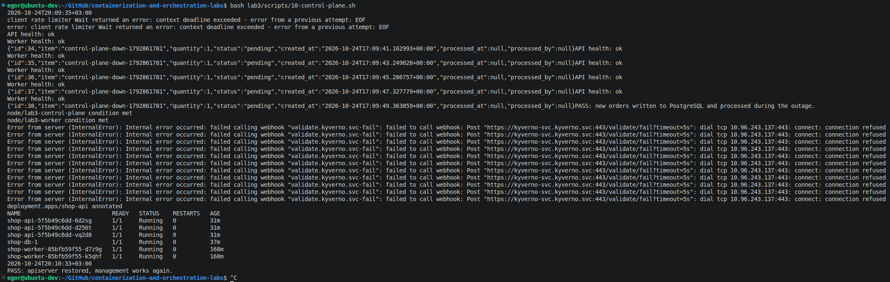
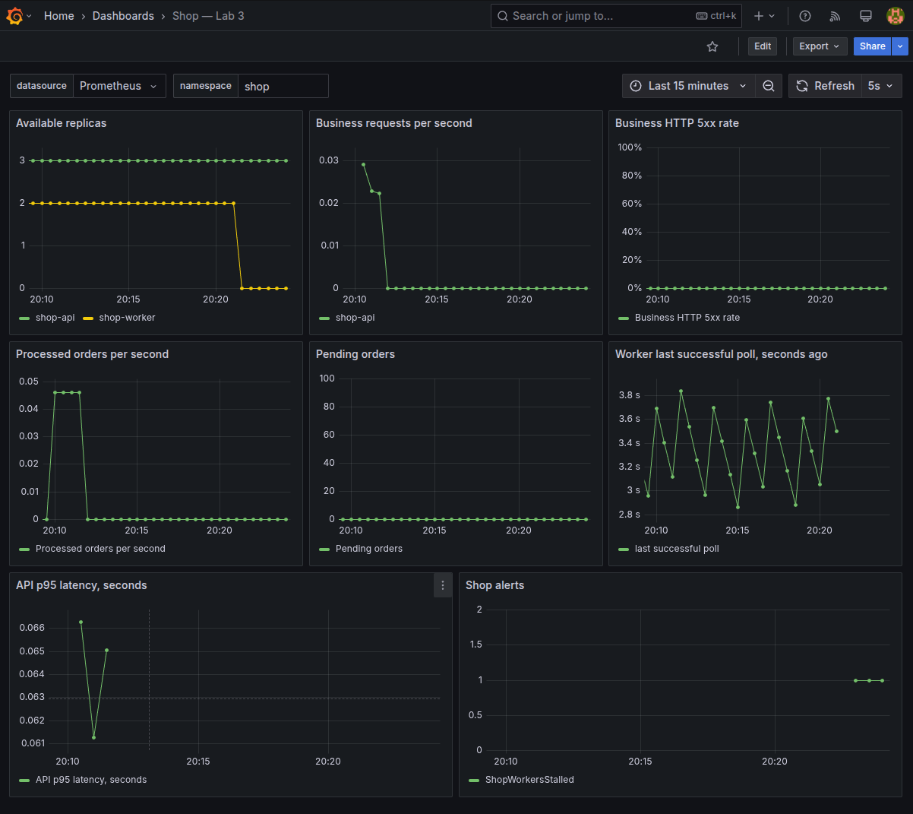
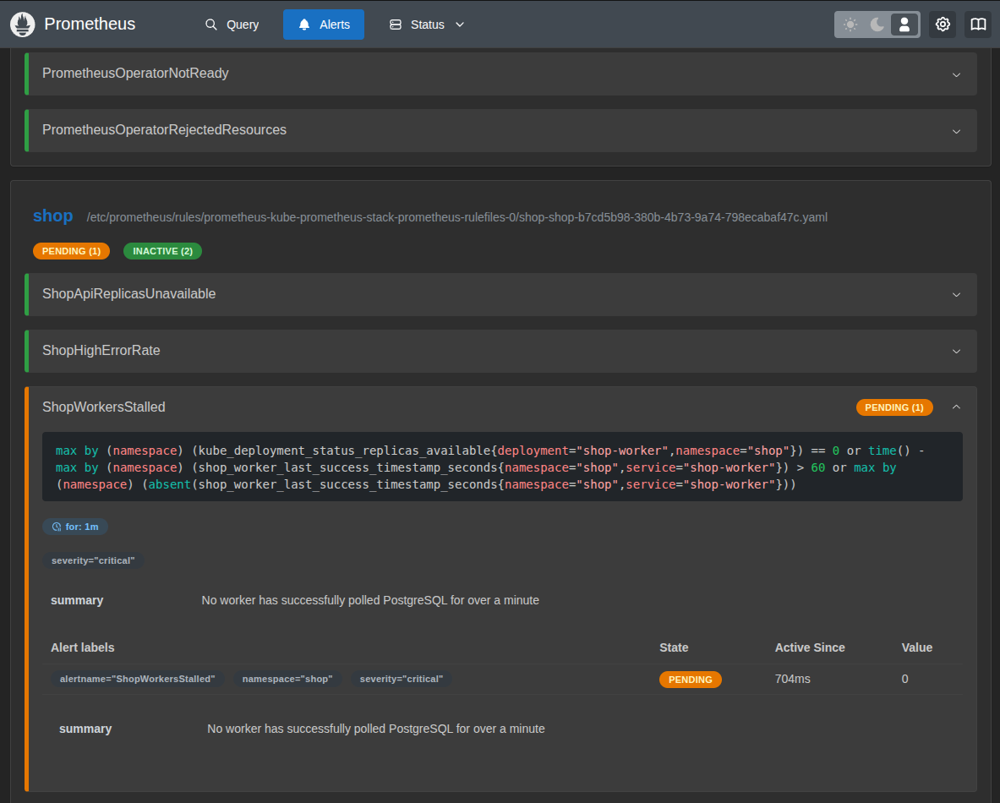
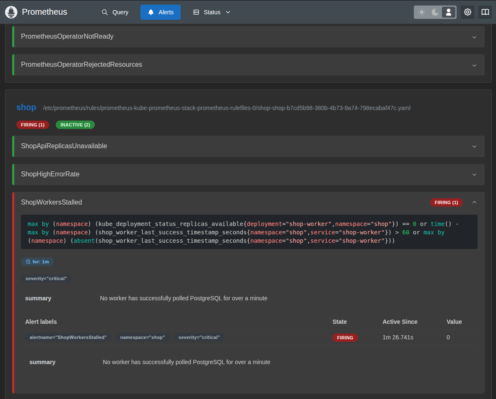
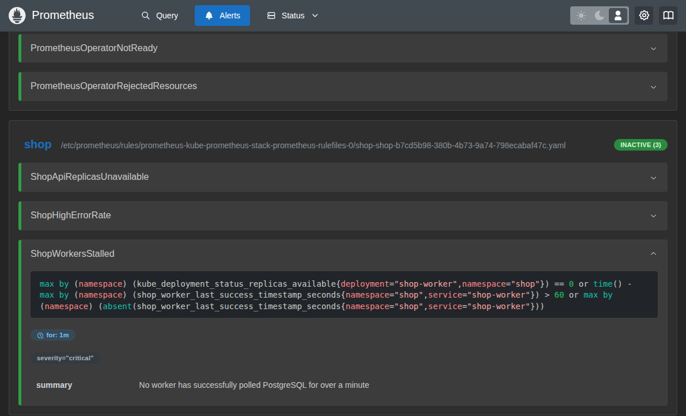

# Лаба 3 — Собери платформу для shop

<table>
<tr><td align="center">


<br>

*На мостике KuberPandas наконец видно, где тормозит система и кто опять съел всю энергию. Но дашборд сам не поднимет упавший сервис, не вернёт потерянную реплику и не остановит опасный деплой. Спасательная операция продолжается.*

*КуберПанды собирают следующую версию PandaRecovery: API принимает задания, worker забирают их из очереди, PostgreSQL хранит журнал. Теперь нужно научить платформу поддерживать нужное число исполнителей, переживать обновления и не пускать на борт конфигурации, которым нельзя доверять.*

</td></tr>
</table>

В этой лабораторной `shop` — учебный стенд для такой платформы. Заказы играют роль заданий спасательной операции: API записывает их в PostgreSQL, а worker помечают обработанными. Расчёта балласта и реального управления кранами в коде нет — здесь проверяем инфраструктуру, на которой могла бы работать PandaRecovery.

Маршрут этой главы: ограждения на входе → восстановление сервисов → обновления и откат → PostgreSQL под присмотром оператора → отказ control plane → проверка алертов.


## Запуск

Разрабатывалось на Linux amd64

Все команды выполняются **из корня репозитория**

Подготовка стенда и установка приложения:

```bash
bash lab3/scripts/00-tools.sh         # Скачать kubectl, Helm и kind в lab3/.tools
bash lab3/scripts/01-cluster.sh       # Создать kind-кластер и добавить Helm-репозитории
bash lab3/scripts/02-monitoring.sh    # Восстановить стек мониторинга из лабы 2, если его нет
bash lab3/scripts/03-policies.sh      # Установить Kyverno, применить и проверить политики
bash lab3/scripts/05-operator.sh      # Установить CloudNativePG
bash lab3/scripts/06-shop.sh          # Собрать образы 1.0.0 и 1.1.0, установить shop
bash lab3/scripts/12-smoke.sh         # Проверить создание и обработку 20 заказов
```

Политики устанавливаются до чарта shop. Скрипты используют отдельный kubeconfig в `lab3/.state/kubeconfig` и контекст `kind-lab3`

Проверки лабораторной запускаются последовательно, после завершения предыдущей:

```bash
bash lab3/scripts/07-reconciliation.sh  # Восстановление API/PostgreSQL и масштабирование
bash lab3/scripts/08-rolling-update.sh  # Обновление API с 1.0.0 на 1.1.0 без ошибок HTTP
bash lab3/scripts/09-broken-rollback.sh # Сломанная версия и rollback
bash lab3/scripts/10-control-plane.sh   # Остановка и восстановление apiserver
bash lab3/scripts/11-alerts.sh          # Провокация firing и восстановление worker
bash lab3/scripts/13-final-check.sh     # Проверка рабочего состояния после экспериментов
```

**Для повторной проверки rolling update** сначала нужно вернуть API на 1.0.0. Иначе при уже установленной 1.1.0 скрипт 08 не вызовет замену подов:

```bash
source lab3/scripts/common.sh
helm upgrade shop lab3/charts/shop -n shop --reuse-values \
  --set-string api.image.tag=1.0.0 --set api.healthFail=false \
  --wait --timeout 4m
kubectl rollout status deployment/shop-api -n shop --timeout=180s
bash lab3/scripts/08-rolling-update.sh
```

После установки доступны:

| Адрес | Назначение |
| --- | --- |
| http://localhost:18000/health | Проверка API |
| http://localhost:18000/orders | Список заказов |
| http://localhost:18001/health | Проверка worker |
| http://localhost:13000/d/shop-lab3 | Grafana: логин `admin`, пароль `panda-admin` из лабы 2 |
| http://localhost:19090/alerts | Состояния алертов в Prometheus |

Скрипты проверок сохраняют вывод в `lab3/report/evidence`. Повторный запуск перезаписывает соответствующие журналы

## Часть 0 — Сервисы

Сервисы `api` и `worker` были успешно сгенерированы


## Часть 1 — Ограждения на кластер

Я выбрал **Kyverno** так как я верю преподавателю, что там порог входа ниже


Ну а вообще **Kyverno**, так как правила описываются YAML-манифестами Kubernetes. Для моих проверок этого достаточно, мне не нужен отдельный язык Rego.

Было сказано про не менее чем 5 правил, так что их 5. И все что было в примерах, тоже тут есть:
| Политика | Проверка | Польза |
| --- | --- | --- |
| `require-resources` | CPU/memory requests и limits у каждого обычного и init-контейнера | Планирование и ограничение потребления ресурсов |
| `trusted-images` | Разрешены `registry.local/shop/*` и `ghcr.io/cloudnative-pg/*`, включая init- и ephemeral-контейнеры | Ограничение источников образов |
| `require-labels` | Непустая метка `app` | Поиск, группировка и эксплуатация приложений |
| `disallow-privileged` | Запрет `securityContext.privileged=true` у обычных, init- и ephemeral-контейнеров | Не давать контейнеру полный доступ к хосту |
| `disallow-host-namespaces` | Запрет `hostNetwork`, `hostPID`, `hostIPC` | Сохранение изоляции сети и процессов от ноды |

В директории policy-tests находятся 1 валидный и 5 сломанных манифестов



## Часть 2 — Чарт api и worker

Умный ChatGPT рассказал мне, что можно сделать `Deployment` и `Service` для `api` и `worker` в 1 файле. В начале перебор имен
```
{{- range $name := list "api" "worker" }}
{{- $component := index $.Values $name }}
```
А также 2 конфигурации отделенные через `---`:
```
---
apiVersion: apps/v1
kind: Deployment
metadata: ...
---
apiVersion: v1
kind: Service
metadata: ...
```
Мы задаём 3 API и 2 worker по умолчанию.
Readiness и liveness обращаются к `/health`. Отдельная startup-проба проверяет `/version`, чтобы дождаться подключения к БД при первом запуске и не скрыть намеренный отказ readiness в эксперименте.

Было написано 3 скрипта для проверки всего и вся:
- Удаление API Pod и восстановление недостающей реплики контроллером ReplicaSet. Установка values-оверлея [`experiments/scale.yaml`](experiments/scale.yaml) через `helm upgrade` количество реплик 3 --> 4 --> 3. Также удаляем под Postgres (чтобы было в одном месте по смыслу).



- Смена версии образа 1.0.0 --> 1.1.0. `maxUnavailable: 0`, `maxSurge: 1`, `minReadySeconds: 5` дают постепенную замену. Пауза preStop позволяет обновиться сетевым endpoints до завершения процесса. Во время upgrade отдельный процесс обращается к `/health` каждые 100 мс и считает каждый неуспешный запрос.



- `HEALTH_FAIL=true`: новый Pod отвечает 503, не становится Ready. Исправные старые реплики остаются в Service. После `ProgressDeadlineExceeded` выполняется явный `helm rollback` на сохранённую рабочую ревизию. `--atomic` здесь не используется, чтобы сначала увидеть зависший rollout. Непрерывная HTTP-проверка охватывает и rollback.



## Часть 3 — Postgres через оператора (CloudNativePG)

[`templates/postgres.yaml`](charts/shop/templates/postgres.yaml) создаёт `postgresql.cnpg.io/v1/Cluster`: одна инстанция PostgreSQL, база `shop`, владелец `shop`, PVC 1 GiB. Для восстановления после удаления пода достаточно одной инстанции (да, это не HA-конфигурация). Во время её перезапуска доступ к БД временно отсутствует.

Скрипт `07-reconciliation.sh` перед удалением создаёт заказ, запоминает его ID, удаляет PostgreSQL Pod и проверяет изменение UID и сохранность всех прежних ID.
Диск остаётся прежним. Полный объект с `spec` и `status` сохраняется в [`report/evidence/04-postgres-cluster.yaml`](report/evidence/04-postgres-cluster.yaml).

(скриншот с выполнением 7 скрипта уже был выше, но все же)


`spec` задаёт желаемое: число инстанций, образ, bootstrap, хранилище, ресурсы.

`status` заполняет оператор: текущий primary, готовые инстанции, phase и conditions. 

Оператор и `kube-controller-manager` используют один принцип reconciliation через Kubernetes API, но работают с разными знаниями. Встроенные контроллеры управляют Deployment/ReplicaSet/Node и другими типами Kubernetes. CloudNativePG понимает роли PostgreSQL, инициализацию, primary, репликацию и PVC своего `Cluster`. CRD без работающего оператора не создаёт БД.

## Часть 4 — Падение control plane

Скрипт перемещает static Pod manifest **только apiserver** из каталога kubelet во временный файл на control-plane ноде. Простое завершение контейнера не подходит, так как kubelet сразу запустил бы его снова. При ошибке shell trap возвращает manifest. Скрипт также смотрит, чтобы локальный контекст был правильным.

Проверяется отказ чтения и изменения через Kubernetes API, затем HTTP health API/worker, запись новых заказов и их обработка worker при недоступном apiserver. Запрос `/orders` обращается к PostgreSQL, поэтому проверяется
фактическая работа БД, а не только ответ health. После возврата manifest скрипт ждёт `/readyz` и выполняет успешное изменение аннотации Deployment.

Уже запущенные контейнеры, kubelet, DNS и правила kube-proxy продолжают работать. Планирование, reconciliation контроллеров и новые изменения через API в этот момент недоступны. Устойчивость проверяется при рабочих нодах и готовых контейнерах. Отказа worker-ноды в этом эксперименте нет.



После запуска apiserver admission-webhook Kyverno некоторое время оставался недоступен. Скрипт повторял изменение аннотации до успешного выполнения, подтверждая восстановление управления.

## Часть 5 — Мониторинг

Лаба 2 выполнялась на другом компьютере и другим человеком, так что её кластер был недоступен. Поэтому я восстановил kube-prometheus-stack с использованием конфигурации из 2ой лабы. Чарт shop добавляет в него `ServiceMonitor` для API/worker, `PrometheusRule` и ConfigMap с Grafana-дашбордом. Дашборд показывает доступные реплики, RPS, долю 5xx, скорость обработки заказов, очередь, время последнего успешного опроса worker,
p95 HTTP и firing-алерты. `/health` исключён из графиков бизнес-запросов.



| Алерт | Условие | Причина |
| --- | --- | --- |
| `ShopApiReplicasUnavailable` | Available API replicas меньше желаемого числа дольше минуты | Обнаруживает деградацию мощности, даже когда часть API ещё отвечает |
| `ShopHighErrorRate` | Более 10% бизнес-запросов возвращают 5xx дольше минуты, окно 2m | Ловит ошибки БД/обработки, которые обычный `/health` не обнаружит |
| `ShopWorkersStalled` | Нет доступных worker, отсутствует метрика или последний успешный опрос БД был больше минуты назад. И любое из перечисленных условий сохраняется одну минуту | Health процесса сам по себе не доказывает, что заказы обрабатываются |

Установил число реплик worker'ов равное 0. 
В начале alert был в статусе `pending`:


Потом он стал `firing`:


После установки числа реплик обратно на 2 и спустя некоторое время alert погас:


## Итог — вахта продолжается

<table>
<tr><td align="center">


<br>

*На главном терминале — ошибка связи с управляющей частью. На соседнем экране — новые задания и отметки об их обработке. Три API, два worker и PostgreSQL продолжают свою вахту. Когда apiserver возвращается, мостик снова может менять инфраструктуру.*

*Корабль пока остаётся у острова, и безопасный план снятия с мели ещё впереди. Но платформу уже не нужно держать лапами: потерянные реплики восстанавливаются, сломанная версия не вытесняет исправные поды, журнал переживает пересоздание базы, а отсутствие worker становится заметно по алерту.*

</td></tr>
</table>

## Проблемы с которыми столкнулся

У kind были проблемы с внешним DNS. Так что `01-cluster.sh` при контексте `desktop-linux` настраивает containerd на встроенный прокси `http.docker.internal:3128`.

Также возникла ошибка kind при импорте multiarch-индекса из containerd image store Docker Desktop. Так что [`scripts/pull-image.py`](scripts/pull-image.py) скачивает публичный образ на хосте, выбирает `linux/amd64`, проверяет SHA256 каждого blob и создаёт совместимый Docker archive.
