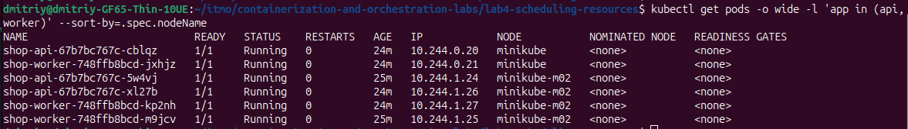

# Лаба 4 — SLA критического пути под перегрузкой

<table>
<tr><td align="center">

<!-- TODO(сюжет): сюда картинка из report/story/, продолжение истории КуберПанд после лабы 2 -->


<br>

*TODO: сюжетная подводка к лабе 4 — согласовать с тиммейтом (см. Plot.md из лабы 2).*

</td></tr>
</table>

Структура отчёта:

- **Часть 0** — критический путь (лавка панд: `api` → `worker` → `postgres`) и сервис `batch`;
- **Часть 1** — механизм разнесения подов: `podAntiAffinity` vs `topologySpreadConstraints`;
- **Часть 2** — тесный кластер (1-2 ноды) и гвардрейлы ресурсов;
- **Часть 3** — реальные метрики через `krr` вместо прикидок "с потолка";
- **Часть 4** — разнесение `api`/`worker` по нодам;
- **Часть 5** — приоритеты и QoS: `PriorityClass`, `PodDisruptionBudget`;
- **Часть 6** — `Pending` и preemption при нехватке ресурсов;
- **Часть 7** — давление по памяти и eviction;
- **Часть 8** — доказательство SLA пути заказа под перегрузкой;
- **Часть 9** — мониторинг: `ServiceMonitor`/`PrometheusRule` поверх стека лабы 2;
- **Итоги** — что в сухом остатке.

## Часть 0 — Критический путь и `batch`

Критический путь — лавка панд оформляет заказы. `api` принимает `POST /orders` (бамбуковые снэки, стикеры, плюшевые панды, кружки — на выбор или рандомом из каталога), пишет строку в `postgres`. `worker` — кладовщица на фоновом поллинге: вычитывает заказы со статусом `new` (через `FOR UPDATE SKIP LOCKED`, чтобы несколько реплик не толкались за один и тот же заказ), 0.5-2.5 секунды "упаковывает" и помечает `fulfilled`. Трейсинг, логи и метрики — тот же стек, что и в лабе 2, просто пара новых эндпоинтов и бизнес-метрик `shop_orders_created_total` / `shop_orders_processed_total`.

`batch` — контролируемый дармоед на будущее: Python-скрипт без единой зависимости, который по переменным окружения `CPU_WORKERS`/`MEMORY_MB` крутит N процессов в busy-loop и держит кусок памяти. Специально, чтобы в частях 6-7 было кого приносить в жертву без пересборки образа — всё крутится через `values.yaml`.

Первая версия воркера брала заказы строго по одному (упаковка 0.5-2.5 с), то есть три реплики тянули около 2 заказов в секунду, а нагрузка в пике — 50. Первый же прогон показал это в Postgres: за волну накапливались десятки тысяч заказов в статусе `new`, а `krr` смотрел бы на воркера, который почти всё время спит. Так что воркер теперь умеет `WORKER_CONCURRENCY` параллельных «кладовщиц» на реплику (по умолчанию 16, ручка в `values.yaml`), не держит соединение с БД, пока упаковывает, а в таблице заказов есть индекс по `(status, created_at)`.

Нагрузку по пути заказа даёт `loadgen/` — маленький Job внутри кластера (образ `shop-api`, там уже есть `httpx`), а не `hey` через `port-forward`: `port-forward` бьёт в один под, и две реплики `api` из трёх просидели бы без дела. Без keep-alive каждый запрос идёт новым соединением, и `kube-proxy` раскидывает их по всем репликам (в логах `api` получилось 498/466/504 заказов на реплику). Профиль — волнами, `loadgen/run.sh`: 5 → 20 → 50 → 10 → 0 запросов в секунду, 7 минут на цикл.

## Часть 1 — Механизм разнесения подов

Дефолт — `topologySpreadConstraints` (`maxSkew: 1`), и для `api`, и для `worker` — обе части пути одинаково критичны. `podAntiAffinity` остаётся в `values.yaml` как переключаемая альтернатива (так требует задание), но не дефолт.

Причина чисто арифметическая: нод — 2, реплик `api`/`worker` закладываем 3+. Hard `podAntiAffinity` — это бинарный запрет без понятия баланса: третья реплика на двух нодах просто не находит свободного места без "нарушителя" и зависает в `Pending` навсегда. `topologySpreadConstraints` в этой же ситуации разложит 3 реплики как 2+1 и тупика не создаст.

## Часть 2 — Тесная площадка

В задании kind/k3d упомянуты "строго на 1-2 ноды" — но строгость тут про число нод, не про инструмент. Остались на уже знакомом minikube: `minikube start --driver=docker --nodes=2 --cpus=3 --memory=6g`. Принцип тот же, что у kind/k3d — нода это просто контейнер на хосте, — а тащить в проект второй инструмент ради того же результата смысла не было.

Неожиданная находка по пути: у всего `kube-prometheus-stack` (Prometheus/Alertmanager/Grafana/kube-state-metrics/node-exporter) в чарте `resources: {}` по дефолту — весь мониторинг живёт как QoS BestEffort. Специально не чинили: ожидали, что низкий `priorityClass` у `batch` (часть 5) вытолкнет его раньше мониторинга, несмотря на одинаковый QoS-класс. Это была гипотеза, и в части 7 мы её проверили на практике. Она подтвердилась с оговоркой: kubelet смотрит сначала на превышение `requests` и только потом на приоритет, так что один из прогонов мониторинг пострадал раньше `batch`.

Ещё одна грабля, уже практическая: `minikube image build` на multi-node кластере грузит образ только на ту ноду, где шла сборка (обычно control-plane) — на второй ноде `kubectl get pods` сразу выдаёт `ErrImageNeverPull`. `minikube image load` эту ситуацию не чинит (он ищет образ в собственном кеше minikube, а собранный `image build`'ом образ туда не попадает). Рабочий обход — руками перегнать образ между нодами через containerd: `docker exec minikube ctr -n k8s.io images export - <образ> | docker exec -i minikube-m02 ctr -n k8s.io images import -` (ноды — это просто соседние docker-контейнеры на одном хосте, так что `ctr` внутри видит их как обычные файлы).

**А кластер-то оказался не тесным.** Перед частью 6 выяснилось неприятное: `--cpus=3 --memory=6g` у minikube на docker-драйвере работают только отчасти. Память ноды-контейнера действительно ограничена шестью гигабайтами (`memory.max` в её cgroup), а вот CPU не ограничен вообще (`NanoCpus=0`, `cpu.max = max`). Хуже того, kubelet про эти лимиты вообще не знает: он берёт capacity из `/proc/meminfo` и `nproc` хоста, и планировщик видел на каждой ноде **12 CPU и около 30 ГБ**. То есть «тесная площадка» была тесной только на бумаге: чтобы получить `Pending`, пришлось бы запросить в два с лишним раза больше ресурсов, чем у хоста вообще. Вдобавок minikube прописывает в `evictionHard` kubelet только дисковые сигналы (со значением `0%`), а `memory.available` там нет совсем, то есть **eviction по памяти в этом кластере не работал бы вовсе**: нода упёрлась бы в docker-лимит, а kubelet не заметил бы ничего.

Чинит это `setup/04-tight-cluster.sh`, на каждой ноде он делает три вещи:

1. `docker update --cpus=3`: теперь у ноды реально три ядра;
2. `kubeReserved.cpu = 9`: из 12 ядер хоста планировщику достаются ровно 3;
3. `evictionHard.memory.available = capacity − 5Gi`: этот порог одновременно уменьшает allocatable памяти до 5 ГБ и включает eviction, когда занято больше 5 ГБ, то есть раньше, чем docker убьёт процессы грубо по своему лимиту в 6 ГБ.

После `minikube start` конфиг kubelet может сброситься, тогда скрипт нужно запустить заново. Итог: `kubectl get node` показывает `ALLOC_CPU = 3` и `ALLOC_MEM = 5Gi` на каждую ноду.


## Часть 3 — Реальные метрики через `krr`

Изначально в `values.yaml` стояли цифры «на глаз»: `api` и `worker` по `50m/64Mi` requests и `200-250m/128Mi` limits, `postgres` — `100m/128Mi` и `500m/256Mi`. Теперь проверяем их реальностью.

**Нагрузка.** `loadgen` крутил волны 70 минут (10 циклов по 7 минут), всё это время Prometheus писал cAdvisor-метрики подов. Первый 70-минутный прогон пришлось выкинуть: он шёл на однопоточном воркере (см. часть 0), а потом его заодно убила перезагрузка тачки — Job в кластере живёт ровно столько, сколько живёт нода.


**`krr`.** Бинарник `krr` (v1.31.1) берётся готовым из Releases на GitHub — в PyPI его нет. Стратегия `simple-limit`, потому что только она выдаёт ещё и лимиты (обычный `simple` CPU-лимит не ставит вообще): CPU request на 66-м перцентиле, CPU limit на 96-м, память — максимум плюс 15%. Окно истории сначала поставили в час, чтобы оно целиком пришлось на волны, а не на простой кластера, а при перепроверке расширили до 24 часов (см. ниже). Автоопределение Prometheus получило `403`, поэтому `port-forward` и `-p`:

```bash
kubectl port-forward -n monitoring svc/kube-prometheus-stack-prometheus 9090:9090
krr simple-limit -n default -p http://127.0.0.1:9090 \
  --history-duration 1 --timeframe-duration 1 --points-required 30 --mem-min 32
```

(`--mem-min 32` убирает дефолтный пол в 100 МБ, он бы завысил цифры у лёгких сервисов, `--points-required 30` — потому что за час при шаге 1 минута набирается меньше дефолтных 100 точек. Итоговый запуск — то же самое, но с `--history-duration 24` (см. перепроверку ниже). Полный отчёт в формате YAML — `krr-report.yaml`.)


| Компонент | Первая прикидка (requests / limits) | `krr` | В чарте сейчас (requests = limits) |
|---|---|---|---|
| `api` | CPU `50m / 250m`, память `64Mi / 128Mi` | CPU `10m / 26m` (в часовом окне — «No data»), память `74Mi` | CPU `100m`, память `80Mi` |
| `worker` | CPU `50m / 200m`, память `64Mi / 128Mi` | CPU `10m` (это пол `--cpu-min`), память `59Mi` | CPU `50m`, память `64Mi` |
| `postgres` | CPU `100m / 500m`, память `128Mi / 256Mi` | CPU `17m / 29m` (в часовом окне — `10m`), память `198Mi` (в часовом окне — `123Mi`) | CPU `100m`, память `208Mi` |

Память прикидка угадала почти везде (`krr` просит чуть больше у `api` и чуть меньше у остальных). А вот CPU мы сильно переоценили: реальный пик `api` — около 28m при 17 запросах в секунду на реплику, воркера — 8m, Postgres — 31m. Кластер при этом нагружен ровно по волнам, не вхолостую.

Дальше «числа из `krr`» превратились в самую интересную часть лабы, потому что слепо перенести их в чарт не получилось. Три грабли подряд:

1. **В часовом окне `krr` молчит про CPU `api` и занижает Postgres.** Для `api` он не вернул данных (`Prometheus returned no CPULoader metrics`), а для Postgres показал `10m` при реальных p66 = 22m и p96 = 29m. Мы не поверили и проверили: прямой PromQL с той же формулой (`quantile_over_time(0.96, rate(container_cpu_usage_seconds_total{...}[1m])[1h:30s])`) данные возвращает, а запрос из исходников `krr`, выполненный руками, для `api` тоже работает. Вчерашняя нагрузка к тому моменту лежала в Prometheus, поэтому 70 минут повторять не пришлось: тот же `krr` с `--history-duration 24` (пустые часы, когда кластер был выключен, на перцентили не влияют, в подзапросе там просто нет точек) выдал для `api` `10m / 26m`, для Postgres `17m / 29m`. Это совпадает с сырым Prometheus (26-27m у `api`, 22m / 29m у Postgres). Вывод: CPU у `krr` стоит сверять с сырыми метриками, а окно истории брать с запасом. Причину «No data» в часовом окне до конца не выяснили.

2. **Postgres убит как `OOMKilled` при `128Mi`.** `krr` по часовому окну видел максимум 107Mi в установившемся режиме и порекомендовал 123Mi (с запасом 15%). Но при рестарте Postgres, с `shared_buffers = 128MB` по умолчанию и восстановлением, занимает заметно больше: контейнер падал в `CrashLoopBackOff`, а за ним, не достучавшись до БД, перезапускались `api` и `worker`. Окно побольше, поймавшее такой пик, показало настоящую цифру (2 часа — 171Mi, 24 часа — 198Mi), итоговые `208Mi` — круглое число над рекомендацией `krr` на 24 часа. Мораль: `krr` видит то, что было в окне истории, а не пик, который случится при рестарте.

3. **CPU-троттлинг.** Когда CPU limit поставили около p96 (по умолчанию стратегия так и делает, а Guaranteed ещё и требует `requests = limits`), прогон на 50 запросах в секунду показал `p95 = 3141 мс` вместо привычных 4-6 мс:

   | CPU limit | троттлинг `api` / `postgres` / `worker` (доля периодов) | p95 `POST /orders` на 50 rps |
   |---|---|---|
   | около p96 (`40m` / `50m` / `30m`) | 29% / 23% / 7-13% | **3141 мс** |
   | запас около x3.5 (`100m` / `100m` / `50m`) | 1% / 5% / 1% | **6 мс** |

   Дело в том, что лимит CFS считается окнами по 100 мс: `40m` — это всего 4 мс процессорного времени на окно, и любой микровсплеск упирается в потолок, хотя среднее использование (26m) ниже лимита. Для SLA «95% заказов быстрее 300 мс» троттлинг оказался куда опаснее, чем нехватка памяти. Так что итоговый CPU — это p96 из `krr` / Prometheus с запасом около x3.5, а не он сам.

Ещё одна мелочь по дороге: при CPU-лимите в единицы милликор Python-приложение с OpenTelemetry поднимается десятки секунд, и liveness-проба убивала его раньше, чем оно успевало стартовать. В чарт добавлен `startupProbe` для `api` и `worker` (до 5 минут на старт), пока он не пройдёт, liveness не включается.

## Часть 4 — Разнесение критического сервиса

`topologySpreadConstraints` (`maxSkew: 1`, `topologyKey: kubernetes.io/hostname`) висит на `api` и `worker`, по 3 реплики у каждого. `kubectl get pods -o wide` показывает разброс 2/1 между `minikube` и `minikube-m02` для обоих компонентов. Дымовой тест пути (`POST /orders` → `new` в postgres → воркер → `fulfilled`) проходит через реплики на обеих нодах.


Чтобы проверить, что это даёт на деле, мы «потеряли» ноду под нагрузкой: `kubectl cordon minikube-m02`, затем удалили все поды `api` и `worker`, которые на ней жили (честный `drain` не годится: он мог бы выселить заодно Prometheus и Loki с их `emptyDir`, а с ними историю метрик). Всё это время `loadgen` лил 20 заказов в секунду.

**`whenUnsatisfiable: DoNotSchedule` (дефолт).** Замена подов с `m02` встала в `Pending` и простояла так до возврата ноды (около двух с половиной минут). Причина прямо в событиях планировщика: `0/2 nodes are available: 1 node(s) didn't match pod topology spread constraints, 1 node(s) were unschedulable`. То есть планировщик не стал сваливать все реплики на единственную живую ноду, потому что перекос (3 против 0) больше `maxSkew`. Критический путь при этом остался в строю: на `minikube` жили одна реплика `api` и одна `worker`, и они вытянули 20 запросов в секунду с `p95 = 4 мс`. Ошибок было 13 из 6000 запросов, все в одном 30-секундном окне, в момент удаления подов (скорее всего, `kube-proxy` ещё не успел убрать их из эндпоинтов). После `uncordon` оставшиеся поды запланировались за секунды и стали `Ready` примерно за 15 секунд. Оговорка: одна реплика воркера (16 параллельных кладовщиц по ~1.5 с на заказ) разбирает около 10 заказов в секунду, то есть при 20 запросах в секунду очередь в Postgres на это время растёт и потом рассасывается. Это расчёт, длину очереди мы не замеряли.


*Слева направо по времени: поды `api` и `worker` с `m02` в `Pending` (в `NODE` пусто), после `uncordon` они сразу садятся на `minikube-m02`, `ContainerCreating`, `Running`.*

**`whenUnsatisfiable: ScheduleAnyway`.** Замена подов сразу уехала на живую ноду, всё снова стало 3+3, и в этом прогоне ошибок не было вовсе (разница с первым прогоном не в режиме, а в тайминге удаления подов: те же 13 ошибок могли бы получиться и здесь). Но видна и обратная сторона: после возврата ноды ничего не перераспределилось, все 6 подов остались на `minikube`, пока мы не перекатили Deployment руками (`helm upgrade` с жёстким режимом тут же раскидал их обратно 2/1). Планировщик решает, где жить поду, только в момент его создания.


*Нода к этому моменту уже была закордонена, а подов на ней уже не оставалось (`No resources found`): все шесть реплик стоят на `minikube`, в эндпоинтах `shop-api` три адреса оттуда же.*



| | `DoNotSchedule` | `ScheduleAnyway` |
|---|---|---|
| Пока нода мертва | часть реплик в `Pending`, мощность падает пропорционально потерянной ноде | сразу полный комплект реплик на живой ноде |
| Гарантия разнесения | жёсткая, все реплики на одной ноде не окажутся никогда | только пожелание, после аварии всё может «слипнуться» на одной ноде |
| Когда нода вернулась | недостающие реплики встают на неё сами | ничего не двигается без рестарта или descheduler |

В `values.yaml` оставили `DoNotSchedule`: лаба про явное разнесение, а в частях 6-7 нам нужен именно предсказуемый `Pending`. Для боевого сервиса с одним-двумя минутами допустимой деградации мы бы, скорее всего, выбрали `ScheduleAnyway` плюс descheduler. Переключатель — одна строчка (`podSpread.whenUnsatisfiable`).

## Часть 5 — Приоритеты и QoS

В чарте теперь два `PriorityClass` и по PDB на каждый компонент критического пути:

| Компонент | QoS | PriorityClass | PDB |
|---|---|---|---|
| `api` | Guaranteed (`requests = limits`) | `shop-critical`, 100000 | `maxUnavailable: 1` |
| `worker` | Guaranteed | `shop-critical`, 100000 | `maxUnavailable: 1` |
| `postgres` | Guaranteed | `shop-critical`, 100000 | `minAvailable: 1` |
| `batch` | Burstable (`500m / 1Gi` requests, `1 CPU / 1536Mi` limits) | `shop-batch`, -100 | нет |


Цифры приоритетов выбраны не случайно. `shop-critical` 100000 лежит выше любых пользовательских нагрузок, но далеко ниже системных классов Kubernetes (они начинаются с двух миллиардов), так что мы не конкурируем с `kube-system`. `shop-batch` -100 специально ниже дефолтного 0, которым живёт всё остальное без явного класса, в том числе мониторинг из лабы 2. Иначе при нехватке ресурсов `batch` стоял бы в одной очереди с Prometheus и Grafana. У `shop-batch` ещё `preemptionPolicy: Never`: если `batch` не влезает на ноду, он остаётся в `Pending` и никого не вытесняет, потому что он сам расходный материал.

**PDB.** Для `api` и `worker` всё просто: при добровольных выселениях (`kubectl drain`, обновление ноды) не больше одной реплики сразу. С Postgres пришлось отступить от того, что чарт Bitnami делает сам. Он создаёт PDB с `maxUnavailable: 1`, а реплика у нас одна, то есть такой PDB разрешает выселить единственный под и ничего не защищает. Поэтому поставили `minAvailable: 1`. Цена вопроса: `kubectl drain` ноды с Postgres теперь зависнет с ошибкой `Cannot evict pod as it would violate the pod's disruption budget`, и это нормально, потому что так и должна работать защита. Важное ограничение: PDB работает только для добровольных выселений. Падение ноды, eviction под давлением ресурсов и `OOMKilled` на него не смотрят, а обновление StatefulSet через контроллер им тоже не блокируется.

**Burstable и Guaranteed: кого выселят первым.** Порядок вытеснения при нехватке ресурсов на ноде (node-pressure eviction, делает kubelet) такой: сначала под, чьё потребление превышает его `requests`, и среди них первыми идут поды с меньшим приоритетом, а уже потом смотрят, насколько сильно превышены `requests`. Поды, которые укладываются в свои `requests`, трогают в последнюю очередь. Отсюда для нас:

- `api`, `worker`, `postgres` (Guaranteed): `requests = limits`, поэтому память физически не может превысить `requests` (на лимите контейнер убьёт OOM killer, а не eviction). Они всегда в «последней» группе.
- `batch` (Burstable): пока он спокойно жуёт свои ~140 МБ, он укладывается в `requests` и никому не интересен. Но если «потечёт» за свои `requests`, то попадает в «первую» группу, и там у него самый низкий приоритет (-100), поэтому он первая жертва.
- Мониторинг (BestEffort, `requests` не заданы): любое потребление превышает нулевые `requests`, так что он тоже в «первой» группе, но с приоритетом 0 его выселят после `batch`. Это то, что мы обсуждали в части 2. В части 7 проверили на практике, с нюансом про `requests` самого `batch`.

Отдельно: preemption планировщика (часть 6) смотрит только на приоритет и QoS-класс не учитывает вовсе.

## Часть 6 — Pending и preemption

`batch` получил осмысленные ресурсы: `requests` `500m / 1Gi`, `limits` `1 CPU / 1536Mi` (Burstable, `requests` заметно ниже `limits`). Цифры подобраны под кластер из двух нод по 3 CPU и 5 ГБ allocatable: с учётом того, что на них уже живут критический путь, `kube-system` и мониторинг, помещается ровно 7 реплик (3 на `minikube`, 4 на `minikube-m02`). `requests` у этих 7 реплик занимают 91% CPU на `minikube` и 87% памяти на `minikube-m02`. Реально же каждая реплика `batch` ест около 120-140 МБ памяти: планировщик считает по `requests`, а не по факту, поэтому ноды «полны» при почти пустой памяти.

**`Pending`.** Дальше увеличиваем `batch.replicaCount` до 10 (`helm upgrade ... --set batch.replicaCount=10`). Семь реплик `Running`, три остаются в `Pending` с причиной от планировщика:

```
0/2 nodes are available: 1 Insufficient cpu, 1 Insufficient memory.
preemption: not eligible due to preemptionPolicy=Never.
```

Оба слова про нехватку тут настоящие: на одной ноде кончился CPU, на другой память. А последняя строка показывает ещё кое-что: `batch` не может никого вытеснить, потому что у `shop-batch` `preemptionPolicy: Never`. Критический путь при этом не пострадал ни на секунду.


**Preemption.** Теперь заставим критический путь потребовать места. Оставляем кластер заполненным `batch` и поднимаем `api` с 3 до 14 реплик (`--set api.replicaCount=14`, по `100m / 80Mi` на реплику, суммарно больше, чем осталось свободным). Через несколько секунд новые поды `api` в `Pending` получают в колонке `NOMINATED NODE` значение `minikube`, то есть планировщик решил освободить место именно там, а в событиях появляется:

```
Preempted   shop-batch-...-4d9vz   Preempted by pod 2caaeace-... on node minikube
```

Жертва уходит в `Terminating`, на её месте поднимаются поды `api`. Через минуту все 14 реплик `api` `Running` и разнесены 7/7 (`maxSkew` из части 1 удержался даже при вытеснении), а у `batch` в этом прогоне вытеснена одна реплика: её замена встала в `Pending` и вместе с остальными ждёт, пока освободятся ресурсы. Итог: 6 `batch` в `Running` и 4 в `Pending`, а критический путь не потерял ни одной реплики.


Эксперимент поставлен через `--set`, в `values.yaml` остались дефолты (`api` 3 реплики, `batch` 2), после опыта сделали `helm upgrade --reset-values`. Заметка про Helm: у `helm upgrade` без флагов значения из прошлых `--set` не сбрасываются сами, так что откатывать их надо явно.

## Часть 7 — Давление по памяти и eviction

Здесь два способа потерять под из-за памяти, и их легко перепутать. Поэтому делаем оба по очереди.

### 7А — `OOMKilled`: под упёрся в свой лимит

Один `batch` с аппетитом 2000 МБ при лимите 1536Mi (`experiments/oomkill.values.yaml`):

```bash
helm upgrade shop charts/shop --reset-values -f experiments/oomkill.values.yaml
```

Через секунду-другую контейнер убит, а в `describe` видно:

```
Last State:  Terminated
  Reason:    OOMKilled
  Exit Code: 137
```

Дальше `CrashLoopBackOff` с растущей паузой. Убило не Kubernetes, а ядро: контейнер вылез за memory-cgroup, которую ему выставил `limits.memory`. Нода при этом ничего не заметила, `Evicted` в событиях нет, соседи не пострадали. Это приговор конкретному контейнеру за его собственные дела.


### 7Б — eviction: давление на ноде

Теперь наоборот: каждый под ведёт себя прилично (меньше своего лимита), но вместе они съедают ноду. Порог мы поставили в части 2: kubelet начинает выселять поды, когда `memory.available < 26680520Ki`, то есть когда working set ноды превышает 5 ГБ. На старте на `minikube` уже занято около 2,7 ГБ (control-plane и мониторинг), на `minikube-m02` около 1,5 ГБ. Запас до 5 ГБ есть, но небольшой.

Опыт (`experiments/eviction.values.yaml`, запускается одной командой `bash experiments/eviction-demo.sh`): 5 реплик `batch`, каждая плавно набирает память со скоростью 10 МБ/с до 1400 МБ, то есть ниже лимита 1536Mi, так что `OOMKilled` тут ни при чём. «Плавно» важно: kubelet проверяет память раз в 10 секунд, а у нод есть жёсткий потолок 6 ГБ на уровне Docker. Если занять память одним махом, нода проскочит порог и упрётся в потолок раньше, чем kubelet успеет среагировать, и OOM-killer начнёт убивать что попало вместо аккуратного eviction. Для этого в `batch` появилась переменная `GROW_MB_PER_SEC` (0 = занять всё сразу, как было раньше).


Как это выглядит: working set обеих нод растёт, и на пороге около 5 ГБ kubelet выселяет одну реплику `batch`. Working set после этого падает на 1-1,3 ГБ, оставшиеся реплики продолжают расти, и так по кругу. За прогон выселено 5 реплик: первая вылетела, когда набрала всего ~900 МБ (давление на ноде набралось от нескольких реплик сразу), последние успели вырасти до целевых 1400 МБ. Каждое событие выглядит так:

```
The node was low on resource: memory. Container batch was using 1143748Ki,
request is 512Mi, has larger consumption of memory.
```

Выселяются только `batch`. `api`, `worker` и `postgres` не потеряли ни одной реплики, их счётчики рестартов не сдвинулись. Выселенные поды остаются в статусе `Failed`, Deployment создаёт им замену, а та растёт и со временем выселяется снова.


### Что вскрылось по дороге

**Первый прогон выселил Prometheus раньше `batch`.** Мы запустили то же самое, но с `requests` 1Gi (как в части 6) и семью репликами. Результат: kubelet выселил `prometheus`, `jaeger`, `promtail`, `node-exporter`, `storage-provisioner`, и только потом дошёл до `batch`. Причина в порядке ранжирования из части 5: kubelet смотрит сначала на то, превышает ли под свои `requests`, и лишь потом на приоритет. Семь реплик росли одновременно, и нода дошла до порога, когда каждая реплика была ещё меньше чем на гигабайте, то есть *ниже* своего `requests` в 1Gi. По этому критерию `batch` в тот момент был «приличным подом», а BestEffort-мониторинг с нулевыми `requests` превышал их при любом потреблении и шёл первым. Когда реплики `batch` доросли выше 1Gi, их выселения пошли штатно (в сообщении появилось `request is 1Gi, has larger consumption`), но Prometheus к тому моменту уже погиб, а вместе с ним и вся история метрик, потому что хранит её в `emptyDir`. Урок: приоритет `-100` защищает от выселения в последнюю очередь, а не в первую, если `requests` завышены. Для опыта мы временно снизили `requests` по памяти у `batch` до 512Mi, это и лежит в `eviction.values.yaml`. В дефолтных `values.yaml` остался 1Gi, он нужен для части 6.

**Гипотеза из части 2 подтвердилась.** В логе kubelet перед каждым выселением печатается очередь кандидатов (`pods ranked for eviction`). В нашем прогоне она выглядит так: на каждой ноде сначала реплики `batch`, за ними BestEffort-мониторинг (`promtail`, `node-exporter`, `grafana`, `prometheus`), дальше `kube-system`, и в самом хвосте `api`, `worker` и `postgres`. То есть BestEffort-мониторинг действительно следующий после `batch`, а в первом прогоне мы увидели, как это выглядит на практике. Выводится этот список в конце `eviction-demo.sh`.

**Под без статистики выселяют первым.** В первом прогоне `alertmanager` выселялся по пять раз, хотя ничем не выделялся. Он застрял в `Init:0/1`, потому что в кластере не было секрета `telegram-bot-token` (осталось от лабы 2). У пода в `Init` нет статистики использования, а kubelet выселяет первым того, о ком ничего не знает. Секрет мы завели, Alertmanager поднялся, а он нам понадобится в части 9.

**Лишняя чистка.** Поды, которые controller пересоздаёт на ноде под давлением, kubelet отклоняет на этапе допуска (`The node had condition: [MemoryPressure]`). Каждая отклонённая попытка остаётся в кластере объектом `Failed`. К концу первого прогона их набралось 79, и убираются они `kubectl delete pods -A --field-selector=status.phase=Failed`.

**Давление не снимается сразу.** Когда память уже в норме, нода ещё около пяти минут держит условие `MemoryPressure` и taint `node.kubernetes.io/memory-pressure`. Мы выставили `evictionPressureTransitionPeriod: 0s`, но kubelet воспринимает ноль как «значение по умолчанию» (5 минут). Всё это время замены выселенных `batch` висят в `Pending`. Критическому пути это не мешает, а `eviction-demo.sh` перед стартом сам ждёт, пока taint-ы слезут.

### Eviction и `OOMKilled`: в чём разница

| | `OOMKilled` | eviction |
|---|---|---|
| Кто убивает | ядро (OOM-killer в cgroup контейнера) | kubelet |
| Триггер | контейнер превысил свой `limits.memory` | на ноде не хватает памяти (`memory.available` ниже порога) |
| Кого | того, кто вышел за лимит | кого скажет ранжирование: сначала превысивших `requests`, среди них с меньшим приоритетом |
| Что с подом | контейнер перезапускается в том же поде (`RESTARTS` растёт, потом `CrashLoopBackOff`) | под завершается со статусом `Failed`, контроллер создаёт новый |
| Где видно | `Last State: Terminated, Reason: OOMKilled`, exit code 137 | событие `Evicted` с текстом про ноду |
| Защита `Guaranteed` | не помогает: за свой лимит убивают и их | помогает: потребление не выше `requests`, поэтому в очередь они попадают последними |

Вывод для лабы: приоритет и QoS в Kubernetes защищают от eviction, но не от `OOMKilled`. Защита от `OOMKilled` — это правильный `limits.memory`, а не классы, и именно поэтому в части 3 мы считали memory limit по максимуму из krr плюс запас.

## Часть 8 — Доказательство SLA

**SLA.** Мы обещаем так: *95% запросов на создание заказа (`POST /orders`) отвечают быстрее 300 мс, а доля ответов 5xx ниже 1%, при нагрузке до 50 заказов в секунду, даже когда `batch` занял кластер.* Меряем по метрике сервера (`http_request_duration_seconds`, окно в минуту), потому что именно это видит покупатель, когда нажимает «оформить». Упаковка заказа воркером в обещание не входит: она асинхронная, и про неё отдельный разговор ниже.

**Как проверяли.** Одной командой `bash experiments/sla-run.sh`: 21 минута нагрузки (три цикла волн 5, 20, 50, 10 и 0 заказов в секунду, пик 50 заказов/с) и поверх неё две перегрузки от `batch`:

| Когда (UTC) | Что происходило |
|---|---|
| 12:56-12:58 | базовая линия, без перегрузок |
| 12:58-13:03 | перегрузка 1: eviction по памяти из части 7 (5 выселенных `batch`), совпала с пиковой волной 50 заказов/с первого цикла |
| 13:07-13:15 | перегрузка 2: 7 реплик `batch` жгут по ядру, то есть все 6 ядер двух нод; полностью накрыла пик третьего цикла и частично второго |


**Результат.**

| Фаза | p95 `POST /orders`, максимум по минутным окнам | 5xx |
|---|---|---|
| базовая линия | 81 мс (самая первая минута, холодные соединения), дальше 5-10 мс | 0% |
| eviction | 18 мс | 0% |
| CPU-перегрузка, 7 `batch` | 22 мс | 0% |
| весь прогон, глазами клиента (`loadgen`) | 4-37 мс по волнам | 0 из 27 900 запросов |

На самых тяжёлых волнах (50 заказов/с, пики второго и третьего циклов, которые накрыла CPU-перегрузка) клиентский p95 был 32 и 37 мс против 21 мс в первом цикле. Задержка выросла в 1,5-1,8 раза, но SLA в 300 мс выдержан с запасом минимум в 8 раз, а ошибок нет вообще. Худшая точка на графике, 81 мс, пришлась на первую минуту, когда `loadgen` только открыл соединения, и это тоже в пределах SLA.


**Почему так вышло.** Всё из частей 5-7 сработало вместе, и каждый кусок видно на графиках. `batch` на панели CPU по подам честно съедает по ядру на реплику, а `api` в это время тратит 1-3% ядра, и ему этого хватает: у `api` Guaranteed-QoS, `requests` равны `limits`, так что его 100m гарантированы независимо от соседей, а больше ему и не нужно. Память: когда нода дошла до порога, kubelet выселял `batch`, а `api`, `worker` и `postgres` стояли в хвосте очереди (часть 7), и ни один из них не потерял реплику. А если бы критическому пути не хватило места, preemption из части 6 освободил бы его за счёт `batch`.

**Оговорка про `worker`.** SLA про приём заказа, а не про его упаковку, и это не случайно. Воркер на трёх репликах вытягивает около 30 заказов/с, а на пике создаётся 50, поэтому очередь необработанных заказов растёт на пиках и рассасывается на спадах (панель «Необработанные заказы» на дашборде). Задержка приёма от этого не страдает, потому что `api` только кладёт заказ в базу. Если бы мы обещали «заказ упакован за N секунд», этот SLA на пике мы бы не выдержали, и тогда пришлось бы масштабировать воркер. Поэтому в формулировке стоит именно `POST /orders`.

**Заметка про дашборд.** Первая версия панели p95 рисовала ось до 80 мс, и красная линия SLA в 300 мс просто не попадала в кадр, а панель 5xx показывала `No data` вместо нуля, потому что за весь прогон не было ни одной 5xx-серии. Поправили: у p95 минимум шкалы 350 мс, а у 5xx выражение дополнено `or vector(0)`.

## Часть 9 — Мониторинг

Мониторинг лежит в чарте целиком, отдельно ничего не ставится. Графики латентности нужны были ещё для частей 3 и 8, поэтому первые два куска появились раньше: `ServiceMonitor` (`api` и `worker`, скрейп раз в 15 секунд, шаблон `servicemonitor.yaml`) и дашборд «Лавка панд — критический путь заказа» (9 панелей, ConfigMap с лейблом `grafana_dashboard`, его подхватывает сайдкар Grafana). Третий кусок, `PrometheusRule` с алертами (`prometheusrule.yaml`), добавлен в этой части. Пороги вынесены в `values.yaml`.

**Три алерта и зачем именно они.** Алерт должен будить человека тогда, когда есть что делать, и не шуметь по расходному материалу. Поэтому два алерта про симптомы (то, что видит покупатель), один про причину, которая стреляет раньше симптомов.

| Алерт | Условие | `for` | Severity | Зачем |
|---|---|---|---|---|
| `ShopOrderLatencySLOBreach` | p95 `POST /orders` > 300 мс (окно 2 минуты) | 2m | critical | Прямое нарушение SLA из части 8. Две минуты, чтобы не будить из-за разовых всплесков (холодный старт `loadgen` давал 81 мс, но это далеко от порога). |
| `ShopOrderErrorsHigh` | доля 5xx на `POST /orders` > 1% | 2m | critical | Вторая половина SLA. Отдельный алерт, потому что отказы бывают быстрыми: если упадёт Postgres, `api` будет отвечать 500 за миллисекунды, и по задержке всё будет прекрасно. |
| `ShopNodeMemoryPressure` | у любой ноды `MemoryPressure = true` (`kube_node_status_condition`) | 30s | warning | Причина, а не симптом. Это единственное, что видно в части 7, пока SLA ещё цел: kubelet уже выселяет `batch`, запас по памяти кончился, и следующим шагом могут быть уже не только `batch`. `warning`, а не `critical`, потому что критический путь в этот момент жив. |

Чего в списке нет: алертов на `batch` (CPU, `Pending`, выселения). `batch` у нас расходный материал, его `Pending` и eviction это штатное поведение (части 6 и 7), и алерт на него разбудил бы человека ради того, что система сделала правильно.

**Проверка.** Правила применились (`kubectl get prometheusrule shop-alerts`), Prometheus принял их без ошибок. Чтобы убедиться, что выражения работают, а не просто выглядят правдоподобно, мы временно опустили порог задержки до 1 мс и дали немного нагрузки: алерт прошёл `pending`, через ~100 секунд стал `firing` и появился в Alertmanager. После этого порог вернули. Настоящее срабатывание ловим на `ShopNodeMemoryPressure`: запускаем `experiments/eviction-demo.sh` из части 7, и через 2-3 минуты после старта алерт загорается. Состояние `MemoryPressure` на ноде держится ещё около 5 минут после конца давления (см. часть 7), так что `firing` успевает попасть на скрин.


Оговорка про доставку. Алерты видны в Prometheus и Alertmanager, но в Telegram не уходят: Alertmanager из лабы 2 отправляет туда только `Panda*`-алерты, остальное уходит в пустой приёмник. Трогать конфиг стека лабы 2 в рамках этой лабы не стали.

## Итоги

SLA критического пути под перегрузкой мы не просто заявили, а измерили: за 21 минуту волн до 50 заказов в секунду, при eviction по памяти и при семи `batch`, которые жгли все ядра кластера, p95 создания заказа на всех волнах не поднимался выше 37 мс при пороге 300 мс (единственный всплеск до 81 мс пришёлся на холодный старт `loadgen`), ошибок 0 из 27 900. Держат это сразу несколько механизмов, и без любого из них картина была бы хуже: разнесение по нодам (часть 4), Guaranteed-QoS с приоритетом `shop-critical` (часть 5), `preemptionPolicy: Never` у `batch` и preemption в пользу критического пути (часть 6), eviction, который съедает `batch` первым (часть 7).

**Что получилось лучше ожиданий.** Ни одного нарушения SLA и ни одной потерянной реплики критического пути во всех перегрузках от `batch` (части 6-8). Настоящий алерт `ShopNodeMemoryPressure` загорелся в опыте из части 7, а выражение алерта по задержке мы проверили искусственно, опустив порог до 1 мс.

**Грабли, которые стоили нам больше всего времени (и поэтому попали в отчёт):**

- **Кластер был «тесным» только на бумаге** (часть 2): флаги `--cpus` и `--memory` у minikube на docker-драйвере kubelet не видит, а eviction по памяти в нём не настроен вообще. Без `setup/04-tight-cluster.sh` частей 6 и 7 просто не существовало бы.
- **`krr` нельзя переносить в чарт слепо** (часть 3): окно истории пропустило пик памяти при рестарте Postgres (`OOMKilled`), а CPU limit около p96 дал троттлинг и p95 в три секунды. Цифры из `krr` это отправная точка, а не результат.
- **Приоритет не защищает, если завышены `requests`** (часть 7): kubelet сначала смотрит на превышение `requests` и только потом на приоритет. Из-за этого в одном из прогонов раньше `batch` пострадал мониторинг.
- **Мелочи, которые кусаются:** `helm upgrade` без `--reset-values` тихо тащит значения из прошлых `--set`; Prometheus с `emptyDir` теряет всю историю при выселении; под в `Init` без статистики выселяют первым; memory-pressure держится на ноде 5 минут после конца давления.

**Что мы бы доделали, будь это боевой сервис:**

- Дать мониторингу собственный `priorityClass` и `requests`: сейчас он BestEffort, и при серьёзном давлении на ноде он следующий после `batch`. Заодно положить Prometheus на постоянный том.
- Масштабировать `worker` по длине очереди (HPA по необработанным заказам): на пике он вытягивает ~30 заказов/с против 50 создаваемых, и очередь копится. SLA приёма заказа от этого не страдает, но «заказ упакован за N минут» мы бы так не пообещали.
- Подключить новые алерты к Telegram в конфиге Alertmanager и поставить `descheduler`, чтобы `ScheduleAnyway` из части 4 не оставлял всё на одной ноде.

### Как воспроизвести

```bash
minikube start --driver=docker --nodes=2 --cpus=3 --memory=6g
bash setup/04-tight-cluster.sh        # повторять после каждого minikube start / перезагрузки
bash build-images.sh                  # образы api, worker, batch на обе ноды
helm upgrade --install shop charts/shop   # стек лабы 2 (kube-prometheus-stack) должен стоять заранее: нужны его CRD

bash loadgen/run.sh                   # волны нагрузки (WAVES / CYCLES настраиваются)
bash experiments/eviction-demo.sh     # часть 7Б: eviction под давлением памяти
bash experiments/sla-run.sh           # часть 8: нагрузка + eviction + CPU-перегрузка за ~21 минуту
```

Остальные опыты (части 4, 6, 7А) воспроизводятся командами из соответствующих разделов, значения для 7А лежат в `experiments/oomkill.values.yaml`. После любых опытов с `--set` откатывайтесь командой `helm upgrade shop charts/shop --reset-values`.
