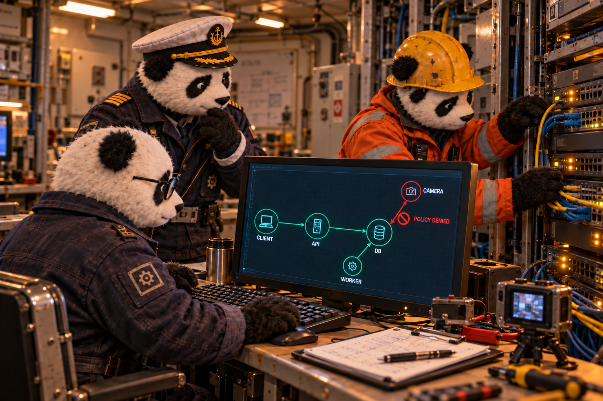
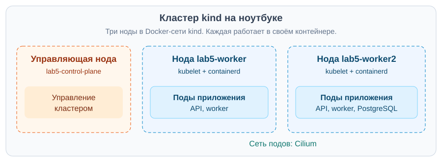
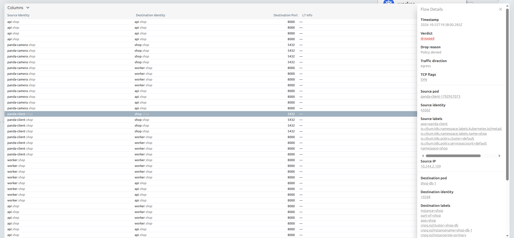
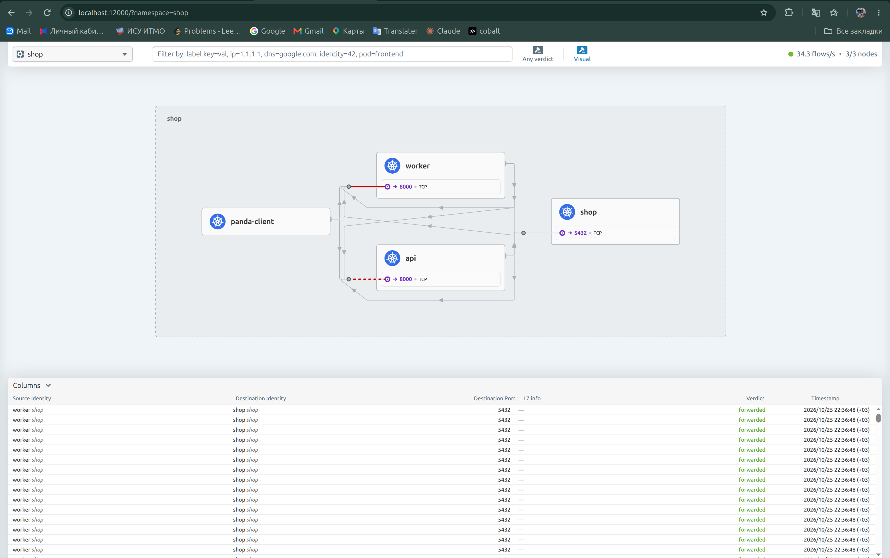
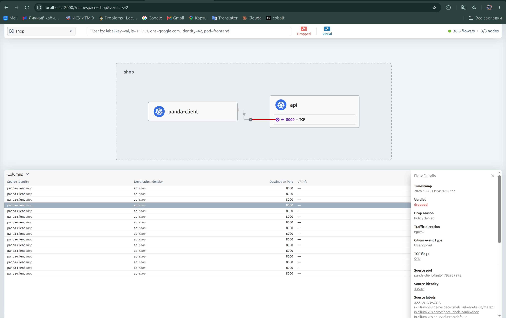
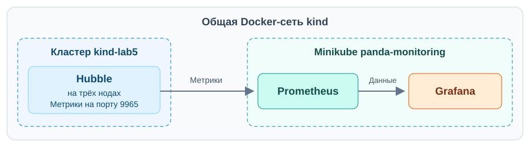
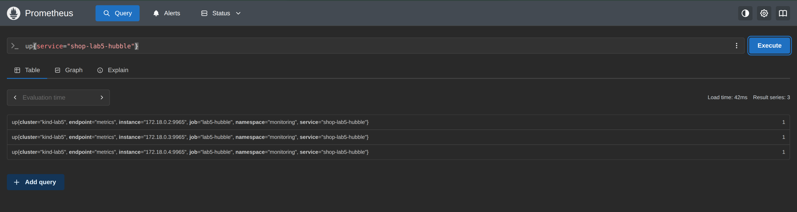
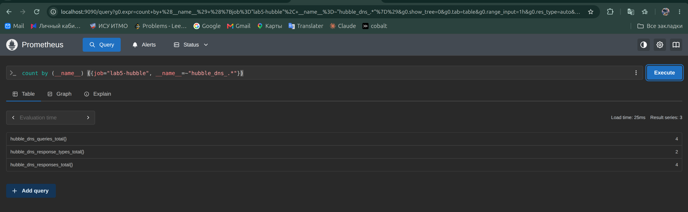
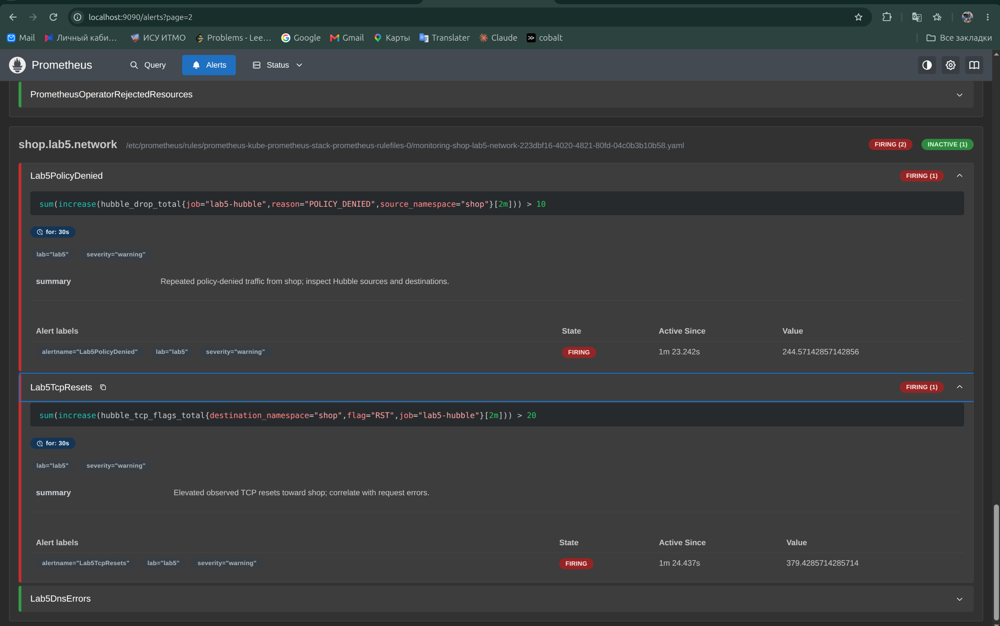

# Лаба 5 — Zero-trust сеть с доказательством

<table>
<tr><td align="center">

 

*Панды готовят план перемещения груза. Оператор отправляет задания в PandaRecovery через API, worker их обрабатывает, а база хранит результаты. За грузом на палубе следят через камеру. Она подключена к той же сети, но обращаться к базе ей незачем.*

*Нужно оставить только нужные соединения, проверить работу сервиса при замене подов и разобраться, как искать сетевые ошибки.*

</td></tr>
</table>

Для проверки взяли `shop` из третьей лабы. Вместо расчётов груза в нём пока тестовые задания, но для опытов с сетью этого вполне достаточно.

Структура:

- [0. Кластер в Docker и выбор CNI](#часть-0--кластер-в-docker-и-выбор-cni)
- [1. Сеть пода](#часть-1--сеть-пода)
- [2. Пересоздание подов под нагрузкой](#часть-2--пересоздание-подов-под-нагрузкой)
- [3. Кому нужен доступ](#часть-3--кому-нужен-доступ)
- [4. Сетевые политики](#часть-4--сетевые-политики)
- [5. Проверка доступа](#часть-5--проверка-доступа)
- [6. Поиск поломки через Hubble](#часть-6--поиск-поломки-через-hubble)
- [7. Мониторинг](#часть-7--мониторинг)

## Часть 0 — Кластер в Docker и выбор CNI

Кластер подняли через kind. Я впервые попробовал запускать Kubernetes так: вместо отдельных машин под ноды используются обычные Docker-контейнеры. В каждом работают kubelet и containerd и через них запускаются поды. Весь кластер помещается на одном ноутбуке.

В [kind.yaml](cluster/kind.yaml) указали одну управляющую ноду и две рабочие. Получили три контейнера в общей Docker-сети `kind`. Рабочих нод взяли две, чтобы проверить, как общаются поды на разных нодах.

Docker-сеть соединяет сами ноды. Для сети подов выбрали Cilium вместо стандартного kindnet. Вместе с ним поставили Hubble, чтобы видеть разрешённые и заблокированные соединения.

За Service оставили отвечать kube-proxy в режиме `iptables`. В [настройках Cilium](cluster/cilium-values.yaml) отключили его замену (`kubeProxyReplacement: false`) и включили Hubble Relay и веб-интерфейс.

Заодно впервые попробовал Lens. Раньше пользовался k9s, но для этой лабы Lens оказался удобнее. В нём смотрел состояние нод и подов.

Проверка кластера в Lens

Открыл в Lens kubeconfig `$HOME/.kube/lab5.yaml` и выбрал `kind-lab5`. В разделе Nodes все три ноды уже были `Ready`.

## Часть 1 — Сеть пода

Развернули три реплики API, две worker и PostgreSQL под управлением CloudNativePG. В Lens открыли Pods и выбрали namespace `shop`. Все шесть подов в `Running`, перезапусков нет.

Приложение взяли из [третьей лабы](../lab3-control-plane). С ноутбука API доступен на `127.0.0.1:28000` через NodePort.

Потом проверили сеть подов скриптом:

~~~bash
bash lab5-networking/scripts/01-network-check.sh
~~~

Нашли IP пода и его интерфейс `eth0`, а на ноде — парный интерфейс. Вместе они образуют veth-пару, через которую под подключён к сети ноды.

Затем из одного пода запросили `/health` у API на другой ноде, напрямую по IP. Получили `200 ok`, значит, поды связались без Service и DNS. Внизу скрина виден ответ.

## Часть 2 — Пересоздание подов под нагрузкой

Запустили [02-chaos.py](scripts/02-chaos.py). Два клиента три минуты запрашивали `/health`: один из пода по DNS-имени Service, другой с ноутбука через NodePort. Каждые восемь секунд скрипт удалял случайный готовый под API или worker.

С первого раза получилось странно. Ошибок не было, но через DNS прошло всего 29 запросов, а через NodePort — 875. Оказалось, разрешение полного имени занимало примерно шесть секунд.

Сравнили три варианта имени:

| Имя | Время разрешения |
| --- | --- |
| `shop-api` | 0,069 с |
| `shop-api.shop.svc.cluster.local` | 6,007 с |
| `shop-api.shop.svc.cluster.local.` | 0,001 с |

При `ndots:5` наше имя с четырьмя точками сначала проверялось с поисковыми суффиксами. Добавили точку в конце, чтобы искать сразу полное имя. Задержка исчезла.

Повторили тест. За 180 секунд получили 870 запросов через DNS и 874 через NodePort, в обоих случаях 0 ошибок. За это время скрипт удалил 21 под API/worker.

Вывод теста и условия запуска

В терминале остался список удалённых подов с их IP. Внизу скрипт вывел число запросов и ошибок для обоих клиентов.

Здесь мы ещё не ограничивали доступ сетевыми политиками. Внешний запрос мог попасть в API на любой ноде (`externalTrafficPolicy: Cluster`). Позже переключились на `Local`, где запрос обслуживает только нода, на которую он пришёл. Поэтому результат этого теста относится к режиму `Cluster`.

### Почему запросы продолжали проходить

У Service постоянный адрес. Пока один под удалялся, запросы принимали другие готовые реплики. Kubernetes обновлял список подов, а kube-proxy — правила, куда отправлять трафик. Пауза в `preStop` давала на это время перед остановкой пода.

С ноутбука подключались через NodePort, то есть через порт ноды. LoadBalancer даёт доступ через внешний балансировщик, а Headless Service отдаёт адреса подов напрямую через DNS.

## Часть 3 — Кому нужен доступ

Разрешили терминалу обращаться к API, а API и worker к базе. Всё остальное между подами приложения решили закрыть. Камеру из сюжета в тесте изображает под `panda-camera`. С него проверяем, что постороннее устройство не получит доступ к сервисам.

Получилась такая таблица доступа. API → API и worker → worker здесь означают подключение к другому поду, а не к самому себе.

| Источник | API, TCP 8000 | worker, TCP 8000 | PostgreSQL, TCP 5432 |
| --- | --- | --- | --- |
| Терминал (`panda-client`) | Да | Нет | Нет |
| API | Нет | Нет | Да |
| worker | Нет | Нет | Да |
| Камера (`panda-camera`) | Нет | Нет | Нет |
| PostgreSQL | Нет | Нет | Только внутри своего DB-кластера |

Ответы на разрешённые запросы отдельно открывать не нужно.

Ещё оставили DNS, доступ оператора CloudNativePG к базе и самой базы к Kubernetes API, чтобы они продолжали работать. Доступ с ноутбука через NodePort разобрали ниже.

## Часть 4 — Сетевые политики

Добавили политики в [шаблон Helm](charts/shop/templates/networkpolicy.yaml), а их настройки вынесли в [values.yaml](charts/shop/values.yaml). Включаются они через [zero-trust.yaml](experiments/zero-trust.yaml).

Сначала запретили весь входящий и исходящий трафик в `shop` через default-deny. Затем разрешили связи из таблицы и служебный трафик. Все поды остались `Ready`, база тоже работала.

Применение через Helm

~~~bash
helm upgrade shop lab5-networking/charts/shop \
  --kubeconfig "$HOME/.kube/lab5.yaml" \
  --kube-context kind-lab5 -n shop \
  --set monitoring.enabled=false \
  -f lab5-networking/experiments/zero-trust.yaml \
  --wait --timeout 3m
~~~

`monitoring.enabled=false` отключает шаблоны мониторинга приложения, оставшиеся от третьей лабы. Сетевые метрики подключали отдельно к уже работающему Prometheus.

Позже добавили правило `nodeport-entry` для внешнего клиента и заменили обычное разрешение DNS на CiliumNetworkPolicy, чтобы видеть DNS-запросы. В итоговой конфигурации получилось шесть NetworkPolicy и одна CiliumNetworkPolicy.

## Часть 5 — Проверка доступа

Запустили [03-access-matrix.py](scripts/03-access-matrix.py). Скрипт пробует соединения из клиентского и постороннего подов, API и worker. Все 12 направлений совпали с ожиданиями.

| Источник | Получатель | Ожидали | Получили |
| --- | --- | --- | --- |
| client | api | ALLOW | ALLOW |
| client | worker | DENY | DENY |
| client | postgres | DENY | DENY |
| camera | api | DENY | DENY |
| camera | worker | DENY | DENY |
| camera | postgres | DENY | DENY |
| api | api | DENY | DENY |
| api | worker | DENY | DENY |
| api | postgres | ALLOW | ALLOW |
| worker | api | DENY | DENY |
| worker | worker | DENY | DENY |
| worker | postgres | ALLOW | ALLOW |

Разрешённые TCP-соединения открылись, запрещённые завершились таймаутом. Проверили и само приложение: клиент получил HTTP 200 через DNS Service, API и worker выполнили `SELECT 1` в PostgreSQL.

Вывод проверки матрицы

В выводе скрипта сравнили `EXPECTED` и `ACTUAL`. Везде `PASS`, в том числе там, где соединение должно быть запрещено.

На скриншоте [первый успешный прогон](report/evidence/matrix-initial). После настройки NodePort повторили проверку, [итоговый результат](report/evidence/matrix-final/matrix.md) остался таким же.

В Hubble выбрали запрос `panda-client → shop-db-1:5432` и открыли Flow Details справа. Там указано `Policy denied`, направление `egress`. Запрос остановила исходящая политика клиента.

Общая карта и запрещённые потоки

Открыли карту namespace `shop` в Hubble. База здесь подписана как `shop`; в таблице под картой видны разрешённые обращения worker к ней на порт 5432 (`forwarded`).

Из самой базы отдельно попробовали подключиться к API и worker. Оба запроса завершились таймаутом, а Hubble подтвердил блокировку исходящей политикой PostgreSQL.

Проверка исходящего доступа из PostgreSQL

В контейнере БД использовали Python `socket.create_connection` с таймаутом 3 секунды. Обращались к `10.244.1.165:8000` (API) и `10.244.1.173:8000` (worker) напрямую по IP, чтобы не зависеть от DNS.

На скриншоте выбран поток от `shop-db-1` к worker: `Policy denied`, направление `egress`.

### Что случилось с NodePort

Внутри кластера проверки прошли, а с ноутбука API не отвечал: запрос на `127.0.0.1:28000/health` заканчивался таймаутом. Посмотрели в Hubble и увидели, что запрос блокируется на входе в API. При этом адресом отправителя был `10.244.1.121`. Это адрес интерфейса `cilium_host` на ноде, через которую пришёл запрос.

Попробовали разрешить этот IP в правиле `nodeport-entry`, но ничего не изменилось. Проверили ipcache: Cilium распознавал его как адрес ноды (`host` или `remote-node`).

Блокировка и адрес источника до переключения режима

В Hubble внешний запрос отображается как `world → api`. Открыли одну попытку в Flow Details: справа видны блокировка `ingress` и адрес источника `10.244.1.121`.

Тогда переключили Service на `externalTrafficPolicy: Local`, чтобы запрос обслуживал API на той же ноде. В Hubble появился другой адрес отправителя, `172.18.0.1`. Это шлюз Docker-сети kind. На скрине запрос пока заблокирован, но теперь стало понятно, какой адрес добавить в разрешение.

Разрешили `172.18.0.1/32` обращаться к API на TCP 8000. После применения запрос с ноутбука вернул `HTTP 200 ok`. Снова прогнали матрицу: все 12 проверок прошли, доступ через DNS и запросы к базе тоже работали. [Результаты сохранили здесь](report/evidence/matrix-final).

Теперь запрос с ноутбука может попасть только в API на `lab5-worker`. Если на этой ноде не останется готового пода API, запрос не пройдёт, даже если на другой ноде API работает.

## Часть 6 — Поиск поломки через Hubble

[Скриптом](scripts/04-break-network.py) внесли одну случайную ошибку через Helm values:

- Неверный порт (клиенту разрешён доступ на 8001 вместо 8000).
- Неверная метка клиента (правило API больше не разрешает запросы от нашего клиента).
- Запрет DNS (клиент не может узнать IP сервиса по имени).

Какой вариант выпал, сразу не смотрели. Запустили [проверочные запросы](scripts/05-fault-probe.sh) и открыли Hubble.

На карте осталась связь клиента с API на порту 8000. Открыли заблокированный запрос: в Flow Details указано `Policy denied` и `egress`. Значит, сначала стоит проверить исходящее правило клиента.

После этого проверили [сохранённые values](report/evidence/fault-wrong-port/fault-values.yaml). В разрешении клиента оказался порт 8001 вместо 8000. Метки API были правильные, но под нужный порт правило не подходило.

Вернули исходные значения через `helm upgrade --reset-values` с `zero-trust.yaml` и отключённым мониторингом приложения. Клиент снова смог отправить задания: все шесть получили HTTP 201. Повторная проверка матрицы дала 12 из 12 PASS, запрос через DNS и `SELECT 1` тоже прошли.

В терминале сверху видны шесть ответов `201`, ниже результаты повторной проверки. Задания ещё в `pending`, здесь проверили только их приём.

## Часть 7 — Мониторинг

Использовали готовый kube-prometheus-stack в Minikube `panda-monitoring`. Само приложение осталось в `kind-lab5`.

Minikube сначала не запустился из-за лимитов inotify. Увеличили их на хосте и перезапустили containerd, после этого мониторинг заработал.

Ошибка запуска Minikube

Containerd не запускался из-за ошибки `failed to create fsnotify watcher: too many open files`. Ему не хватало системного лимита на отслеживание изменений файлов. Подняли лимиты inotify и перезапустили containerd, после этого всё заработало.

Чтобы Prometheus видел ноды другого кластера, подключили контейнер Minikube к Docker-сети `kind`. Cilium отдаёт метрики Hubble на каждой ноде через порт 9965.

Через [external-hubble.yaml](charts/shop/templates/external-hubble.yaml) указали Prometheus, откуда забирать метрики Hubble.

Проверка сбора метрик в Prometheus

В разделе Query выполнили `up{service="shop-lab5-hubble"}`. У всех трёх нод значение 1, значит, Prometheus успешно забирает метрики.

### DNS и дашборд

Чтобы видеть DNS-запросы в Hubble, включили DNS-прокси через [CiliumNetworkPolicy](charts/shop/templates/dns-visibility.yaml). Разрешили любые имена (`matchPattern: "*"`), но обращаться можно только к CoreDNS.

Проверка DNS-метрик

В том же окне Prometheus проверили наличие метрик `hubble_dns_*`. Появились запросы, ответы и типы ответов.

В Grafana открыли [дашборд](charts/shop/dashboards/lab5-network.json). На нём собрали доступность Hubble, попытки TCP-соединений, блокировки, сбросы и DNS-ответы.

Ниже данные за последние 30 минут.

Hubble считает события, одно соединение может дать таких несколько.

### Алерты

Добавили три правила в [network-alerts.yaml](charts/shop/templates/network-alerts.yaml). Для каждого считаем события за последние две минуты; условие должно держаться 30 секунд.

| Алерт | Когда срабатывает | Зачем нужен |
| --- | --- | --- |
| `Lab5PolicyDenied` | Больше 10 блокировок `POLICY_DENIED` из `shop` | Замечаем лишние обращения или ошибку в политике. |
| `Lab5TcpResets` | Больше 20 TCP RST в сторону `shop` | Проверяем сбросы соединений. |
| `Lab5DnsErrors` | Больше 5 DNS-ответов для `shop` с кодом ошибки | Замечаем ошибки разрешения имён. |

Пороги выбрали для учебного стенда. Проверили срабатывание повторными запусками матрицы: в ней достаточно заведомо запрещённых обращений.

В Prometheus открыли Alerts и группу `shop.lab5.network`. `Lab5PolicyDenied` и `Lab5TcpResets` перешли в `Firing`, DNS-алерт остался `Inactive`.

<table>
<tr><td align="center">

 

*Панды снова разложили на столе план палубы. Камера показывает груз, на соседнем экране идут графики сети. Проверки закончены, нужные соединения работают. «Сеть настроили. Теперь бы ещё контейнеры на палубе так же аккуратно разложить», — говорит механик и берёт карандаш.*

</td></tr>
</table>
