# Лаба 5 — Zero-trust сеть с доказательством

*PandaRecovery уже принимает задания по спасению контейнеровоза. Теперь пандам нужно разобраться с корабельной сетью: терминал оператора должен обращаться к API, API и worker — к журналу в PostgreSQL. Камере доступ к журналу не нужен. При этом замена подов не должна прерывать работу оператора.*

В этой работе использовали приложение `shop` из лабы 3. Проверили связь между подами, провели эксперимент с их удалением, ограничили доступ сетевыми политиками и нашли намеренно внесённую ошибку через Hubble. Метрики отправили в уже существующий стек мониторинга.

Структура:

- [0. Выбор CNI](#часть-0--выбор-cni)
- [1. Сеть пода](#часть-1--сеть-пода)
- [2. Непрерывность при пересоздании подов](#часть-2--непрерывность-при-пересоздании-подов)
- [3. Целевая матрица доступа](#часть-3--целевая-матрица-доступа)
- [4. Сетевые политики](#часть-4--сетевые-политики)
- [5. Проверка матрицы](#часть-5--проверка-матрицы)
- [6. Диагностика скрытой поломки](#часть-6--диагностика-скрытой-поломки)
- [7. Мониторинг](#часть-7--мониторинг)

## Часть 0 — Выбор CNI

Для сети выбрали **Cilium с Hubble**. Cilium применяет NetworkPolicy, а Hubble позволяет наблюдать сетевые потоки и блокировки. Через Hubble затем проверяли запрещённые соединения и искали причину поломки. Calico также подходит для применения политик; Cilium выбран ради встроенной сетевой наблюдаемости.

В `cluster/kind.yaml` отключили стандартный CNI kindnet. Вместо него установили Cilium. Само принятие NetworkPolicy API-сервером ещё не означает, что правила исполняются — для этого нужна поддержка со стороны сетевого компонента.

Стенд включает control plane и две worker-ноды для проверки межнодовой связи. Для API предусмотрен порт `127.0.0.1:28000`, направленный на NodePort `30080` одной worker-ноды; он отличается от порта стенда лабы 3.

Kube-proxy оставлен в режиме `iptables`, а его замена средствами Cilium отключена через `kubeProxyReplacement: false`. Поэтому в части 2 исследовали работу Service через kube-proxy. В `cluster/cilium-values.yaml` включены Hubble Relay для сбора потоков с разных нод и Hubble UI для их просмотра. До установки CNI состояние нод `NotReady` ожидаемо.

На стенде использовали kind 0.30.0, Kubernetes 1.32.2 и Cilium 1.18.16. Ноды kind запускались контейнерами в Docker-контексте `panda-host`. Для кластера выделили kubeconfig `$HOME/.kube/lab5.yaml` и контекст `kind-lab5`, чтобы не путать его с кластером мониторинга.

<details>
<summary>Три готовые ноды в Lens</summary>

<a href="report/screenshots/01-cluster-ready.png">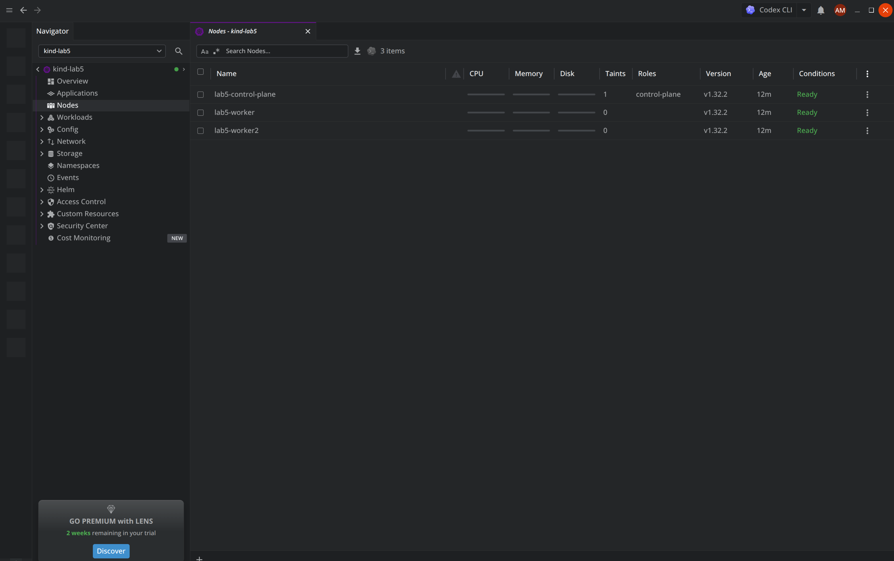</a>

</details>

## Часть 1 — Сеть пода

Развернули `shop` из лабы 3: три реплики API, две реплики worker и PostgreSQL под управлением CloudNativePG. После запуска все шесть подов были готовы, а API отвечал через NodePort на `127.0.0.1:28000`. Использовали образ приложения `registry.local/shop/app:1.0.0`, оператор CloudNativePG 1.25.1 и PostgreSQL 17.4. Код приложения и скрипт загрузки образов взяли из `lab3-control-plane`, копировать их в эту лабораторную не стали.

Сеть проверили скриптом:

```bash
bash lab5-networking/scripts/01-network-check.sh
```

В нашем запуске под API на `lab5-worker` имел IP `10.244.1.159`. Внутри его сетевого namespace интерфейс `eth0` имел `ifindex=18` и `iflink=19`. На ноде найден парный интерфейс `lxc6894d3ddab56@if18` с индексом 19. Так связаны два конца veth: один находится внутри пода, второй — в сетевом namespace ноды.

Из этого пода отправили запрос к `http://10.244.2.204:8000/health` — API на `lab5-worker2`. Получили `HTTP 200 ok`. Запрос шёл напрямую на IP пода, без Service и DNS; результат подтверждает межнодовую связность для проверенного направления. IP и имена интерфейсов относятся к этому запуску и могут измениться после пересоздания подов.

<a href="report/screenshots/02-shop-pods.png">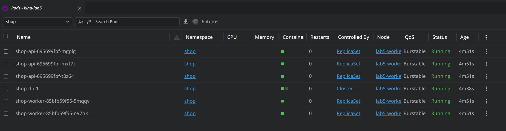</a>

<a href="report/screenshots/03-pod-network.png">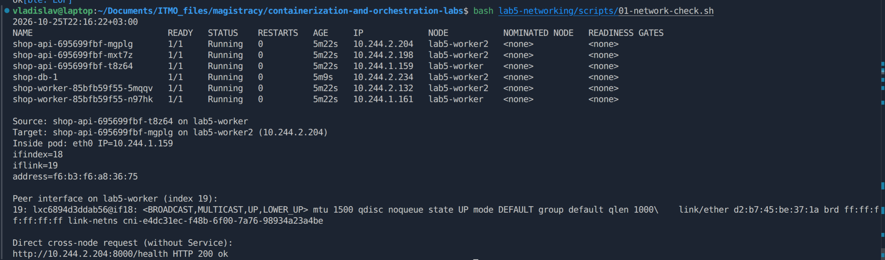</a>

## Часть 2 — Непрерывность при пересоздании подов

Для эксперимента запустили `python3 lab5-networking/scripts/02-chaos.py`. В течение трёх минут два клиента проверяют `/health`: один через DNS Service из отдельного пода, второй через NodePort с хоста. Каждые восемь секунд скрипт выбирает случайный готовый под API или worker и удаляет его обычным graceful deletion. Повторных попыток HTTP-запросов нет. Исходные запросы, события удаления и снимки подов сохраняются в отдельную папку `report/evidence/chaos-*` для каждого запуска.

Первый прогон `chaos-20261025-222114`: 21 удаление, 29 запросов через DNS и 875 через NodePort, ошибок нет. Однако каждый DNS-запрос занимал около 6 секунд, поэтому этот результат не трактуется как отсутствие деградации.

Диагностика разрешения имён показала:

| Имя | Время разрешения |
| --- | --- |
| `shop-api` | 0,069 с |
| `shop-api.shop.svc.cluster.local` | 6,007 с |
| `shop-api.shop.svc.cluster.local.` | 0,001 с |

В `/etc/resolv.conf` пода установлены `ndots:5` и поисковые суффиксы `shop.svc.cluster.local svc.cluster.local cluster.local dlink`. Имя без завершающей точки содержит четыре точки, поэтому сначала проверяется с поисковыми суффиксами. В клиенте заменили его на абсолютное DNS-имя с завершающей точкой. Это сохраняет обращение через DNS и Service, устраняя лишний поиск; конкретный медленный DNS-запрос среди поисковых вариантов отдельно не трассировался.

Для этого опыта политики ещё не включали, а Service работал с `externalTrafficPolicy: Cluster`. При повторении на финальном чарте нужно явно задать `--set networkPolicy.enabled=false --set api.externalTrafficPolicy=Cluster`; итоговая конфигурация доступа из частей 4–5 отличается от условий этого опыта.

### Результат повторного эксперимента

После исправления DNS-имени повторили эксперимент: `chaos-20261025-222658`: за 180 секунд клиент через DNS Service выполнил **870 запросов**, клиент через NodePort — **874**, в обоих потоках **0 ошибок**. Удалён 21 под API/worker. Это результат проверки `/health` при обычном удалении подов с graceful shutdown, а не гарантия отсутствия ошибок при аварийном отказе ноды или для всех бизнес-операций.

<a href="report/evidence/chaos-20261025-222658/continuity.svg">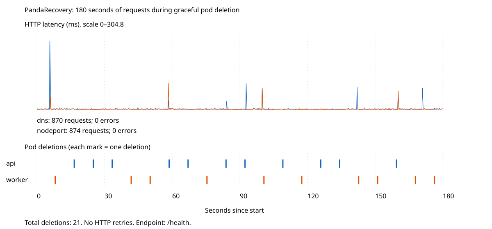</a>

<a href="report/screenshots/04-pod-chaos.png">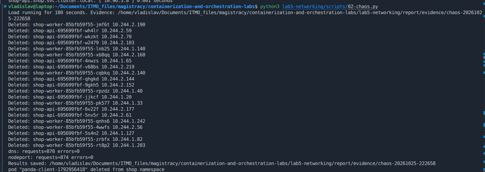</a>

### Почему Service пережил пересоздание подов

DNS возвращает стабильный ClusterIP обычного Service, а не фиксирует адрес конкретного пода. Контроллер обновляет EndpointSlice при изменении состава и готовности подов. Kube-proxy отслеживает Service и EndpointSlice и программирует перенаправление трафика к доступным endpoint на нодах. Он не является HTTP-прокси, через процесс которого проходит каждый запрос.

В сохранённом `kube-proxy.yaml` указан режим `iptables`. В этом режиме перенаправление реализуется правилами netfilter. IPVS использует подсистему балансировки ядра; разница становится существеннее при большом числе Service/endpoint и частых обновлениях. В данном небольшом стенде сравнение производительности режимов не проводилось.

Нулю ошибок способствовали несколько реплик, readiness-пробы, обычное удаление с graceful shutdown и `preStop` с паузой 5 секунд для обновления маршрутизации. Сам по себе Service не гарантирует сохранность уже установленных соединений при внезапной смерти пода.

NodePort открывает порт нод, который направляет трафик к Service; в kind порт 30080 одной worker-ноды опубликован на `127.0.0.1:28000` ноутбука. LoadBalancer запрашивает внешний балансировщик у доступной реализации инфраструктуры. Headless Service (`clusterIP: None`) не имеет виртуального ClusterIP: DNS может возвращать адреса его endpoint, а выбор адресата остаётся клиенту.

## Часть 3 — Целевая матрица доступа

В сюжете клиент — терминал оператора на мостике, API принимает задания спасательной операции, worker обрабатывает их, а PostgreSQL хранит журнал. Посторонний под изображает терминал камеры, которому доступ к журналу запрещён.

Целевая матрица соединений приложения:

| Источник | API, TCP 8000 | worker, TCP 8000 | PostgreSQL, TCP 5432 |
| --- | --- | --- | --- |
| Терминал оператора (`app=panda-client`) | Разрешено | Запрещено | Запрещено |
| API | Запрещено между разными подами | Запрещено | Разрешено |
| worker | Запрещено | Запрещено между разными подами | Разрешено |
| Посторонний под (`app=panda-camera`) | Запрещено | Запрещено | Запрещено |
| PostgreSQL | Запрещено | Запрещено | Репликация между подами своего DB-кластера разрешена |

Матрица описывает новые соединения между подами; ответный трафик разрешённых соединений не требует отдельного зеркального правила. Доступ процесса к самому себе не используется как проверка межподовой изоляции.

Служебные исключения также входят в модель доступа:

- DNS: UDP/TCP 53 к CoreDNS в `kube-system` для подов namespace `shop`.
- CloudNativePG: оператору необходим доступ к instance manager базы (TCP 8000); подам базы — к Kubernetes API. Адреса API и метки оператора проверили перед применением правил.
- Мониторинг: существующий Prometheus собирает метрики Hubble с нод на TCP 9965; это отдельный маршрут, не доступ к подам приложения.
- Внешний NodePort: в финальной конфигурации разрешили источник `172.18.0.1/32` к API на TCP 8000. Ниже разобрали, почему адрес зависит от маршрутизации и SNAT.

Остальной входящий и исходящий трафик namespace `shop` должен быть запрещён. Метки выступают селекторами политики; право назначать эти метки должно контролироваться отдельно через доступ к Kubernetes API.

## Часть 4 — Сетевые политики

Политики добавили в шаблон `charts/shop/templates/networkpolicy.yaml`, а метки, порты и адреса вынесли в `values.yaml`. Файл `experiments/zero-trust.yaml` включает ограничения. Сначала применили default-deny для входящих и исходящих соединений, затем разрешения для клиента, API, worker, PostgreSQL и DNS. После применения все поды оставались Ready, а CloudNativePG показывал `Cluster in healthy state`.

Позже обычное DNS-правило заменили CiliumNetworkPolicy для наблюдения DNS-запросов, а для внешнего клиента добавили `nodeport-entry`. В финальном варианте получились шесть NetworkPolicy и одна CiliumNetworkPolicy. Ответные пакеты разрешённых соединений отдельно не открывали.

~~~bash
helm upgrade shop lab5-networking/charts/shop \
  --kubeconfig "$HOME/.kube/lab5.yaml" \
  --kube-context kind-lab5 -n shop \
  --set monitoring.enabled=false \
  -f lab5-networking/experiments/zero-trust.yaml \
  --wait --timeout 3m
~~~

`monitoring.enabled=false` отключает унаследованные шаблоны метрик приложения. Сетевой мониторинг из части 7 применяли отдельно в существующий кластер Prometheus.

## Часть 5 — Проверка матрицы

Матрицу проверили скриптом `python3 lab5-networking/scripts/03-access-matrix.py`. Первый успешный прогон сохранили в `report/evidence/matrix-20261025-223429`, итоговый после настройки NodePort — в `report/evidence/matrix-20261025-231648`.

Все 12 проверенных направлений от клиента, постороннего пода, API и worker к API, worker и PostgreSQL совпали с ожиданиями. Проверки API → API и worker → worker выполнялись между разными подами. Разрешённые TCP-соединения устанавливались, запрещённые завершались таймаутом. Дополнительно терминал получил HTTP 200 через DNS Service, а API и worker выполнили `SELECT 1` в PostgreSQL.

| Источник | Получатель | Ожидали | Получили | Результат |
| --- | --- | --- | --- | --- |
| client | api | ALLOW | ALLOW | PASS |
| client | worker | DENY | DENY | PASS |
| client | postgres | DENY | DENY | PASS |
| camera | api | DENY | DENY | PASS |
| camera | worker | DENY | DENY | PASS |
| camera | postgres | DENY | DENY | PASS |
| api | api | DENY | DENY | PASS |
| api | worker | DENY | DENY | PASS |
| api | postgres | ALLOW | ALLOW | PASS |
| worker | api | DENY | DENY | PASS |
| worker | worker | DENY | DENY | PASS |
| worker | postgres | ALLOW | ALLOW | PASS |

<a href="report/screenshots/05-access-matrix.png">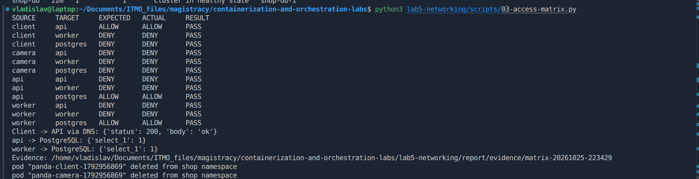</a>

Этот прогон не проверяет исходящие соединения от PostgreSQL и внешнего клиента NodePort. Они проверены отдельно ниже.

Из контейнера PostgreSQL отдельно попробовали открыть TCP-соединения через Python `socket.create_connection` с таймаутом 3 секунды:

| Источник | Назначение | Ожидание | Наблюдение |
| --- | --- | --- | --- |
| PostgreSQL | API `10.244.1.165:8000` | DENY | TIMEOUT |
| PostgreSQL | worker `10.244.1.173:8000` | DENY | TIMEOUT |

Использовались IP подов, поэтому разрешение DNS не влияло на результат. Таймауты соответствуют целевой матрице. В Hubble видны отброшенные потоки от БД к API и worker на TCP 8000. Для выбранного потока `shop-db-1 → shop-worker-85bfb59f55-hx9w7` детали подтверждают `dropped`, `Policy denied`, направление `egress`: соединение блокируется исходящей политикой БД. Межрепличная связь PostgreSQL не проверялась: экземпляр БД один.

<a href="report/screenshots/18-postgres-egress-denied.png">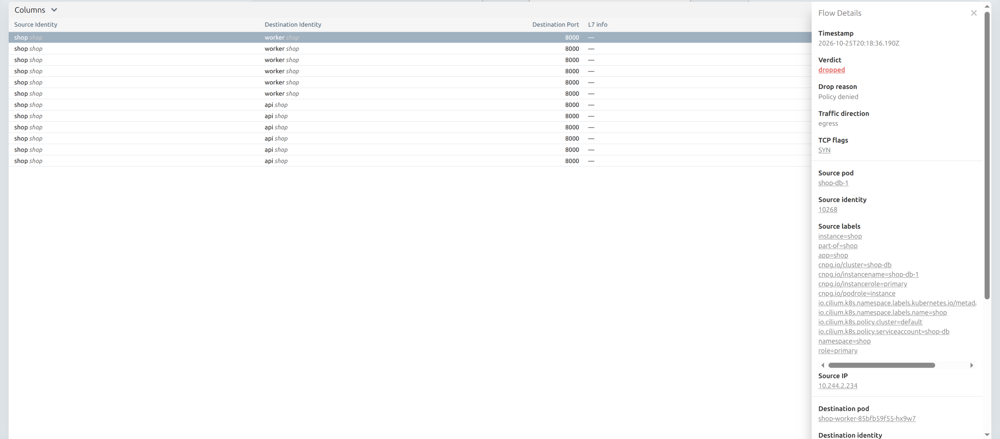</a>

В Hubble наблюдаются разрешённые потоки worker → PostgreSQL:5432 (`forwarded`) и запрещённые направления из тестовой матрицы (`dropped`), в том числе клиент → worker:8000. Интерфейс показывает подключение к трём нодам. В деталях отдельного потока `panda-client → shop-db-1:5432` показаны `Verdict: dropped`, `Drop reason: Policy denied` и `Traffic direction: egress`. Это подтверждает блокировку исходящего соединения сетевой политикой, соответствующую целевой матрице.

<details>
<summary>Карта трафика Hubble</summary>

<a href="report/screenshots/06-hubble-map.png"></a>

</details>

<details>
<summary>Запрещённые потоки Hubble</summary>

<a href="report/screenshots/07-hubble-dropped.png">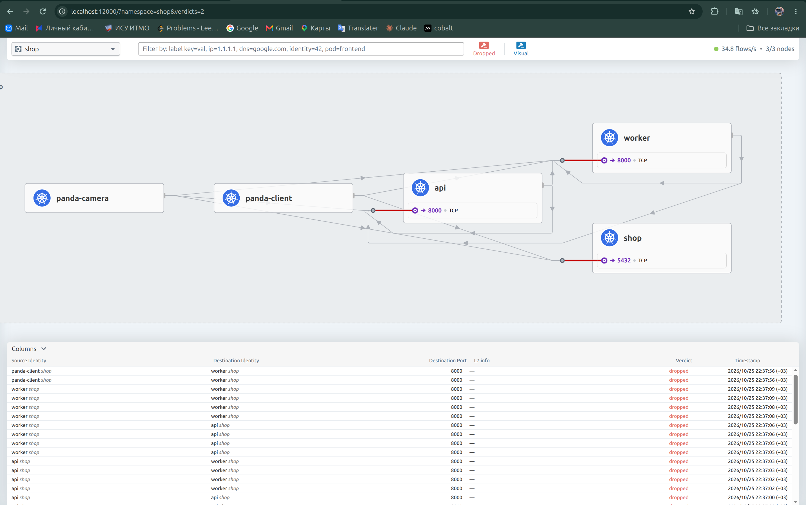</a>

</details>

<a href="report/screenshots/08-policy-denied.png"></a>

### Проверка внешнего NodePort после включения политик

Запрос с ноутбука к `127.0.0.1:28000/health` завершался таймаутом. В Hubble он наблюдался как `world → api:8000`, `Policy denied`, направление `ingress`, адрес источника `10.244.1.121`. Проверка `ip -4 addr show cilium_host` на `lab5-worker` подтвердила, что это адрес интерфейса Cilium ноды входа, а не пода приложения.

Сначала добавили разрешение `nodeport-entry` для `10.244.1.121/32` — оно не восстановило доступ. В ipcache этот адрес имел identity host на ноде входа и remote-node на соседних нодах.

После переключения Service API на `externalTrafficPolicy: Local` Hubble показал источник `172.18.0.1` (шлюз Docker-сети kind), локальный под API и ingress-блокировку `Policy denied`. В чарте закрепили режим Local и разрешение только `172.18.0.1/32` к API на TCP 8000. После применения Helm revision 8 внешний запрос к `127.0.0.1:28000/health` вернул `ok`, HTTP 200. Повторная проверка `matrix-20261025-231648` дала 12/12 PASS: разрешённые связи работают, запрещённые остаются заблокированными. Дополнительно подтверждены HTTP 200 через DNS из клиента и SQL `SELECT 1` из API и worker. Результаты сохранены в `report/evidence/matrix-20261025-231648/`.

Режим Local требует готового API-пода на `lab5-worker`, куда опубликован порт: без локального endpoint внешний доступ пропадёт. Поэтому результаты предыдущего chaos-теста с режимом Cluster нельзя автоматически переносить на эту конфигурацию. Адрес шлюза не идентифицирует конкретного пользователя; Docker публикует порт только на loopback ноутбука. После пересоздания сети адрес нужно проверить.

<a href="report/screenshots/17-nodeport-local-source.png">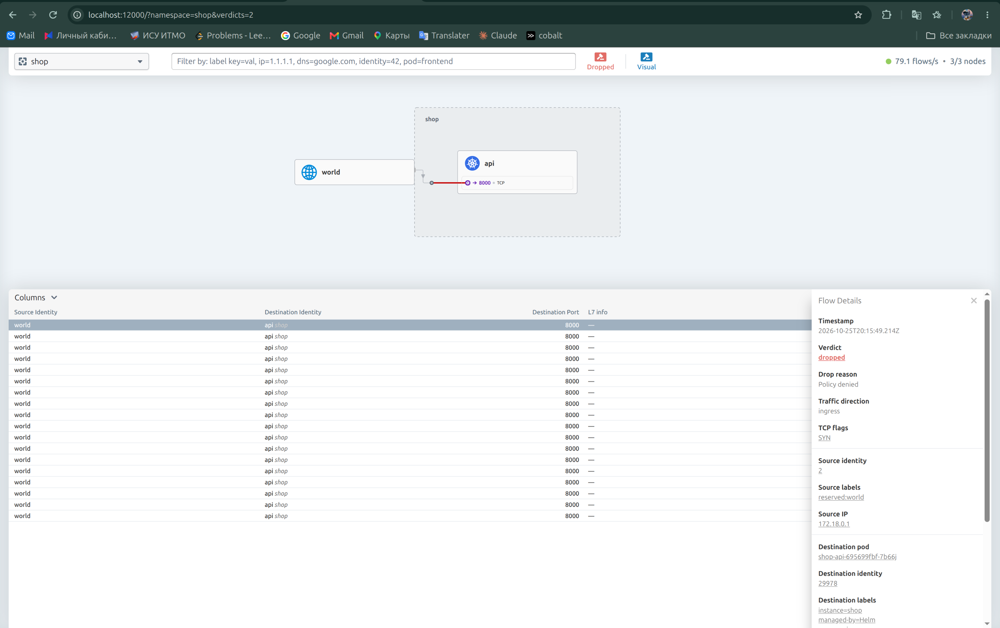</a>

<details>
<summary>Блокировка NodePort</summary>

<a href="report/screenshots/15-nodeport-blocked.png">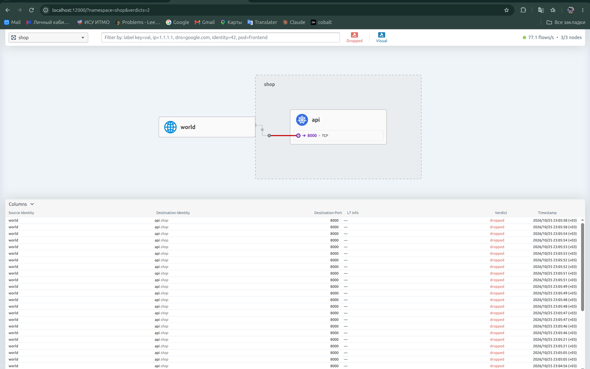</a>

</details>

<details>
<summary>Адрес источника NodePort и ingress-блокировка</summary>

<a href="report/screenshots/16-nodeport-source.png">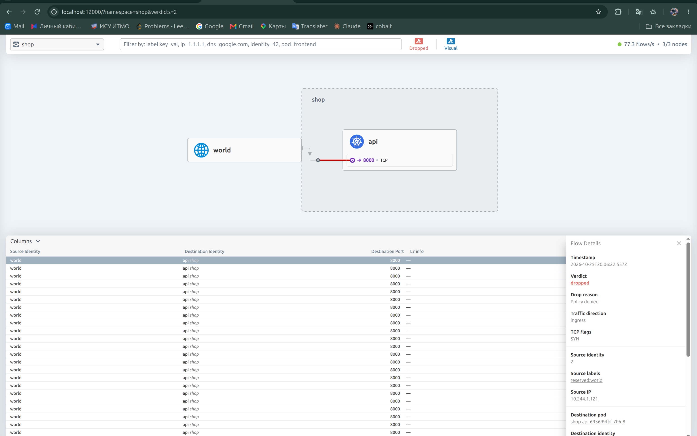</a>

</details>

## Часть 6 — Диагностика скрытой поломки

Скрипт `scripts/04-break-network.py` выбирает один из трёх вариантов: неверный порт исходящего разрешения клиента, неверная метка клиента во входящем разрешении API или исключение клиента из разрешения DNS. Изменения применяются через Helm values; исходные значения и внесённая поломка сохраняются в `report/evidence/fault-*`.

В эксперименте `fault-20261025-224119` запустили `scripts/05-fault-probe.sh` и увидели в Hubble потоки `panda-client-fault → api:8000` с `Policy denied`, направлением `egress` и флагом TCP SYN. Это локализовало отказ на исходящем разрешении клиента, до HTTP-обработки запроса API.

Затем посмотрели values внесённой поломки: в политике `client` разрешён TCP-порт **8001** вместо **8000**. Метки адресата соответствуют API, но порт запроса не совпадает с разрешённым; default-deny блокирует соединение. Исправление — восстановить разрешение TCP 8000 из исходных значений чарта.

<a href="report/screenshots/09-network-fault.png"></a>

Исходные правила восстановили через `helm upgrade --reset-values` с `experiments/zero-trust.yaml` и отключёнными шаблонами мониторинга приложения. После восстановления тестовый клиент успешно создал шесть заданий (HTTP 201). Повторный прогон `matrix-20261025-224334` показал PASS для всех 12 направлений; запрос через DNS вернул HTTP 200, API и worker выполнили `SELECT 1`. Ответы создания заданий содержат `status=pending`: этот снимок подтверждает их приём, но не завершение обработки worker.

<a href="report/screenshots/10-network-restored.png">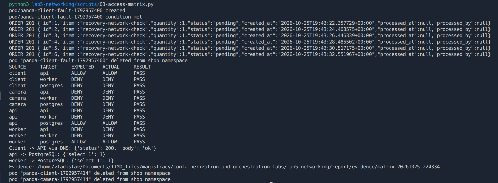</a>

## Часть 7 — Мониторинг

Для мониторинга использовали существующий kube-prometheus-stack в Minikube `panda-monitoring`; новый стек в `kind-lab5` не устанавливался. При запуске Minikube CRI-плагин containerd не загрузился из-за `failed to create fsnotify watcher: too many open files`. После временного увеличения на хосте `fs.inotify.max_user_instances` с 128 до 1024 и `fs.inotify.max_user_watches` с 65536 до 1048576, а также перезапуска containerd, CRI восстановился и поды мониторинга стали Ready. Эти изменения sysctl не сохраняются после перезагрузки хоста.

Контейнер Minikube дополнительно подключили к Docker-сети `kind`, что обеспечило доступ к адресам нод `172.18.0.2`, `172.18.0.3`, `172.18.0.4`. Cilium экспортирует метрики Hubble на TCP 9965. Шаблон `charts/shop/templates/external-hubble.yaml` создаёт Service без selector, Endpoints с адресами нод и ServiceMonitor в кластере мониторинга. Шаблон рендерится отдельно из чарта shop; весь чарт приложения в Minikube не устанавливается.

В Prometheus запрос `up{service="shop-lab5-hubble"}` вернул три серии со значением 1, метками `job="lab5-hubble"` и `cluster="kind-lab5"`. Таким образом проверен сбор метрик самим Prometheus со всех трёх нод.

<details>
<summary>Три доступные цели Hubble</summary>

<a href="report/screenshots/11-hubble-targets.png">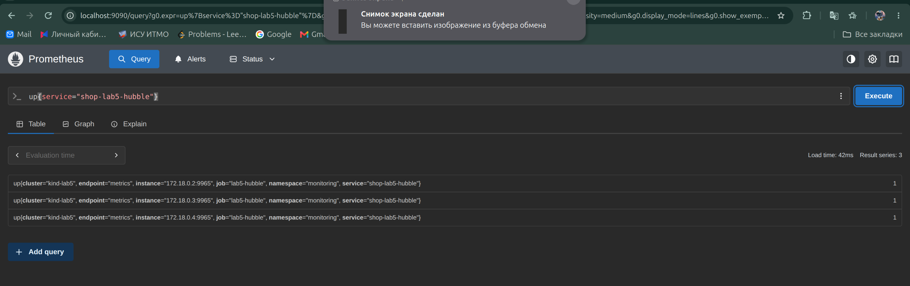</a>

</details>

Для DNS-наблюдаемости обычное разрешение DNS заменено шаблоном `dns-visibility.yaml` с CiliumNetworkPolicy: DNS TCP/UDP 53 разрешён только к CoreDNS в `kube-system`, правило `matchPattern: "*"` включает разбор DNS через прокси. Остальные сетевые разрешения остаются NetworkPolicy.

После применения в Prometheus появились `hubble_dns_queries_total`, `hubble_dns_responses_total` и `hubble_dns_response_types_total`. Это подтверждает поступление DNS-метрик; значения на скриншоте — количество временных рядов, а не число запросов.

<details>
<summary>DNS-метрики Hubble</summary>

<a href="report/screenshots/12-dns-metrics.png"></a>

</details>

Дашборд `PandaRecovery — сеть и политики` добавили через шаблон `network-dashboard.yaml`, JSON хранится в `dashboards/lab5-network.json`. Он показывает доступность трёх целей Hubble, наблюдаемые TCP SYN, блокировки политиками, TCP RST, DNS-ответы по кодам и ошибки DNS.

<a href="report/screenshots/13-network-dashboard.png">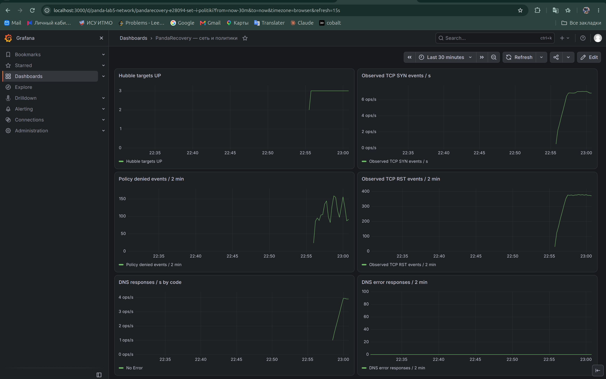</a>

Три алерта заданы в `templates/network-alerts.yaml` как PrometheusRule и применены в существующем кластере мониторинга:

| Алерт | Условие за 2 минуты, выдержка 30 секунд | Что обнаруживает и чем грозит |
| --- | --- | --- |
| `Lab5PolicyDenied` | Более 10 событий `POLICY_DENIED` из namespace shop | Повторные запрещённые обращения: возможны ошибочная политика или нежелательный источник трафика. Если заблокирована необходимая связь, задания не доходят до адресата. Требует проверки источника и назначения в Hubble. |
| `Lab5TcpResets` | Более 20 наблюдаемых TCP RST к namespace shop | Повышенное число сбросов соединений. Может сопровождать отказы и прерывание запросов, но RST возможны и при штатном поведении клиентов; сигнал нужно сопоставлять с HTTP-ошибками и задержкой. |
| `Lab5DnsErrors` | Более 5 DNS-ответов к shop с кодом, отличным от `No Error` | Ошибки разрешения имён, включая NXDOMAIN. Могут помешать поиску сервисов; ошибочные тестовые имена также способны вызвать сигнал. Полное отсутствие DNS-ответов это правило не обнаруживает. |

Пороги учебные, не откалиброваны под производственную нагрузку. Счётчики Hubble отражают наблюдаемые события, не уникальные соединения или пользовательские запросы. DNS-панель использует нулевое значение при отсутствии серий ошибок; её нужно читать вместе с доступностью целей и потоком DNS-ответов.

Чтобы проверить алерты, несколько раз запустили проверку матрицы. Она создаёт в том числе заведомо запрещённые обращения. На скриншоте `Lab5PolicyDenied` находится в Firing (около 244,6 событий за окно), `Lab5TcpResets` также в Firing (около 379,4), `Lab5DnsErrors` — Inactive. Дробные значения получаются из-за экстраполяции функции `increase`. Причина высокого фонового числа RST отдельно не установлена; это не доказательство неисправности API.

<a href="report/screenshots/14-network-alert.png"></a>

Все три правила загрузились, два перешли в Firing. Возврат в Inactive после прекращения тестового трафика отдельно не фиксировали.
