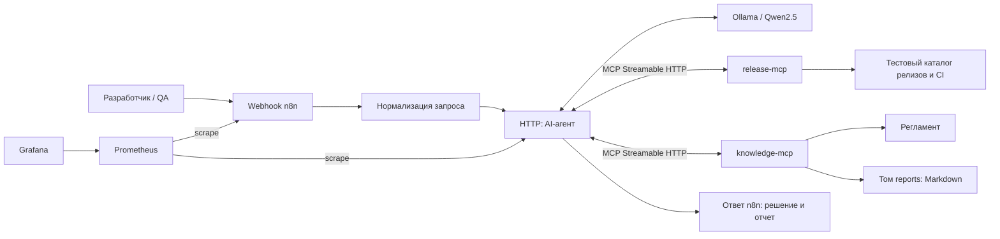
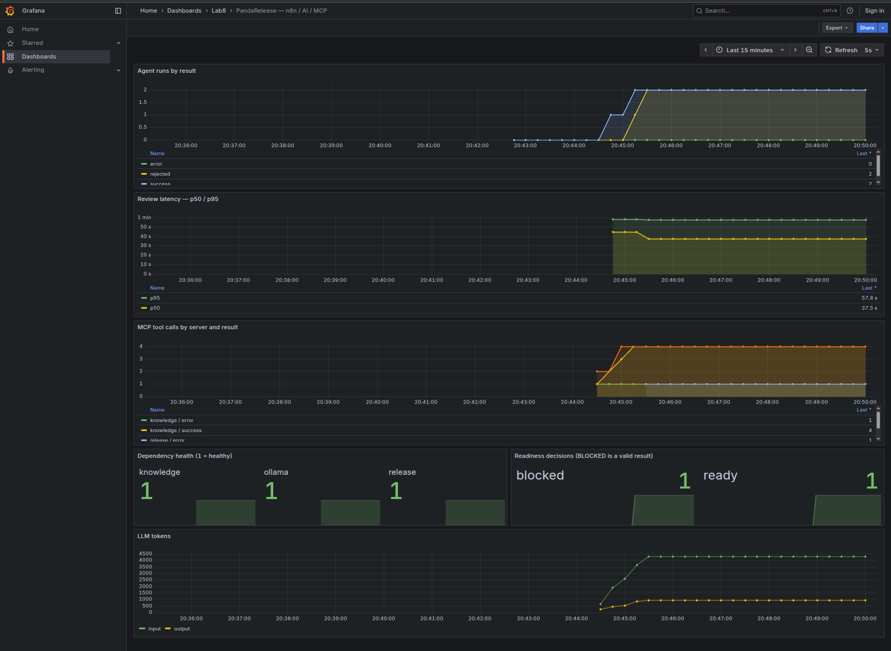
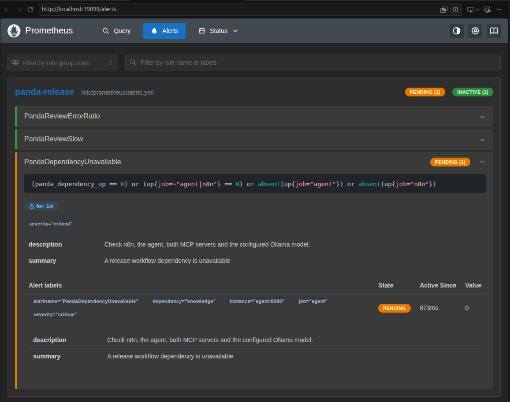
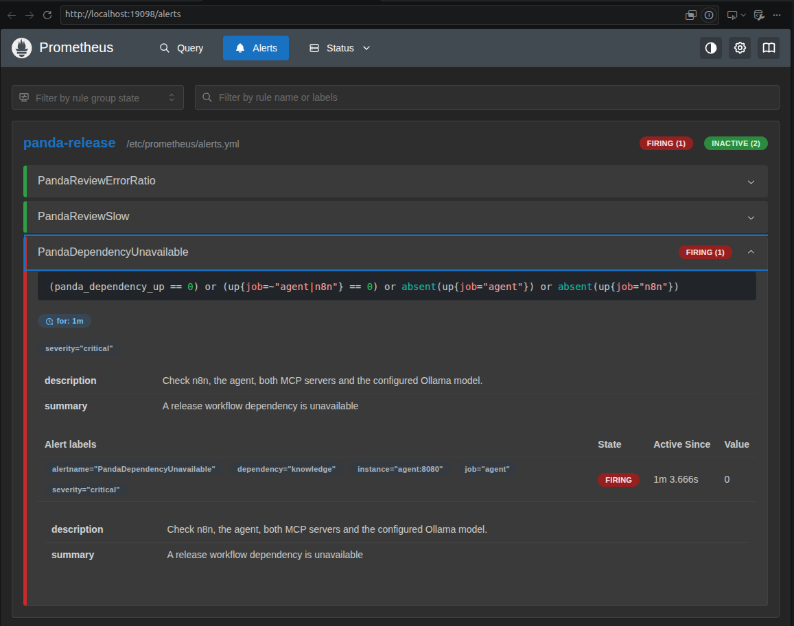
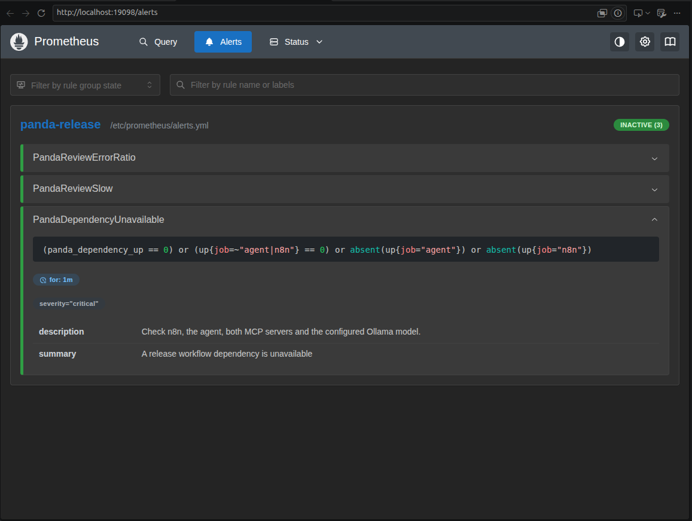
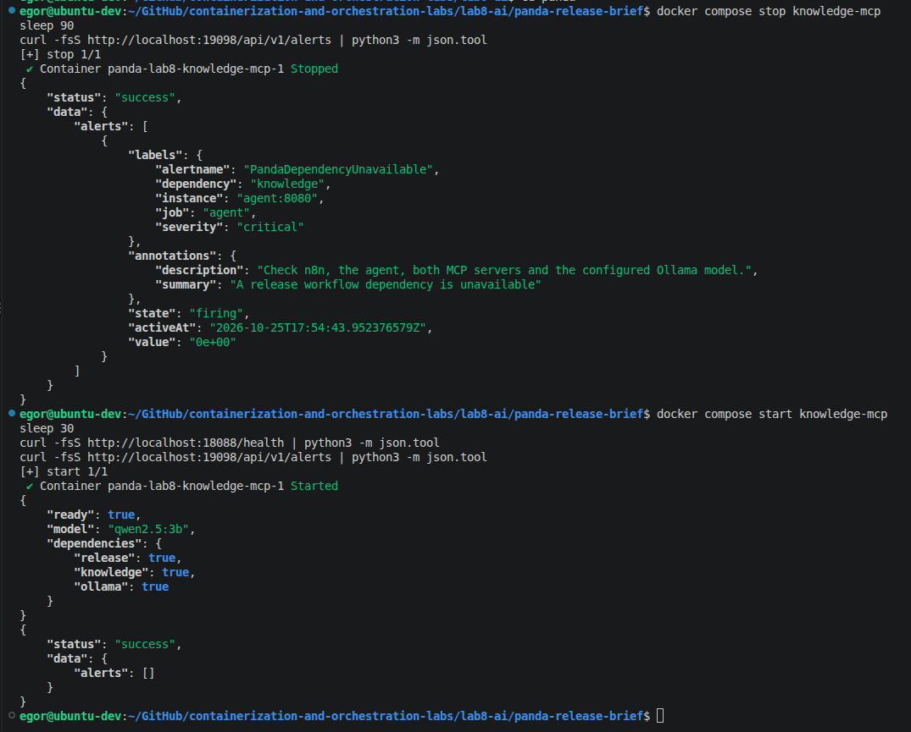

# Лаба 8 — Автоматизация devops-процесса с n8n + AI


## Часть 1 — Кейс

PandaRecovery - небольшой B2B SaaS для учета и обработки заданий восстановления. Приложение состоит из API, worker и PostgreSQL, как стенд из lab3. В компании 5-10 разработчиков, несколько QA и DevOps. 

Разработчики выпускают несколько релизов в неделю. Перед выпуском QA вручную собирает сведения из GitLab CI и документации: что изменилось, прошли ли тесты и сканирование образа, проверен ли staging, есть ли согласование и понятный откат. На все это уходит время, а также легко забыть что-то конкретное посмотреть, например совместимость миграции БД с предыдущей версией приложения.

Данная автоматизация поможет **разработчикам и QA** подготовить единое заключение перед релизом. Триггер - запрос с номером релиза в вебхук n8n. Агент получает изменения и результаты проверок через MCP, читает регламент, объясняет риски и сохраняет Markdown-отчет со статусом `READY` или `BLOCKED`. Результат возвращается в ответе вебхука.

Это подготовка к решению о выпуске: деплой и согласование остаются
за командой. Данные полностью учебные, внешние аккаунты и платные API не нужны.

---

## Часть 2 — Реализация

### Архитектура



n8n управляет процессом. Обычный Set-шаг нормализует номер релиза. AI-шаг - HTTP-вызов отдельного сервиса агента, внутри которого цикл: 

LLM --> tool_calls --> MCP tools/call --> результат --> LLM

Максимум 10 обращений к модели и 600 секунд на обработку. Это собственный агент, а не встроенная AI Agent-нода n8n. Такой вариант оставляет видимыми маршрутизацию MCP, проверки политики и метрики. После успешной записи отчета цикл завершается.

Все сведения о релизах, регламент и запись отчета проходят через два отдельных MCP-сервера на официальном Python SDK. Агент обнаруживает инструменты через tools/list, а не читает fixtures напрямую. В реальной компании за первым сервером был бы GitLab API, за вторым — база знаний и хранилище документов. В лабораторной вместо них небольшие локальные файлы.

### Toolkit и skill

У агента **4 инструмента**, схемы получает от MCP-серверов:

| MCP-сервер | Инструмент | Вход | Действие |
| --- | --- | --- | --- |
| `release-mcp` | `get_release` | `release_id: string` | Метаданные, изменения, риски и откат |
| `release-mcp` | `get_checks` | `release_id: string` | Pipeline, тесты, scan, staging и approval |
| `knowledge-mcp` | `read_runbook` | `service: string` | Регламент для `pandarecovery` |
| `knowledge-mcp` | `write_report` | `report_id: string`, `markdown: string` | Атомарная запись отчета в разрешенный каталог |

[Skill агента](skills/release-review.md) загружается в system prompt при каждом запуске. Он задает порядок сбора фактов, анализа и сохранения, запрещает выдумывать наблюдения и выполнять деплой. Модель выбирает вызовы инструментов, обрабатывает их результаты и пишет анализ.

Правила, которые нельзя доверять модели, проверяет хост агента:

- Получить все 3 вида доказательств до записи отчета
- Обращаться только к запрошенному релизу и сервису
- Заблокировать релиз при любой отсутствующей/неуспешной проверке или без отката
- Добавить проверенные значения и решение в начало отчета, а AI-текст пометить как рекомендацию
- Записывать только файл с выданным сервером UUID, без произвольного пути

Модель может ошибиться в пояснении, так что ее текст остается рекомендацией для инженера. Обязательный статус выводит обычный код, а не текст от модели.

---

## Часть 3 — Запуск

Для запуска нужны Docker Compose и Bash. На хосте также используется Python 3 скриптом `check.sh`. Я делал все на Linux amd64. 

Первый запуск скачивает образы и модель `qwen2.5:3b` (~1,9 GB). Модель работает на CPU и занимает примерно 6 GB RAM. Qwen2.5 3B выбрана из-за легкости и отсутствия thinking-режима (он съедает много токенов).


Для запуска нужно выполнить из корня репозитория:

```bash
bash lab8-ai/panda-release-brief/scripts/up.sh
```

Скрипт создаёт локальный `.env`, собирает Python-образ, импортирует и публикует workflow до старта n8n. Модель сохраняется в Docker volume и повторно не скачивается. При повторном запуске n8n кратковременно останавливается для импорта.

| Интерфейс | Адрес 
| --- | --- | 
| n8n | http://localhost:15678 | 
| Grafana | http://localhost:13008/d/panda-release |
| Prometheus | http://localhost:19098 | 
| Агент | http://localhost:18088/health | 

Порты можно поменять в `.env`. MCP и Ollama доступны только внутри Docker-сети. Пароль Grafana по умолчанию - `panda-lab8-local`. При первом заходе в n8n нужно создать учетную запись, которая сохранится в Docker volume `n8n`.

### Демонстрация

```bash
curl --fail-with-body --max-time 660 \
  -H 'Content-Type: application/json' \
  -d '{"release_id":"1.1.0"}' \
  http://localhost:15678/webhook/panda-release-brief
```

Для `1.1.0` ожидается `ready`: все проверки пройдены, откат описан.

Для `1.2.0` ожидается `blocked`: CI, сканирование и staging упали, согласование ожидается, плана отката нет. Изменение схемы удаляет столбец, нужный предыдущей версии. **BLOCKED — успешный результат анализа**, HTTP 200.

Оба сценария с копированием полученных файлов в `outputs/`:

```bash
bash lab8-ai/panda-release-brief/scripts/demo.sh
```

JSON-ответ содержит `decision`, `report_id`, полный `markdown`, трассировку `tool_trace`, число обращений к модели и длительность. Оригинал отчёта хранится в томе `reports`, а `outputs/` - копия на хосте. Каждый запуск получает новый UUID. 

Неверный формат номера возвращает 422, неизвестный релиз - 404, одновременный второй запрос - 429. Ошибка инфраструктуры/модели - 502.

Результаты локального прогона на CPU с Qwen2.5 3B:

| Релиз | Решение | Обращений к LLM | Время |
| --- | --- | --- | --- |
| `1.1.0` | READY | 2 | 47,736 с |
| `1.2.0` | BLOCKED | 2 | 31,574 с |

---

## Часть 4 — Мониторинг 

Агент сам экспортирует Prometheus-метрики через `prometheus-client` на `/metrics`: отдельный экспортер не нужен. В n8n включён собственный `/metrics`. 

Prometheus собирает данные раз в 5 секунд. Grafana получает datasource и дашборд автоматически из файлов provisioning.

Три основных графика на дашборде:

| Название | Показывает| О чем говорит 
| --- | --- | --- |
| Agent runs by result | Счётчики успешных, ошибочных и отклонённых запросов | Выполняет ли автоматизация полезную работу и как реагирует на ошибки |
| Review latency - p50 / p95 | Длительность обработки через histogram, окно 15 минут. Включает LLM и MCP | Позволяет заметить замедление модели |
| MCP tool calls by server and result | Число вызовов 2 серверов, отдельно успехи и ошибки | Подтверждает, что агент получает факты и сохраняет отчёт |

Дополнительно есть здоровье зависимостей, решения по релизам и токены LLM. Счётчики на графиках накопительные с момента запуска агента. После рестарта они сбрасываются. Алерты используют `increase`/`rate`, учитывающие сбросы.



Также были выбраны и реализованы [3 правила](monitoring/alerts.yml) для алертов:

| Метрика / сигнал | Условие | Почему нужен алерт |
| --- | --- | --- |
| `panda_workflow_runs_total` | Доля `error` больше 20% за 15 минут, держится 2 минуты | Пользователи перестают получать заключения. Нужно проверить модель, MCP и ошибки агента. `rejected` и решение `blocked` не считаются сбоем выполнения |
| `panda_workflow_duration_seconds_bucket` | p95 больше 180 секунд, держится 5 минут | Проверка релиза задерживает команду. Вероятны нехватка CPU, медленная модель или повторы инструментов. Порог надо откалибровать под доступное железо |
| `panda_dependency_up` и Prometheus `up` | MCP/модель недоступны либо n8n/агент не собираются, дольше минуты | При отказе зависимости весь процесс бесполезен. `up` также ловит падение самого агента, который уже не может обновить собственный health gauge |

В Prometheus можно увидеть pending/firing. Уведомлений во внешние каналы нет.

Для проверки я остановил работу `knowledge-mcp`. В начале у алерта появился статус `pending`:



Потом он стал `firing`:



После включения `knowledge-mcp` и примерно 15-30 секунд алерт погас:




Я делал это через консоль и дополнительно вызывал ручку алертов:



---

## Файлы для сдачи

| Требование | Артефакт |
| --- | --- |
| Кейс, запуск, выбор метрик | Этот README |
| Экспорт n8n workflow | [workflows/release-brief.json](workflows/release-brief.json) |
| AI skills | [skills/release-review.md](skills/release-review.md) |
| Два MCP-сервера и агент | [src/](src/) |
| Локальный запуск | [compose.yaml](compose.yaml) |
| Дашборд и алерты | [monitoring/](monitoring/) |
| Результаты реального запуска | [report/evidence/](report/evidence/) |
